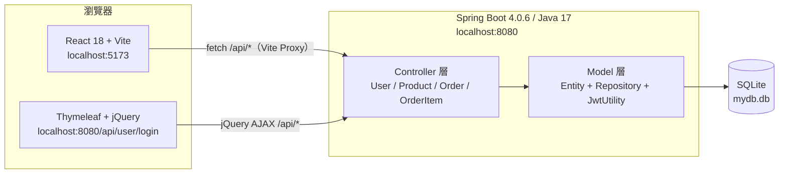

# 簡易購物車全端專案教學文件

> 本文件依 `shoppingusercart`（Spring Boot 後端）與 `usercart_react`（React 前端）兩個資料夾的**實際程式碼**整理而成。
> 目標是讓讀者從「看懂現有專案」進一步做到「能自己重建一個相似的購物車系統」。

---

## 1. 專案在做什麼？

這是一個教學用的迷你購物車系統，包含以下功能：

| 功能 | 說明 | 實作位置 |
|------|------|----------|
| 帳號登入 | 使用記憶體中的測試帳號登入，成功後取得 JWT | `UserController`、`JwtUtility` |
| 產品列表 | 從 SQLite 讀取 20 筆產品並顯示卡片 | `ProductController`、`Products.jsx` |
| 購物車 | 前端記憶體保存選購商品、計算總金額 | `AppRouter.jsx`、`Cart.jsx` |
| 送出訂單 | 將購物車內容寫入 `orders` 與 `orderitems` | `OrderController`、`apiService.js` |
| 訂單查詢 | 依使用者查詢訂單，再查看單筆明細 | `OrderController`、`Orders.jsx` |
| 舊版 UI | Thymeleaf 頁面 + jQuery AJAX 的替代前端 | `templates/usercart.html`、`static/js/jqusercart.js` |

測試帳號（密碼全部是 `1234`）：

```text
admin / 1234
guest / 1234
mary  / 1234
george/ 1234
john  / 1234
```

> ⚠️ 這是**教學示範**：密碼以明碼存在記憶體、JWT 密鑰寫死在程式碼、部分查詢沒有驗證身分。正式專案不可直接沿用，文末與各文件都會標出改善方向。

---

## 2. 系統架構



### 分層責任

```text
Controller  ── 接收 HTTP 請求、組裝回應、處理 CORS
    │
Repository  ── 繼承 JpaRepository，負責資料庫存取
    │
Entity      ── 以 JPA 註解描述資料表與關聯
    │
SQLite      ── 實際資料（mydb.db 檔案）
```

這個小專案**沒有 Service 層**，Controller 直接呼叫 Repository。對照大型專案，通常會再抽出一層 `Service` 來放交易與商業邏輯；後端文件中會說明為什麼、以及如何補上。

---

## 3. 技術棧

### 後端 `shoppingusercart`

| 項目 | 版本 / 技術 | 用途 |
|------|-------------|------|
| Java | 17（`pom.xml` 設定） | 語言執行環境 |
| Spring Boot | 4.0.6 | 應用程式框架 |
| Maven | 3.x | 建置與依賴管理 |
| Spring Web | Starter | REST Controller |
| Spring Data JPA | Starter | Repository / Entity |
| Hibernate Community Dialects | 內建版本 | SQLite 方言 |
| SQLite JDBC | 3.53.2.0 | SQLite 驅動 |
| Thymeleaf | Starter | 舊版 HTML 頁面 |
| Lombok | 內建版本 | `@Data` 減少 getter/setter |
| JJWT | 0.9.1 | 產生與解析 JWT |
| JAXB API | 2.3.1 | 解決 Java 17 缺少 `javax.xml.bind` |
| Actuator | Starter | `/actuator/health` 健康檢查 |
| DevTools | Starter | 開發時自動重啟 |

### 前端 `usercart_react`

| 項目 | 版本 / 技術 | 用途 |
|------|-------------|------|
| React | 18.2 | UI 元件 |
| Vite | 7.3 | 開發伺服器與打包 |
| React Router DOM | 7.x | 前端路由 |
| Bootstrap | 5.3 | 版面與樣式 |
| Fetch API | 瀏覽器原生 | 呼叫後端 API |

---

## 4. 目錄結構

```text
usercart_demo/
├─ shoppingusercart/                     # 後端
│  ├─ pom.xml
│  ├─ mydb.db                            # SQLite 資料庫（已含資料）
│  └─ src/main/
│     ├─ java/demo/usercart/
│     │  ├─ Sbusercart0413Application.java
│     │  ├─ controller/
│     │  │  ├─ UserController.java
│     │  │  ├─ ProductController.java
│     │  │  ├─ OrderController.java
│     │  │  └─ OrderItemController.java
│     │  └─ model/
│     │     ├─ Product.java
│     │     ├─ Order.java
│     │     ├─ OrderItem.java
│     │     ├─ ProductRepository.java
│     │     ├─ OrderRepository.java
│     │     ├─ ItemRepository.java
│     │     └─ JwtUtility.java
│     └─ resources/
│        ├─ application.properties
│        ├─ templates/usercart.html       # 舊版 Thymeleaf 頁面
│        └─ static/js/jqusercart.js       # 舊版 jQuery 前端
│
├─ usercart_react/                        # 前端
│  └─ usercart-react/
│     ├─ package.json
│     ├─ vite.config.js
│     ├─ index.html
│     └─ src/
│        ├─ main.jsx                      # 進入點（使用 AppRouter）
│        ├─ AppRouter.jsx                 # React Router 版根元件（啟用中）
│        ├─ App.jsx                       # useState 切頁版根元件（未啟用）
│        ├─ api/apiService.js             # API 封裝
│        └─ components/
│           ├─ NavbarRouter.jsx
│           ├─ Navbar.jsx
│           ├─ Login.jsx
│           ├─ Products.jsx
│           ├─ Cart.jsx
│           └─ Orders.jsx
│
└─ docs/                                  # 本教學文件
   ├─ README.md
   ├─ backend-guide.md
   ├─ frontend-guide.md
   └─ database/init-sqlite.sql
```

---

## 5. 快速開始

### 步驟 1：確認環境

| 工具 | 建議版本 | 檢查指令 |
|------|----------|----------|
| JDK | 17 以上 | `java -version` |
| Maven | 3.9 以上 | `mvn -v` |
| Node.js | 20.19+ / 22.12+ | `node -v` |
| npm | 10 以上 | `npm -v` |
| SQLite 工具 | 任意（可選） | `sqlite3 --version` |

> 本專案沒有附 Maven Wrapper（`mvnw`）。若電腦沒有 Maven，請先安裝，或直接用 IDE 的「Run Java Application」啟動主類別。

### 步驟 2：準備資料庫

**方式 A：使用現成的 `mydb.db`**

`shoppingusercart/mydb.db` 已經包含 20 筆產品、2 筆訂單與 5 筆明細，可直接使用。

**方式 B：從腳本重建**

```bash
# 在 shoppingusercart 資料夾內執行
sqlite3 mydb.db ".read ../docs/database/init-sqlite.sql"
```

或使用 DB Browser for SQLite：

1. 開啟 `shoppingusercart/mydb.db`
2. 點「Execute SQL」
3. 開啟 `docs/database/init-sqlite.sql`
4. 按「Execute all」

> ⚠️ 腳本開頭會 `DROP TABLE`，會清空既有資料。執行前請先備份 `mydb.db`。

### 步驟 3：啟動後端

```bash
cd shoppingusercart
mvn spring-boot:run
```

看到類似以下訊息即成功：

```text
Tomcat started on port 8080 (http)
Started Sbusercart0413Application in ... seconds
```

健康檢查：

```bash
curl http://localhost:8080/actuator/health
# {"status":"UP"}
```

> ⚠️ `spring.datasource.url=jdbc:sqlite:mydb.db` 是**相對路徑**。請在 `shoppingusercart` 資料夾內啟動，否則會在其他工作目錄建立新的空 `mydb.db`，導致 `ddl-auto=validate` 失敗。

### 步驟 4：啟動前端

```bash
cd usercart_react/usercart-react
npm install
npm run dev
```

瀏覽器開啟 Vite 顯示的網址（預設 `http://localhost:5173`）。

> 前端透過 Vite Proxy 將 `/api` 轉到 `http://localhost:8080`，所以**先啟動後端**，再啟動前端。

### 步驟 5：實際操作一次

1. 進入「帳戶登入」，輸入 `admin` / `1234`
2. 切到「產品列表」，選擇數量後加入購物車
3. 切到「購物車」，確認總金額後送出訂單
4. 切到「訂單」，按「顯示訂購商品」查看明細

---

## 6. API 一覽表

| 方法 | 路徑 | 功能 | 需要 Token | 成功狀態 |
|------|------|------|------------|----------|
| GET | `/api/user/login` | 回傳舊版 Thymeleaf 登入頁 | 否 | 200 |
| POST | `/api/user/login` | 登入並取得 JWT | 否 | 200 |
| GET | `/api/products` | 取得全部產品 | 否 | 200 |
| POST | `/api/orders` | 新增訂單 | 是（`Authorization`） | 200 |
| GET | `/api/orders/{username}` | 查詢某使用者的訂單 | 否（現況） | 200 |
| GET | `/api/orders` | 查詢全部訂單 | 否 | 200 |
| GET | `/api/orders/orderid/{orderid}` | 查詢單筆訂單 | 否 | 200 |
| GET | `/api/items/{orderid}` | 查詢某訂單的明細 | 否 | 200 |

完整請求／回應範例請看 **[後端教學文件](backend-guide.md#12-api-規格總表)**。

---

## 7. 文件導覽

| 文件 | 內容 | 適合誰 |
|------|------|--------|
| **[後端教學文件](backend-guide.md)** | 從 pom.xml、設定檔、Entity、Repository、JWT、Controller 到 API 驗證與練習題 | 想學 Spring Boot + JPA + SQLite 的人 |
| **[前端教學文件](frontend-guide.md)** | 從 Vite 建立、API 封裝、React Router、五個元件到建置部署與練習題 | 想學 React Hooks + Router + Fetch 的人 |
| **[資料庫初始化腳本](database/init-sqlite.sql)** | 建表、索引、20 筆產品、20 筆評分、2 筆示範訂單 | 想重建資料庫的人 |

建議閱讀順序：

```text
README（本檔）
   ↓
後端教學文件（先懂 API 與資料模型）
   ↓
前端教學文件（再看畫面如何呼叫 API）
   ↓
資料庫腳本（需要重建資料時查閱）
```

---

## 8. 建議學習路徑

### 初階：先讓它跑起來（約 1 小時）

1. 用現成 `mydb.db` 啟動後端
2. 用 curl 呼叫 `/api/products` 與 `/api/user/login`
3. 啟動 React 前端，完成一次登入與下單
4. 打開瀏覽器 DevTools → Network，觀察每個請求

### 中階：逐層讀懂程式（約 3～5 小時）

1. 讀後端文件第 5～9 章：資料表 → Entity → Repository → Controller
2. 讀前端文件第 6～8 章：API 層 → 路由 → 元件
3. 對照 `OrderController` 與 `apiService.js`，確認欄位名稱一一對應
4. 完成兩份文件各自的 ★ 與 ★★ 練習題

### 進階：改造成更正式的專案（約 1～2 天）

1. 後端補上 Service 層、DTO、`@RestControllerAdvice`、Spring Security
2. 前端補上登入狀態保存、路由守衛、loading/error 狀態、Context
3. 把 SQLite 換成 PostgreSQL/MySQL（`application.properties` 已有註解範例）
4. 加入整合測試與 Docker

---

## 9. 常見問題

### Q1：後端啟動失敗，說某個資料表不存在？

`spring.jpa.properties.hibernate.hbm2ddl.auto=validate` 只會**驗證**，不會建表。請確認：

- 啟動目錄正確（`mydb.db` 在同一個工作目錄）
- 已執行 `docs/database/init-sqlite.sql`
- `mydb.db` 不是 0 bytes 的空檔

### Q2：前端畫面空白，API 回 404？

- 後端是否在 8080 執行？
- 是否使用 `npm run dev`（才有 Vite Proxy）？
- `vite.config.js` 的 proxy target 是否為 `http://localhost:8080`？

### Q3：登入成功，但重新整理後又變「未登入」？

這是目前程式的**已知限制**：`isLoggedIn` 只存在 React state，重新整理就消失。Token 仍在 `localStorage`，但沒有被用來還原登入狀態。修改方式見前端文件練習題。

### Q4：`mvn` 找不到？

本專案沒有 `mvnw`。請安裝 Maven，或在 Eclipse / IntelliJ 直接執行 `Sbusercart0413Application`。

### Q5：產品圖片破圖？

產品圖片是外部網址（`https://fakestoreapi.com/img/...`），需要網路連線。圖片與後端 API 無關。

### Q6：JWT 相關的 `javax.xml.bind.DatatypeConverter` 錯誤？

JJWT 0.9.1 在 Java 11+ 會用到已移除的 JAXB。`pom.xml` 已加入 `javax.xml.bind:jaxb-api:2.3.1` 解決。若仍發生，請確認依賴有被 Maven 下載。

### Q7：SQLite 出現 `database is locked`？

SQLite 同時只允許一個寫入者。請關閉 DB Browser 正在執行的交易，或確認沒有其他後端實例佔用同一個 `mydb.db`。

---

## 10. 已知限制與可改進方向

以下問題在教學文件中都會出現，刻意保留是為了讓你練習「辨識問題 → 動手修正」。

| 類別 | 現況 | 建議 |
|------|------|------|
| 認證 | 只有 POST 訂單會讀 JWT，其他 API 不驗證 | 加 Spring Security + JWT Filter |
| 密碼 | 明碼存在記憶體 | BCrypt 雜湊 + 資料庫使用者表 |
| 授權 | 任何人可查任何人的訂單 | 從 Token 取使用者，忽略路徑上的 username |
| 金額 | 前端計算 `totalPrice`，後端照單全收 | 後端依產品單價重算，使用 `BigDecimal` |
| 資料傳輸 | Entity 直接當 API 回應，含雙向關聯 | 使用 DTO，避免循環與過度暴露 |
| 錯誤處理 | 例外直接 500，查無資料回 `null` | `@RestControllerAdvice` + 404/401 |
| 交易 | Controller 直接呼叫 Repository | 抽出 Service 並加 `@Transactional` |
| 前端狀態 | 重新整理即登出 | 從 `localStorage` 還原並驗證 Token |
| 前端體驗 | 無 loading / error / 空資料狀態 | 加入 `loading`、`error` state |
| 測試 | 只有 `contextLoads` | 加 MockMvc / Repository / 前端測試 |

---

## 11. 版本與檔案對照

| 內容 | 檔案 |
|------|------|
| 後端依賴 | `shoppingusercart/pom.xml` |
| 後端設定 | `shoppingusercart/src/main/resources/application.properties` |
| 後端程式 | `shoppingusercart/src/main/java/demo/usercart/**` |
| 資料庫 | `shoppingusercart/mydb.db` |
| 資料庫重建 | `docs/database/init-sqlite.sql` |
| 前端設定 | `usercart_react/usercart-react/vite.config.js` |
| 前端程式 | `usercart_react/usercart-react/src/**` |

---

> 準備好了嗎？從 **[後端教學文件](backend-guide.md)** 開始，一步一步把這個專案拆解開來。
