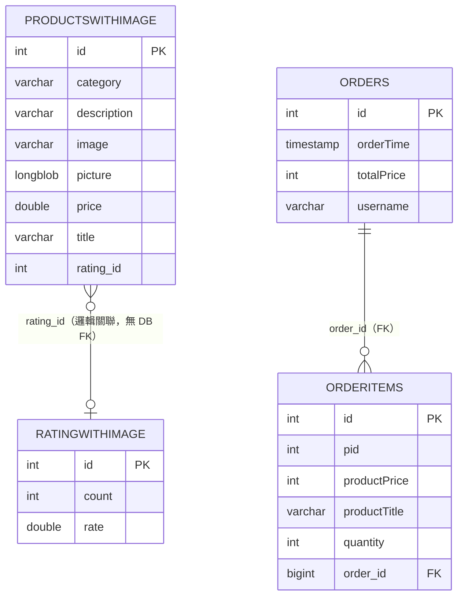
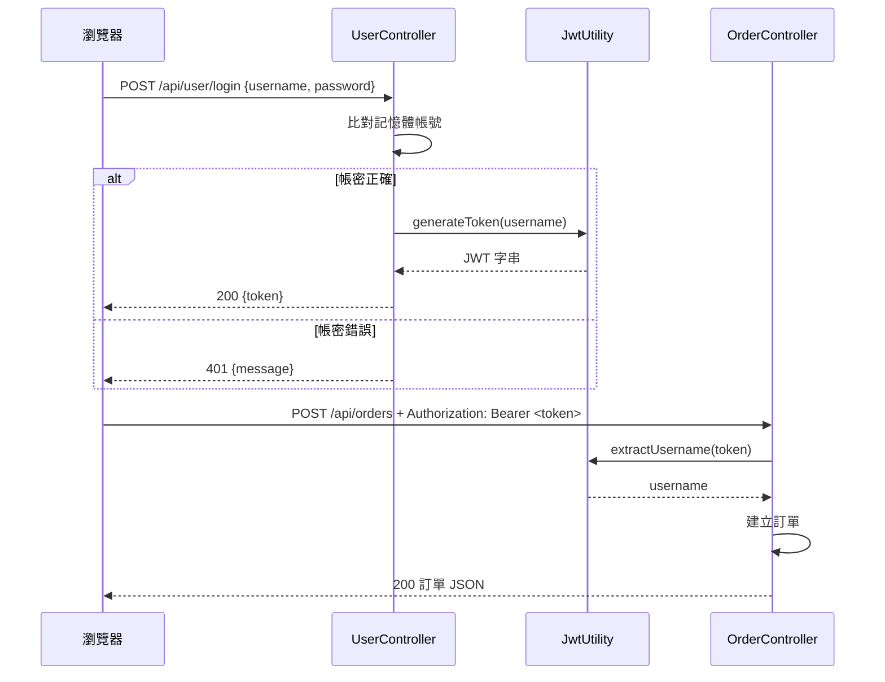

# 後端教學文件：Spring Boot + JPA + SQLite 購物車 API

> 對應專案：`shoppingusercart`
> 技術版本：Spring Boot 4.0.6 / Java 17 / Maven / SQLite
> 閱讀前提：會 Java 基本語法、知道什麼是 HTTP 與 JSON。

---

## 目錄

1. [專案簡介與技術棧](#1-專案簡介與技術棧)
2. [環境準備](#2-環境準備)
3. [建立專案骨架](#3-建立專案骨架)
4. [設定檔](#4-設定檔)
5. [資料庫設計](#5-資料庫設計)
6. [Entity 實體設計](#6-entity-實體設計)
7. [Repository 層](#7-repository-層)
8. [JWT 與登入](#8-jwt-與登入)
9. [Controller 與 API](#9-controller-與-api)
10. [JSON 序列化與循環參照](#10-json-序列化與循環參照)
11. [例外處理：現況與改善](#11-例外處理現況與改善)
12. [API 規格總表](#12-api-規格總表)
13. [舊版 Thymeleaf + jQuery UI](#13-舊版-thymeleaf--jquery-ui)
14. [執行與驗證](#14-執行與驗證)
15. [測試](#15-測試)
16. [練習題](#16-練習題)
17. [附錄：常見錯誤](#17-附錄常見錯誤)

---

## 1. 專案簡介與技術棧

### 1.1 這個後端提供什麼

`shoppingusercart` 是一個**沒有 Service 層**的迷你 REST API，Controller 直接操作 Spring Data JPA Repository。它支援：

- 以記憶體帳號登入，回傳 JWT
- 查詢產品清單
- 新增訂單（主檔 + 明細）
- 依使用者查詢訂單
- 查詢全部訂單、單筆訂單、單筆訂單的明細
- 額外提供一個 Thymeleaf + jQuery 的舊版頁面

### 1.2 技術棧與選擇理由

| 技術 | 版本 | 在本專案的角色 | 為什麼選它 |
|------|------|----------------|------------|
| Spring Boot | 4.0.6 | 自動設定、啟動 Web 容器 | 省去大量 XML 與 Servlet 設定 |
| Spring Web | Starter | `@RestController`、JSON 序列化 | 建立 REST API 的標準選擇 |
| Spring Data JPA | Starter | Repository、Entity 映射 | 幾乎不用寫 SQL 就能 CRUD |
| Hibernate | 內建 | JPA 實作 | Spring Data JPA 的預設 Provider |
| Hibernate Community Dialects | 內建 | SQLite 方言 | 官方 Hibernate 沒有內建 SQLite 方言 |
| SQLite JDBC | 3.53.2.0 | 連線 `mydb.db` | 免安裝資料庫伺服器，適合教學 |
| Thymeleaf | Starter | 回傳 `usercart.html` | 舊版 UI 使用伺服器端模板 |
| Lombok | 內建 | `@Data` 產生 getter/setter | 減少樣板程式碼 |
| JJWT | 0.9.1 | 產生／解析 JWT | 舊版 API 簡單易懂 |
| JAXB API | 2.3.1 | 補回 Java 17 移除的 `javax.xml.bind` | JJWT 0.9.1 的相容性需求 |
| Actuator | Starter | `/actuator/health` | 快速確認應用是否活著 |
| DevTools | Starter | 開發時自動重啟 | 提升開發體驗 |

> ⚠️ **版本提醒**：JJWT 0.9.1 是相當舊的版本，API 與 0.11+ 完全不同。本文件會使用專案現有的 0.9.1 寫法；若你新開專案，建議改用最新版 JJWT 或 Spring Security 的 JWT 支援。

### 1.3 套件結構

```text
demo.usercart
├─ Sbusercart0413Application.java   # 主啟動類
├─ controller
│  ├─ UserController.java           # 登入、JWT
│  ├─ ProductController.java        # 產品查詢
│  ├─ OrderController.java          # 訂單 CRUD（部分）
│  └─ OrderItemController.java      # 訂單明細查詢
└─ model
   ├─ Product.java                  # Entity
   ├─ Order.java                    # Entity
   ├─ OrderItem.java                # Entity
   ├─ ProductRepository.java
   ├─ OrderRepository.java
   ├─ ItemRepository.java
   └─ JwtUtility.java               # JWT 工具
```

這個結構把 Entity 與 Repository 都放在 `model` 套件。較大型的專案通常會拆成：

```text
controller / service / repository / entity / dto / exception / config
```

本文件會在對應章節說明「為什麼要拆」以及「怎麼拆」。

---

## 2. 環境準備

### 2.1 必要工具

| 工具 | 建議版本 | 用途 |
|------|----------|------|
| JDK | 17 以上 | 執行 Spring Boot |
| Maven | 3.9 以上 | 下載依賴、建置、啟動 |
| IDE | IntelliJ IDEA / Eclipse / VS Code | 編輯與除錯 |
| SQLite 工具 | DB Browser for SQLite（可選） | 查看 `mydb.db` |
| curl / Postman | 任意 | 測試 API |

檢查指令：

```bash
java -version
mvn -v
```

> 本專案的 `pom.xml` 設定 `<java.version>17</java.version>`。即使電腦裝的是 JDK 21，也能編譯與執行（向後相容），但建議至少 17。

### 2.2 不需要安裝資料庫伺服器

本專案使用 SQLite，資料庫就是一個檔案：

```text
shoppingusercart/mydb.db
```

這是它適合教學的最大原因：不用安裝 MySQL、不用開帳號、不用建資料庫。缺點是併發寫入能力較弱，正式環境通常會換成 PostgreSQL 或 MySQL。

### 2.3 先確認資料庫檔案存在

```text
shoppingusercart/
├─ mydb.db          ← 必須存在，且包含資料表
├─ pom.xml
└─ src/
```

如果 `mydb.db` 不存在或內容是空的，應用啟動時會因為 `ddl-auto=validate` 而失敗。重建方式見 [第 5 章](#5-資料庫設計)。

---

## 3. 建立專案骨架

### 3.1 用 Spring Initializr 建立（從零開始時）

到 [https://start.spring.io](https://start.spring.io) 選擇：

| 欄位 | 值 |
|------|-----|
| Project | Maven |
| Language | Java |
| Spring Boot | 4.0.x（或你安裝的穩定版） |
| Group | `demo.usercart` |
| Artifact | `shoppingusercart` |
| Packaging | Jar |
| Java | 17 |

Dependencies 勾選：

- Spring Web
- Spring Data JPA
- Thymeleaf
- Actuator
- DevTools
- Lombok

下載解壓後，再手動補上 SQLite、JJWT、JAXB 等依賴。

### 3.2 完整 `pom.xml`

```xml
<?xml version="1.0" encoding="UTF-8"?>
<project xmlns="http://maven.apache.org/POM/4.0.0"
         xmlns:xsi="http://www.w3.org/2001/XMLSchema-instance"
         xsi:schemaLocation="http://maven.apache.org/POM/4.0.0 https://maven.apache.org/xsd/maven-4.0.0.xsd">
    <modelVersion>4.0.0</modelVersion>

    <parent>
        <groupId>org.springframework.boot</groupId>
        <artifactId>spring-boot-starter-parent</artifactId>
        <version>4.0.6</version>
        <relativePath/>
    </parent>

    <groupId>demo.usercart</groupId>
    <artifactId>shoppingusercart</artifactId>
    <version>0.0.1-SNAPSHOT</version>
    <name>shoppingusercart</name>
    <description>Demo project for Spring Boot</description>

    <properties>
        <java.version>17</java.version>
    </properties>

    <dependencies>
        <!-- JJWT 0.9.1 在 Java 17 需要 JAXB API -->
        <dependency>
            <groupId>javax.xml.bind</groupId>
            <artifactId>jaxb-api</artifactId>
            <version>2.3.1</version>
        </dependency>

        <!-- JWT 產生與解析 -->
        <dependency>
            <groupId>io.jsonwebtoken</groupId>
            <artifactId>jjwt</artifactId>
            <version>0.9.1</version>
        </dependency>

        <!-- 健康檢查 /actuator/health -->
        <dependency>
            <groupId>org.springframework.boot</groupId>
            <artifactId>spring-boot-starter-actuator</artifactId>
        </dependency>

        <!-- JPA + Hibernate -->
        <dependency>
            <groupId>org.springframework.boot</groupId>
            <artifactId>spring-boot-starter-data-jpa</artifactId>
        </dependency>

        <!-- SQLite 方言 -->
        <dependency>
            <groupId>org.hibernate.orm</groupId>
            <artifactId>hibernate-community-dialects</artifactId>
        </dependency>

        <!-- 舊版 Thymeleaf 頁面 -->
        <dependency>
            <groupId>org.springframework.boot</groupId>
            <artifactId>spring-boot-starter-thymeleaf</artifactId>
        </dependency>

        <!-- REST API -->
        <dependency>
            <groupId>org.springframework.boot</groupId>
            <artifactId>spring-boot-starter-web</artifactId>
        </dependency>

        <!-- SQLite JDBC 驅動 -->
        <dependency>
            <groupId>org.xerial</groupId>
            <artifactId>sqlite-jdbc</artifactId>
            <version>3.53.2.0</version>
            <scope>compile</scope>
        </dependency>

        <!-- 選用：未來切換 PostgreSQL -->
        <dependency>
            <groupId>org.postgresql</groupId>
            <artifactId>postgresql</artifactId>
            <scope>runtime</scope>
        </dependency>

        <!-- 選用：未來切換 MySQL -->
        <dependency>
            <groupId>com.mysql</groupId>
            <artifactId>mysql-connector-j</artifactId>
            <scope>runtime</scope>
        </dependency>

        <!-- Lombok -->
        <dependency>
            <groupId>org.projectlombok</groupId>
            <artifactId>lombok</artifactId>
            <optional>true</optional>
        </dependency>

        <!-- 測試 -->
        <dependency>
            <groupId>org.springframework.boot</groupId>
            <artifactId>spring-boot-starter-test</artifactId>
            <scope>test</scope>
        </dependency>

        <dependency>
            <groupId>org.springframework.boot</groupId>
            <artifactId>spring-boot-starter</artifactId>
        </dependency>

        <!-- 開發時自動重啟 -->
        <dependency>
            <groupId>org.springframework.boot</groupId>
            <artifactId>spring-boot-devtools</artifactId>
            <scope>runtime</scope>
            <optional>true</optional>
        </dependency>
    </dependencies>

    <build>
        <plugins>
            <plugin>
                <groupId>org.apache.maven.plugins</groupId>
                <artifactId>maven-compiler-plugin</artifactId>
                <configuration>
                    <annotationProcessorPaths>
                        <path>
                            <groupId>org.projectlombok</groupId>
                            <artifactId>lombok</artifactId>
                        </path>
                    </annotationProcessorPaths>
                </configuration>
            </plugin>
            <plugin>
                <groupId>org.springframework.boot</groupId>
                <artifactId>spring-boot-maven-plugin</artifactId>
                <configuration>
                    <excludes>
                        <exclude>
                            <groupId>org.projectlombok</groupId>
                            <artifactId>lombok</artifactId>
                        </exclude>
                    </excludes>
                </configuration>
            </plugin>
        </plugins>
    </build>
</project>
```

### 3.3 每個依賴在做什麼

| 依賴 | 說明 | 拿掉會怎樣 |
|------|------|------------|
| `spring-boot-starter-web` | 內嵌 Tomcat、Spring MVC、Jackson | 無法提供 REST API |
| `spring-boot-starter-data-jpa` | Spring Data JPA + Hibernate | `JpaRepository` 無法使用 |
| `hibernate-community-dialects` | `SQLiteDialect` | 啟動時找不到 SQLite 方言 |
| `sqlite-jdbc` | SQLite 驅動 | `jdbc:sqlite:` 無法連線 |
| `spring-boot-starter-thymeleaf` | 模板引擎 | `ModelAndView("usercart")` 找不到頁面 |
| `jjwt` + `jaxb-api` | JWT | 登入無法產生 token |
| `actuator` | 健康檢查端點 | `/actuator/health` 404 |
| `lombok` | `@Data` 編譯期產生程式碼 | Entity 缺少 getter/setter |
| `postgresql` / `mysql-connector-j` | 未來切換資料庫 | 目前不影響，因為沒啟用 |
| `devtools` | 類別變更後自動重啟 | 不影響功能 |

> ⚠️ `spring-boot-starter` 與 `spring-boot-starter-web` 有重疊，`starter-web` 已包含核心 starter。專案同時保留兩者不會出錯，但實務上可只留 `starter-web`。

### 3.4 主啟動類

`src/main/java/demo/usercart/Sbusercart0413Application.java`

```java
package demo.usercart;

import org.springframework.boot.SpringApplication;
import org.springframework.boot.autoconfigure.SpringBootApplication;

@SpringBootApplication
public class Sbusercart0413Application {

    public static void main(String[] args) {
        SpringApplication.run(Sbusercart0413Application.class, args);
    }
}
```

`@SpringBootApplication` 是三個註解的組合：

| 註解 | 作用 |
|------|------|
| `@SpringBootConfiguration` | 宣告這是設定類別 |
| `@EnableAutoConfiguration` | 依 classpath 自動設定（看到 JPA 就設定 DataSource） |
| `@ComponentScan` | 掃描同套件與子套件的 `@Component`、`@RestController`、`@Repository` |

因為主類別在 `demo.usercart`，所以 `demo.usercart.controller`、`demo.usercart.model` 都會被掃描到。

### 3.5 建立目錄

```text
src/main/java/demo/usercart/
├─ controller/
└─ model/

src/main/resources/
├─ application.properties
├─ templates/
│  └─ usercart.html
└─ static/js/
   └─ jqusercart.js
```

---

## 4. 設定檔

`src/main/resources/application.properties` 完整內容：

```properties
spring.application.name=shoppingusercart

# create-drop , update , validate

#spring.jpa.database-platform=org.hibernate.dialect.MySQLDialect
#spring.datasource.url=jdbc:mysql://localhost:3306/mydb
#spring.datasource.username=root
#spring.datasource.password=1234
#spring.datasource.driver-class-name=com.mysql.cj.jdbc.Driver

spring.jpa.properties.hibernate.hbm2ddl.auto=validate
spring.datasource.driver-class-name=org.sqlite.JDBC
spring.datasource.url=jdbc:sqlite:mydb.db
spring.jpa.database-platform=org.hibernate.community.dialect.SQLiteDialect
#spring.jpa.properties.hibernate.dialect=org.hibernate.community.dialect.SQLiteDialect

spring.jpa.defer-datasource-initialization=true
#spring.jpa.database-platform=org.hibernate.dialect.SQLiteDialect
#spring.jpa.properties.hibernate.dialect=org.hibernate.dialect.SQLiteDialect

spring.jpa.show-sql=true
spring.jpa.properties.hibernate.format_sql=true
# spring.servlet.multipart.max-file-size=10MB
# spring.servlet.multipart.max-request-size=10MB
# spring.datasource.hikari.connection-init-sql=SET GLOBAL max_allowed_packet=10240000
spring.sql.init.encoding=UTF-8
spring.jpa.hibernate.naming.physical-strategy=org.hibernate.boot.model.naming.PhysicalNamingStrategyStandardImpl
logging.level.org.hibernate.orm.results=trace
```

### 4.1 逐項說明

| 屬性 | 意義 | 本專案的值 |
|------|------|------------|
| `spring.application.name` | 應用名稱，出現在 log 與 Actuator | `shoppingusercart` |
| `spring.jpa.properties.hibernate.hbm2ddl.auto` | Hibernate 的 schema 策略 | `validate`：只驗證，不建表 |
| `spring.datasource.driver-class-name` | JDBC 驅動類別 | `org.sqlite.JDBC` |
| `spring.datasource.url` | 連線字串 | `jdbc:sqlite:mydb.db`（相對路徑） |
| `spring.jpa.database-platform` | Hibernate 方言 | `SQLiteDialect` |
| `spring.jpa.defer-datasource-initialization` | 延後 `data.sql` 執行 | `true`，讓 Hibernate 先初始化 |
| `spring.jpa.show-sql` | 印出 SQL | `true` |
| `spring.jpa.properties.hibernate.format_sql` | SQL 排版 | `true` |
| `spring.sql.init.encoding` | SQL 初始化檔編碼 | `UTF-8` |
| `spring.jpa.hibernate.naming.physical-strategy` | 實體欄位 → 資料表欄位命名策略 | `PhysicalNamingStrategyStandardImpl`（保留原樣） |
| `logging.level.org.hibernate.orm.results=trace` | 印出查詢結果 | 除錯用，正式環境可關 |

### 4.2 為什麼是 `validate`？

`hbm2ddl.auto` 常見值：

| 值 | 行為 | 適用情境 |
|----|------|----------|
| `create` | 每次啟動先刪表再建表 | 本機快速重置 |
| `create-drop` | 啟動建表、關閉刪表 | 單元測試 |
| `update` | 自動補欄位／表 | 開發初期 |
| `validate` | 只檢查實體與資料表是否一致 | **本專案**，避免誤改資料 |
| `none` | 不做任何事 | 正式環境搭配 migration 工具 |

本專案使用 `validate`，所以**資料表必須先存在**。這是一個很好的教學設計：它強迫你理解「資料庫 schema 與 Entity 必須對應」。

> ⚠️ 若把 `validate` 改成 `update`，Hibernate 會嘗試自動建表，但 SQLite 的型別與 Hibernate 預期可能仍有落差。教學上建議先用 `init-sqlite.sql` 建好表，再維持 `validate`。

### 4.3 命名策略：為什麼欄位是 `orderTime` 而不是 `order_time`？

Spring Boot 預設會把 Java 的 camelCase 轉成 snake_case（例如 `orderTime` → `order_time`）。本專案設定：

```properties
spring.jpa.hibernate.naming.physical-strategy=org.hibernate.boot.model.naming.PhysicalNamingStrategyStandardImpl
```

這個策略**保留 Java 欄位名稱原樣**，所以：

| Java 欄位 | 資料表欄位 |
|-----------|------------|
| `orderTime` | `orderTime` |
| `totalPrice` | `totalPrice` |
| `productTitle` | `productTitle` |
| `order_id`（`@JoinColumn` 明寫） | `order_id` |

如果拿掉這行，Hibernate 會去找 `order_time`、`total_price`，然後因為 `validate` 失敗。這是初學者最常踩的坑之一。

### 4.4 SQLite 路徑的陷阱

```properties
spring.datasource.url=jdbc:sqlite:mydb.db
```

這是**相對於 JVM 工作目錄**的路徑，不是相對於 `pom.xml`。

| 啟動方式 | 工作目錄 | 實際使用的檔案 |
|----------|----------|----------------|
| `cd shoppingusercart && mvn spring-boot:run` | `shoppingusercart/` | `shoppingusercart/mydb.db` ✅ |
| 在專案根目錄執行 `mvn -f shoppingusercart/pom.xml spring-boot:run` | 專案根目錄 | `usercart_demo/mydb.db` ❌ |
| IDE 直接 Run 主類別 | 通常是模組根目錄 | 需確認 Run Configuration 的 Working directory |

若不小心在錯誤位置建立空 DB，會看到 `no such table: productswithimage`。刪除錯誤的 `mydb.db`，回到正確目錄啟動即可。

### 4.5 選用：切換到 MySQL / PostgreSQL

`application.properties` 已保留 MySQL 的註解範例：

```properties
#spring.jpa.database-platform=org.hibernate.dialect.MySQLDialect
#spring.datasource.url=jdbc:mysql://localhost:3306/mydb
#spring.datasource.username=root
#spring.datasource.password=1234
#spring.datasource.driver-class-name=com.mysql.cj.jdbc.Driver
```

切換步驟：

1. 建立 MySQL 資料庫 `mydb`
2. 把 SQLite 的 `init-sqlite.sql` 改寫成 MySQL 語法（`AUTOINCREMENT` → `AUTO_INCREMENT`、`longblob` → `LONGBLOB` 等）
3. 註解 SQLite 設定、取消 MySQL 設定
4. 將 `hbm2ddl.auto` 暫時改為 `update` 或 `create` 以建立 schema
5. 確認無誤後改回 `validate`

> PostgreSQL 的依賴也已包含，設定方式類似，只需改成 `org.postgresql.Driver` 與 `jdbc:postgresql://...`。

---

## 5. 資料庫設計

### 5.1 ER 圖



### 5.2 四張表

#### `productswithimage`（產品）

| 欄位 | 型別 | 說明 |
|------|------|------|
| `id` | `int` | 產品編號（Entity 沒有 `@GeneratedValue`，由資料庫提供） |
| `category` | `varchar(255)` | 分類 |
| `description` | `varchar(2048)` | 描述 |
| `image` | `varchar(255)` | 圖片網址（Fake Store API） |
| `picture` | `longblob` | 舊版圖片二進位資料，**Entity 未映射** |
| `price` | `double` | 價格 |
| `title` | `varchar(255)` | 名稱 |
| `rating_id` | `int` | 對應 `ratingwithimage.id` |

#### `ratingwithimage`（評分）

| 欄位 | 型別 | 說明 |
|------|------|------|
| `id` | `int` | 評分編號 |
| `count` | `int` | 評分人數 |
| `rate` | `double` | 平均星等 |

> 目前沒有 `Rating` Entity，也沒有 Repository。前端只會拿到 `Product.rating_id`，不會拿到星等。若要做「顯示星等」，需要新增 Entity 與關聯查詢。

#### `orders`（訂單主檔）

| 欄位 | 型別 | 說明 |
|------|------|------|
| `id` | `INTEGER PRIMARY KEY AUTOINCREMENT` | 訂單編號 |
| `orderTime` | `TIMESTAMP(26)` | 下單時間（SQLite 實際存 epoch 毫秒整數） |
| `totalPrice` | `INT` | 總金額（整數） |
| `username` | `varchar(255)` | 下單者 |

#### `orderitems`（訂單明細）

| 欄位 | 型別 | 說明 |
|------|------|------|
| `id` | `INTEGER PRIMARY KEY AUTOINCREMENT` | 明細編號 |
| `pid` | `INT` | 產品編號（**沒有 DB FK**，只是數字） |
| `productPrice` | `INT` | 下單當下的產品價格（整數） |
| `productTitle` | `varchar(255)` | 下單當下的產品名稱（快照） |
| `quantity` | `INT` | 數量 |
| `order_id` | `bigint` | 所屬訂單（邏輯上對應 `orders.id`，原始資料庫未宣告 FK） |

> **為什麼明細要存 `productTitle` 與 `productPrice`？**
> 這是「交易快照」的概念。產品日後可能改名或改價，但歷史訂單應該保留當時的資訊。這是購物車系統很重要的設計。

### 5.3 關聯設計的重點

1. **Order ↔ OrderItem 是雙向一對多**
   - `Order.items`：`@OneToMany(mappedBy = "order", cascade = CascadeType.ALL)`
   - `OrderItem.order`：`@ManyToOne` + `@JoinColumn(name = "order_id")`
   - `mappedBy` 表示「關聯由 OrderItem.order 維護」，Order 這端不擁有外鍵。

2. **Product 與 Rating 只有邏輯關聯**
   - `Product.rating_id` 只是一個整數欄位，沒有 `@ManyToOne`。
   - 好處是簡單；缺點是無法用 JPA 直接 `product.getRating().getRate()`。

3. **Product 與 OrderItem 沒有 JPA 關聯**
   - `OrderItem.pid` 只是數字，沒有 `@ManyToOne Product`。
   - 好處是訂單不依賴產品是否還存在；缺點是無法直接 join 查產品。

### 5.4 種子資料

`mydb.db` 內含：

| 資料表 | 筆數 |
|--------|------|
| `productswithimage` | 20 |
| `ratingwithimage` | 20 |
| `orders` | 2（皆為 `admin`） |
| `orderitems` | 5 |

產品資料來自 [Fake Store API](https://fakestoreapi.com/)，圖片也是外部網址。

### 5.5 重建資料庫

完整腳本在 [`docs/database/init-sqlite.sql`](database/init-sqlite.sql)。核心 DDL：

```sql
PRAGMA foreign_keys = ON;

DROP TABLE IF EXISTS orderitems;
DROP TABLE IF EXISTS orders;
DROP TABLE IF EXISTS ratingwithimage;
DROP TABLE IF EXISTS productswithimage;

CREATE TABLE productswithimage (
    id          int NOT NULL PRIMARY KEY,
    category    varchar(255),
    description varchar(2048),
    image       varchar(255),
    picture     longblob,
    price       double NOT NULL,
    title       varchar(255),
    rating_id   int
);

CREATE TABLE ratingwithimage (
    id    int NOT NULL PRIMARY KEY,
    count int NOT NULL,
    rate  double NOT NULL
);

CREATE TABLE orders (
    id         INTEGER PRIMARY KEY AUTOINCREMENT,
    orderTime  TIMESTAMP(26),
    totalPrice INT NOT NULL,
    username   varchar(255)
);

CREATE TABLE orderitems (
    id           INTEGER PRIMARY KEY AUTOINCREMENT,
    pid          INT NOT NULL,
    productPrice INT NOT NULL,
    productTitle varchar(255),
    quantity     INT NOT NULL,
    order_id     bigint,
    FOREIGN KEY (order_id) REFERENCES orders(id) ON DELETE CASCADE
);

CREATE INDEX idx_orders_username ON orders(username);
CREATE INDEX idx_orderitems_order_id ON orderitems(order_id);
CREATE INDEX idx_products_rating_id ON productswithimage(rating_id);
```

執行方式：

```bash
cd shoppingusercart
sqlite3 mydb.db ".read ../docs/database/init-sqlite.sql"
```

> ⚠️ 腳本會先刪表。若 `mydb.db` 有你要保留的資料，請先備份。
>
> ⚠️ 原始 `mydb.db` 的 `productswithimage` 與 `ratingwithimage` 沒有宣告主鍵；本教學腳本補上了 `PRIMARY KEY` 與索引，屬於較好的實作。Hibernate 的 `validate` 不會因為多了主鍵或索引而失敗。

### 5.6 用 SQL 驗證資料

```sql
-- 產品數量
SELECT COUNT(*) FROM productswithimage;

-- 訂單與明細
SELECT * FROM orders;
SELECT * FROM orderitems;

-- 訂單總金額與明細加總是否一致
SELECT o.id,
       o.totalPrice,
       SUM(i.productPrice * i.quantity) AS itemsTotal
FROM orders o
JOIN orderitems i ON i.order_id = o.id
GROUP BY o.id, o.totalPrice;
```

---

## 6. Entity 實體設計

### 6.1 `Product`

```java
package demo.usercart.model;

import jakarta.persistence.*;
import lombok.Data;
import lombok.NoArgsConstructor;

@Data
@NoArgsConstructor
@Entity
@Table(name = "productswithimage")
public class Product {

    @Id
    Integer id;

    @Column(length = 255)
    String title;

    @Column(length = 2048)
    String description;

    @Column(length = 255)
    String category;

    double price;

    @Column(length = 255)
    String image;

    int rating_id;

    // getters 和 setters 由 Lombok @Data 產生
}
```

#### 重點說明

| 註解 / 寫法 | 意義 |
|-------------|------|
| `@Entity` | 告訴 JPA 這是一個實體，對應一張表 |
| `@Table(name = "productswithimage")` | 明確指定資料表名稱（類別名 `Product` 預設會找 `product`） |
| `@Id` | 主鍵 |
| 沒有 `@GeneratedValue` | 新增產品時必須自己給 `id`；本專案只讀不寫，所以沒問題 |
| `@Column(length = 2048)` | 對應 `varchar(2048)`，`validate` 會檢查 |
| `rating_id` | 欄位名不是 camelCase，如實對應資料庫 |
| `picture` 未映射 | 資料表有這個 `longblob`，但 Entity 故意不宣告，避免每次查詢都把大圖拉進來 |

> 💡 **`@Data` 是什麼？**
> Lombok 會在編譯期產生 getter、setter、`toString()`、`equals()`、`hashCode()`、required-args constructor。`@NoArgsConstructor` 另外產生無參數建構子，JPA 需要它。
>
> ⚠️ 在**雙向關聯**的 Entity 上使用 `@Data` 要小心：`toString()`、`equals()`、`hashCode()` 可能互相呼叫造成遞迴或 `StackOverflowError`。本專案的 `Order`、`OrderItem` 有搭配 `@ToString(exclude = ...)` 规避。

### 6.2 `Order`

```java
package demo.usercart.model;

import java.time.LocalDateTime;
import java.util.*;

import jakarta.persistence.*;
import lombok.Data;
import lombok.ToString;

@Entity
@Table(name = "orders")
@Data
@ToString(exclude = {"items"})
public class Order {

    @Id
    @GeneratedValue(strategy = GenerationType.IDENTITY)
    private Integer id;

    private String username;

    private LocalDateTime orderTime;

    private int totalPrice;

    @OneToMany(mappedBy = "order", cascade = CascadeType.ALL, targetEntity = OrderItem.class)
    private List<OrderItem> items = new ArrayList<>();
}
```

#### 重點說明

| 寫法 | 意義 |
|------|------|
| `@GeneratedValue(strategy = IDENTITY)` | 由資料庫自動遞增（SQLite 的 `AUTOINCREMENT`） |
| `LocalDateTime orderTime` | 下單時間；Hibernate 會對應 `TIMESTAMP` |
| `int totalPrice` | 總金額用整數，這是本專案的簡化設計 |
| `@OneToMany(mappedBy = "order")` | 一個訂單有多個明細；`mappedBy` 指向 `OrderItem.order` |
| `cascade = CascadeType.ALL` | 儲存訂單時，明細會一起被儲存 |
| `targetEntity = OrderItem.class` | 明確指定集合元素型別（通常可省略） |
| `items = new ArrayList<>()` | 避免 `null`，呼叫 `order.getItems().add(...)` 不會 NPE |
| `@ToString(exclude = {"items"})` | Lombok 的 `toString()` 不要印 `items`，避免遞迴 |

> ⚠️ `@Data` 會產生 `equals()` / `hashCode()`，而這兩個方法預設會包含 `items`。若把 `Order` 放進 `HashSet` 或做集合比較，可能觸發延遲載入或遞迴。較安全的做法是改用 `@Getter @Setter`，或加上 `@EqualsAndHashCode(onlyExplicitlyIncluded = true)` 只納入 `id`。

### 6.3 `OrderItem`

```java
package demo.usercart.model;

import com.fasterxml.jackson.annotation.JsonIgnoreProperties;

import jakarta.persistence.*;
import lombok.Data;
import lombok.ToString;

@Entity
@Table(name = "orderitems")
@Data
@ToString(exclude = {"order"})
public class OrderItem {

    @Id
    @GeneratedValue(strategy = GenerationType.IDENTITY)
    private Integer id;

    private int pid;
    private String productTitle;
    private int productPrice;
    private int quantity;

    @ManyToOne
    @JoinColumn(name = "order_id", referencedColumnName = "id")
    @JsonIgnoreProperties("items")
    private Order order;
}
```

#### 重點說明

| 寫法 | 意義 |
|------|------|
| `@ManyToOne` | 多個明細屬於一個訂單 |
| `@JoinColumn(name = "order_id", referencedColumnName = "id")` | 外鍵欄位 `order_id` 對應 `orders.id` |
| `@JsonIgnoreProperties("items")` | JSON 序列化 `order` 時忽略 `items`，避免無限遞迴 |
| `int productPrice` | 價格用整數，與 `Product.price` 的 `double` 不一致（教學重點） |
| `pid` | 只存產品編號，沒有 `@ManyToOne Product` |

### 6.4 Entity 設計的教學重點

#### 為什麼 `Product.price` 是 `double`，`OrderItem.productPrice` 是 `int`？

這是現況，也是一個**型別不一致**的問題：

- 產品價格可能是 `109.95`、`22.3`、`9.99`
- 但訂單明細只能存整數
- 前端送出 `109.95` 時，Jackson 會把它轉成 `109`（預設允許浮點數轉整數，會截斷）

結果：**訂單金額會少算小數**。

改善方式（練習題會做）：

```java
// 用 BigDecimal 保存金額，資料庫改用 DECIMAL(10,2)
private BigDecimal productPrice;
private BigDecimal totalPrice;
```

或至少統一用 `double`，並在計算時四捨五入。正式系統不建議用 `double` 存金額（有浮點誤差），應使用 `BigDecimal`。

#### 為什麼不直接讓 `Product` 和 `OrderItem` 建立 `@ManyToOne`？

技術上可以：

```java
@ManyToOne
@JoinColumn(name = "pid")
private Product product;
```

但本專案選擇只存 `pid`，原因可能是：

1. 訂單是歷史紀錄，不應因為產品被刪除而失效
2. 避免 JSON 序列化時把整個 Product 拉進訂單回應
3. 減少關聯查詢的複雜度

缺點是無法直接用 JPA 導覽到產品，需要自己再用 `ProductRepository.findById(pid)` 查。

---

## 7. Repository 層

Spring Data JPA 的核心觀念：**只要宣告介面，Spring 會自動產生實作**。

```java
public interface ProductRepository extends JpaRepository<Product, Integer> {
}
```

`JpaRepository<T, ID>` 已提供：

| 方法 | 說明 |
|------|------|
| `findAll()` | 查全部 |
| `findById(ID)` | 依主鍵查一筆，回傳 `Optional<T>` |
| `save(T)` | 新增或更新 |
| `deleteById(ID)` | 依主鍵刪除 |
| `count()` | 總筆數 |
| `existsById(ID)` | 是否存在 |

### 7.1 `ProductRepository`

```java
package demo.usercart.model;

import org.springframework.data.jpa.repository.JpaRepository;

public interface ProductRepository extends JpaRepository<Product, Integer> {
}
```

- `Product` 的主鍵是 `Integer`，所以第二個泛型是 `Integer`。
- 不需要 `@Repository`，Spring Data 會自動建立 Bean（加上也不會錯）。

### 7.2 `OrderRepository`

```java
package demo.usercart.model;

import org.springframework.data.jpa.repository.JpaRepository;
import org.springframework.stereotype.Repository;

import java.util.*;

@Repository
public interface OrderRepository extends JpaRepository<Order, Long> {
    List<Order> findByUsername(String username);
}
```

#### `findByUsername` 是什麼？

這是 **Derived Query（衍生查詢）**。Spring Data 會解析方法名稱，自動產生 JPQL：

```sql
SELECT o FROM Order o WHERE o.username = :username
```

方法命名規則：

```text
findBy + 實體屬性名 + 條件
```

更多例子：

| 方法簽章 | 產生的條件 |
|----------|------------|
| `findByUsername(String name)` | `username = ?` |
| `findByUsernameAndTotalPrice(String name, int price)` | `username = ? AND totalPrice = ?` |
| `findByTotalPriceGreaterThan(int price)` | `totalPrice > ?` |
| `findByOrderTimeBetween(LocalDateTime a, LocalDateTime b)` | `orderTime BETWEEN ? AND ?` |
| `findByUsernameOrderByOrderTimeDesc(String name)` | `username = ? ORDER BY orderTime DESC` |

#### ⚠️ 泛型 ID 不一致

`Order.id` 是 `Integer`，但 Repository 宣告 `JpaRepository<Order, Long>`。

- 編譯不會錯
- 執行時 `findById(Long)` 通常也能運作（Hibernate 會轉型）
- 但這是**程式碼異味**，容易造成混淆

建議改成：

```java
public interface OrderRepository extends JpaRepository<Order, Integer> {
    List<Order> findByUsername(String username);
}
```

### 7.3 `ItemRepository`

```java
package demo.usercart.model;

import java.util.*;
import org.springframework.data.jpa.repository.JpaRepository;

public interface ItemRepository extends JpaRepository<OrderItem, Long> {
    List<OrderItem> findByOrderId(long id);
}
```

#### `findByOrderId` 的命名解析

`OrderItem` 有一個屬性 `order`，而 `Order` 有 `id`。所以：

```text
findByOrderId
   │      │
   │      └─ Order.id
   └─ OrderItem.order
```

產生的 JPQL：

```sql
SELECT i FROM OrderItem i WHERE i.order.id = :id
```

這叫 **屬性路徑導覽（property traversal）**。也可以寫成：

```java
List<OrderItem> findByOrder_Id(long id);  // 底線是明確分隔，語意相同
```

> ⚠️ 同樣有泛型 ID 不一致：`OrderItem.id` 是 `Integer`，Repository 卻是 `Long`。建議改 `JpaRepository<OrderItem, Integer>`。

### 7.4 加上分頁與排序（練習）

目前 `findAll()` 一次抓全部。產品只有 20 筆沒問題，但資料量大時應使用 `Pageable`：

```java
import org.springframework.data.domain.Page;
import org.springframework.data.domain.Pageable;

public interface ProductRepository extends JpaRepository<Product, Integer> {
    Page<Product> findByCategory(String category, Pageable pageable);
}
```

Controller：

```java
@GetMapping("/page")
public Page<Product> getProductsByPage(
        @RequestParam(defaultValue = "0") int page,
        @RequestParam(defaultValue = "10") int size) {
    return productDAO.findAll(PageRequest.of(page, size, Sort.by("id").ascending()));
}
```

---

## 8. JWT 與登入

### 8.1 登入流程



### 8.2 `UserController`

```java
package demo.usercart.controller;

import org.springframework.beans.factory.annotation.Autowired;
import org.springframework.http.HttpStatus;
import org.springframework.http.ResponseEntity;
import org.springframework.web.bind.annotation.CrossOrigin;
import org.springframework.web.bind.annotation.GetMapping;
import org.springframework.web.bind.annotation.PostMapping;
import org.springframework.web.bind.annotation.RequestBody;
import org.springframework.web.bind.annotation.RequestMapping;
import org.springframework.web.bind.annotation.RestController;
import org.springframework.web.servlet.ModelAndView;

import demo.usercart.model.JwtUtility;
import jakarta.servlet.http.HttpSession;
import java.util.*;

@RestController
@RequestMapping("/api/user")
@CrossOrigin // 允許跨來源請求
public class UserController {

    List<Map<String, String>> users = new ArrayList<>();

    @Autowired
    private JwtUtility jwtUtil;

    public UserController() {
        users.add(Map.of("admin", "1234"));
        users.add(Map.of("guest", "1234"));
        users.add(Map.of("mary", "1234"));
        users.add(Map.of("george", "1234"));
        users.add(Map.of("john", "1234"));
    }

    @GetMapping("/login")
    public ModelAndView showLogin() {
        return new ModelAndView("usercart");
    }

    @PostMapping("/login")
    public ResponseEntity<?> login(@RequestBody Map<String, String> payload, HttpSession session) {
        String username = payload.get("username");
        String password = payload.get("password");

        Map<String, String> u1 = users.stream()
                .filter(m -> password.equals(m.get(username)))
                .findAny()
                .orElse(null);

        if (u1 != null) {
            session.setAttribute("loginname", username);
            String token = jwtUtil.generateToken(username);
            System.out.println(username + " 登入成功");
            return ResponseEntity.ok(Map.of("token", token));
        } else {
            return ResponseEntity.status(HttpStatus.UNAUTHORIZED)
                    .body(Map.of("message", "帳號或密碼錯誤"));
        }
    }
}
```

#### 逐段說明

| 程式碼 | 說明 |
|--------|------|
| `List<Map<String, String>> users` | 用「一個使用者一個 Map」模擬使用者資料表 |
| `Map.of("admin", "1234")` | key 是帳號、value 是密碼；`Map.of` 不可變 |
| `@Autowired JwtUtility` | 注入 JWT 工具 |
| `@GetMapping("/login")` | 回傳 Thymeleaf 視圖 `usercart.html` |
| `@PostMapping("/login")` | 接收 JSON，回傳 token |
| `password.equals(m.get(username))` | 用輸入的密碼比對該帳號的密碼 |
| `findAny().orElse(null)` | 找到就回傳該 Map，否則 `null` |
| `session.setAttribute(...)` | 把帳號放進 HTTP Session（本專案後續沒有使用） |
| `ResponseEntity.ok(...)` | 200 + JSON |
| `ResponseEntity.status(401)` | 帳密錯誤 |

#### ⚠️ 這段程式的問題

1. **密碼明碼**：正式系統必須用 BCrypt 等雜湊。
2. **`password` 可能是 `null`**：若請求沒有 `password`，`password.equals(...)` 會 `NullPointerException`，回 500。
3. **帳號不存在時**：`m.get(username)` 回 `null`，`password.equals(null)` 回 `false`，不會 NPE，但會多繞一圈。
4. **使用者存在記憶體**：重啟就重置，且無法註冊。
5. **Session 沒有被使用**：登入後只靠 JWT，Session 的 `loginname` 是多餘的。
6. **沒有登出 API**。

### 8.3 `JwtUtility`

```java
package demo.usercart.model;

import java.util.*;

import org.springframework.stereotype.Component;

import io.jsonwebtoken.Jwts;
import io.jsonwebtoken.SignatureAlgorithm;

@Component
public class JwtUtility {

    private static final String SECRET = "MySecretKey";

    public static String generateToken(String username) {
        return Jwts.builder()
                .setSubject(username)
                .setIssuedAt(new Date())
                .setExpiration(new Date(System.currentTimeMillis() + 86400000)) // 1 天
                .signWith(SignatureAlgorithm.HS512, SECRET)
                .compact();
    }

    public static boolean validateToken(String token) {
        try {
            String name = Jwts.parser()
                    .setSigningKey(SECRET)
                    .parseClaimsJws(token)
                    .getBody()
                    .getSubject();
            return name != null;
        } catch (Exception e) {
            System.out.println("validateToken error " + e.getMessage());
            return false;
        }
    }

    public String extractUsername(String token) {
        return Jwts.parser()
                .setSigningKey(SECRET)
                .parseClaimsJws(token)
                .getBody()
                .getSubject();
    }
}
```

#### 逐段說明

| 程式碼 | 說明 |
|--------|------|
| `@Component` | 註冊成 Spring Bean，讓 `UserController` 可以注入 |
| `SECRET` | 簽章密鑰；**寫死在程式碼是安全風險** |
| `setSubject(username)` | 把使用者名稱放進 JWT 的 `sub` |
| `setIssuedAt(new Date())` | 簽發時間 |
| `setExpiration(... + 86400000)` | 到期時間：1 天（毫秒） |
| `signWith(HS512, SECRET)` | 使用 HMAC-SHA512 簽章 |
| `compact()` | 產生字串 |
| `parseClaimsJws(token)` | 驗證簽章並解析 |
| `getBody().getSubject()` | 取出 `sub`（使用者名稱） |

#### JJWT 0.9.1 與 Java 17 的相容性

JJWT 0.9.1 內部使用 `javax.xml.bind.DatatypeConverter`，這個類別在 Java 11 之後被移除。所以 `pom.xml` 必須加：

```xml
<dependency>
    <groupId>javax.xml.bind</groupId>
    <artifactId>jaxb-api</artifactId>
    <version>2.3.1</version>
</dependency>
```

若沒有這個依賴，登入時會看到：

```text
java.lang.NoClassDefFoundError: javax/xml/bind/DatatypeConverter
```

#### ⚠️ 這段程式的問題

1. **`SECRET` 太短且寫死**：正式系統應從環境變數讀取，長度至少 256 bits。
2. **`validateToken` 沒有被使用**：`OrderController` 只呼叫 `extractUsername`，沒有先驗證。
3. **`extractUsername` 遇到無效 token 會丟例外**：Controller 沒有接住，會回 500 而不是 401。
4. **`generateToken` / `validateToken` 是 `static`，`extractUsername` 是實例方法**：風格不一致。`static` 方法透過注入的實例呼叫（`jwtUtil.generateToken`）雖然可行，但容易誤導。
5. **沒有 refresh token、沒有撤銷機制**。
6. **Token 沒有放入角色（role）或權限**。

> 💡 教學重點：JWT 不是「加密」，而是「簽章」。任何人都可以 Base64 解開 payload 看到 `sub`、`iat`、`exp`，但沒有密鑰就無法偽造簽章。所以**不要在 JWT 放密碼或敏感資料**。

### 8.4 如何改成更安全的做法（概念）

1. 使用者存資料庫，密碼用 `BCryptPasswordEncoder`
2. 登入成功後簽發短效 access token（例如 15 分鐘）
3. 用 Spring Security 的 `OncePerRequestFilter` 驗證每個請求的 `Authorization`
4. 從 `SecurityContext` 取得目前使用者，不再信任前端傳來的 `username`
5. 密鑰放環境變數：`jwt.secret=${JWT_SECRET}`

這些會在練習題與進階章節實作。

---

## 9. Controller 與 API

### 9.1 `ProductController`

```java
package demo.usercart.controller;

import org.springframework.beans.factory.annotation.Autowired;
import org.springframework.web.bind.annotation.CrossOrigin;
import org.springframework.web.bind.annotation.GetMapping;
import org.springframework.web.bind.annotation.RequestMapping;
import org.springframework.web.bind.annotation.RestController;

import demo.usercart.model.*;

import java.util.*;

@RestController
@RequestMapping("/api/products")
@CrossOrigin
public class ProductController {

    @Autowired
    ProductRepository productDAO;

    @GetMapping
    public List<Product> getProducts() {
        List<Product> products = productDAO.findAll();
        return products;
    }
}
```

| 註解 | 說明 |
|------|------|
| `@RestController` | 回傳值直接轉 JSON，不加視圖解析 |
| `@RequestMapping("/api/products")` | 這個類別的基礎路徑 |
| `@GetMapping` | 對應 `GET /api/products` |
| `@CrossOrigin` | 允許跨來源（預設允許所有 origin） |
| `@Autowired` | 注入 Repository（欄位注入，實務上建議建構子注入） |

回應範例：

```json
[
  {
    "id": 1,
    "title": "Fjallraven - Foldsack No. 1 Backpack, Fits 15 Laptops",
    "description": "Your perfect pack for everyday use...",
    "category": "men's clothing",
    "price": 109.95,
    "image": "https://fakestoreapi.com/img/81fPKd-2AYL._AC_SL1500_t.png",
    "rating_id": 1
  }
]
```

> 注意：`picture` 欄位沒有在 Entity 中，所以不會出現在 JSON。這是好事，否則每次查產品都會回傳巨大的 base64 圖片。

### 9.2 `OrderController`

```java
package demo.usercart.controller;

import java.time.LocalDateTime;

import org.springframework.beans.factory.annotation.Autowired;
import org.springframework.http.ResponseEntity;
import org.springframework.web.bind.annotation.CrossOrigin;
import org.springframework.web.bind.annotation.GetMapping;
import org.springframework.web.bind.annotation.PathVariable;
import org.springframework.web.bind.annotation.PostMapping;
import org.springframework.web.bind.annotation.RequestBody;
import org.springframework.web.bind.annotation.RequestHeader;
import org.springframework.web.bind.annotation.RequestMapping;
import org.springframework.web.bind.annotation.RestController;

import demo.usercart.model.*;
import java.util.*;

@RestController
@RequestMapping("/api/orders")
@CrossOrigin(origins = "*")
public class OrderController {

    @Autowired
    private OrderRepository orderRepo;

    @Autowired
    JwtUtility JwtUtil;

    @PostMapping
    public ResponseEntity<?> createOrder(@RequestBody Order order,
                                         @RequestHeader("Authorization") String token) {
        String username = JwtUtil.extractUsername(token.replace("Bearer ", ""));
        if (username == null)
            return ResponseEntity.status(401).build();

        order.setOrderTime(LocalDateTime.now());
        for (OrderItem item : order.getItems()) {
            item.setOrder(order);
        }

        Order rs = orderRepo.save(order);

        for (OrderItem item : order.getItems()) {
            item.setOrder(null);
        }
        return ResponseEntity.ok(rs);
    }

    @GetMapping("/{username}")
    public ResponseEntity<List<Order>> getOrdersByUser(@PathVariable String username) {
        System.out.println("find user " + username);
        List<Order> data = orderRepo.findByUsername(username);
        System.out.println("found user order is " + data);
        return ResponseEntity.ok(data);
    }

    @GetMapping
    public ResponseEntity<List<Order>> getAllOrders() {
        List<Order> orders = orderRepo.findAll();
        orders.replaceAll(o -> {
            o.setItems(null);
            return o;
        });
        return ResponseEntity.ok(orders);
    }

    @GetMapping("/orderid/{orderid}")
    public ResponseEntity<Order> getOrdersById(@PathVariable("orderid") long orderid) {
        Order order = orderRepo.findById(orderid).orElse(null);
        if (order != null)
            order.setItems(null);
        return ResponseEntity.ok(order);
    }
}
```

#### `POST /api/orders` 逐行解析

| 程式碼 | 說明 |
|--------|------|
| `@RequestBody Order order` | 把 JSON 自動轉成 `Order` 物件（包含 `items`） |
| `@RequestHeader("Authorization") String token` | 取得 `Authorization` 標頭；**沒有這個標頭會回 400** |
| `token.replace("Bearer ", "")` | 去掉 `Bearer ` 前綴 |
| `JwtUtil.extractUsername(...)` | 解析 JWT 取得使用者名稱；**無效 token 會丟例外** |
| `if (username == null) return 401` | 幾乎不會發生，因為無效 token 會先丟例外 |
| `order.setOrderTime(LocalDateTime.now())` | 伺服器時間，不信任前端 |
| `item.setOrder(order)` | 建立雙向關聯，讓 `cascade` 能寫入外鍵 |
| `orderRepo.save(order)` | 儲存訂單；因 `CascadeType.ALL`，明細一起存 |
| `item.setOrder(null)` | 回傳前切斷關聯，避免 JSON 循環 |
| `ResponseEntity.ok(rs)` | 回 200 與儲存後的訂單（含自動產生的 id） |

#### 為什麼要 `item.setOrder(order)`？

`OrderItem.order` 是關聯的擁有方（`mappedBy` 在 `Order.items`）。如果只設定 `order.setItems(items)`，而沒有設定每個 `item.order`，Hibernate 可能不知道外鍵要填什麼，導致 `order_id` 為 `null`。

#### 為什麼儲存後又要 `item.setOrder(null)`？

因為 `Order` 和 `OrderItem` 是雙向關聯，Jackson 序列化時會：

```text
Order.items → OrderItem.order → Order.items → ...（無限循環）
```

把 `item.order` 設成 `null` 是最直接的斷開方式。另一個做法是 `@JsonIgnoreProperties`（本專案在 `OrderItem.order` 上也有加）。

#### `GET /api/orders/{username}` 的問題

- 沒有驗證 token，任何人都能查任何人的訂單
- 回傳的 `items` 沒有被設為 `null`，所以每筆明細又會帶一個 `order` 物件（雖然 `items` 被 `@JsonIgnoreProperties` 忽略）
- 回應會比需要的更大
- `System.out.println` 不適合正式環境，應使用 Logger

#### `GET /api/orders` 的問題

- `orders.replaceAll(o -> { o.setItems(null); return o; })` 直接修改 Entity
- 如果 `orders` 是不可變集合，`replaceAll` 會丟 `UnsupportedOperationException`；`findAll()` 通常回傳可變的 `ArrayList`，所以目前沒事
- 較好的做法是回傳 DTO

#### `GET /api/orders/orderid/{orderid}` 的問題

- 查不到時回傳 `200` + `null`，而不是 `404`
- `findById` 的參數是 `long`，Repository 泛型卻是 `Long`，型別不一致

### 9.3 `OrderItemController`

```java
package demo.usercart.controller;

import org.springframework.beans.factory.annotation.Autowired;
import org.springframework.http.ResponseEntity;
import org.springframework.web.bind.annotation.CrossOrigin;
import org.springframework.web.bind.annotation.GetMapping;
import org.springframework.web.bind.annotation.PathVariable;
import org.springframework.web.bind.annotation.RequestMapping;
import org.springframework.web.bind.annotation.RestController;

import demo.usercart.model.*;

import java.util.*;

@RestController
@RequestMapping("/api/items")
@CrossOrigin(origins = "*")
public class OrderItemController {

    @Autowired
    ItemRepository itemsRepo;

    @GetMapping("/{orderid}")
    public ResponseEntity<List<OrderItem>> getByOrderId(@PathVariable("orderid") long orderid) {
        List<OrderItem> items = itemsRepo.findByOrderId(orderid);
        for (OrderItem i : items) {
            i.setOrder(null);
        }
        return ResponseEntity.ok(items);
    }
}
```

| 重點 | 說明 |
|------|------|
| `findByOrderId(orderid)` | 透過 `OrderItem.order.id` 查詢 |
| `i.setOrder(null)` | 避免 JSON 循環，也讓回應更乾淨 |
| 沒有檢查訂單是否存在 | 查不到就回空陣列 `[]`，這是合理的 |

### 9.4 CORS 設定

本專案有三種寫法：

| 寫法 | 意義 |
|------|------|
| `@CrossOrigin` | 使用預設值：允許所有 origin、所有 header、常見方法 |
| `@CrossOrigin(origins = "*")` | 明確允許所有 origin |
| 前端 Vite Proxy | 開發時把 `/api` 轉到 8080，**同源**，其實不需要 CORS |

正式環境建議：

```java
@CrossOrigin(origins = "https://shop.example.com")
```

或集中設定：

```java
@Configuration
public class CorsConfig implements WebMvcConfigurer {
    @Override
    public void addCorsMappings(CorsRegistry registry) {
        registry.addMapping("/api/**")
                .allowedOrigins("http://localhost:5173")
                .allowedMethods("GET", "POST", "PUT", "DELETE", "OPTIONS")
                .allowedHeaders("*");
    }
}
```

> ⚠️ `origins = "*"` 不能與 `allowCredentials = true` 一起使用。若未來要用 Cookie 認證，必須指定明確的 origin。

---

## 10. JSON 序列化與循環參照

### 10.1 問題是什麼？

`Order` 與 `OrderItem` 是雙向關聯：

```java
class Order {
    List<OrderItem> items;
}

class OrderItem {
    Order order;
}
```

Jackson 序列化 `Order` 時：

```text
Order
 └─ items[0]
     └─ order
         └─ items[0]
             └─ order
                 └─ ... 無限遞迴
```

會出現：

```text
com.fasterxml.jackson.databind.JsonMappingException:
Infinite recursion (StackOverflowError)
```

### 10.2 本專案的三種解法

| 解法 | 位置 | 效果 |
|------|------|------|
| `@JsonIgnoreProperties("items")` | `OrderItem.order` | 序列化 `order` 時忽略 `items` |
| `item.setOrder(null)` | `POST /orders`、`GET /items` | 回應中不帶 `order` |
| `order.setItems(null)` | `GET /orders`、`GET /orders/orderid` | 回應中不帶 `items` |

### 10.3 各端點的回應形狀

| 端點 | `items` | 每個 item 的 `order` |
|------|---------|----------------------|
| `POST /api/orders` | 有 | `null` |
| `GET /api/orders/{username}` | 有 | 有（但 `order.items` 被忽略） |
| `GET /api/orders` | `null` | — |
| `GET /api/orders/orderid/{id}` | `null` | — |
| `GET /api/items/{orderId}` | — | `null` |

> ⚠️ 同一份 API 對 `items` / `order` 的處理不一致，會讓前端很難預測。正式專案應統一用 DTO，例如：
>
> - `OrderSummaryResponse`：只含 id、username、orderTime、totalPrice
> - `OrderDetailResponse`：含 items，但 item 不含 order
> - `OrderItemResponse`：只含 id、pid、productTitle、productPrice、quantity

### 10.4 `LocalDateTime` 的 JSON 格式

`Order.orderTime` 是 `LocalDateTime`。Spring Boot 會自動註冊 Jackson 的 JavaTimeModule，通常輸出 ISO-8601 字串：

```json
"orderTime": "2026-08-16T20:32:59.186"
```

如果你的環境輸出的是陣列或數字（例如 `[2026,8,16,20,32,59]`），可以用下列方式固定格式：

```java
@JsonFormat(pattern = "yyyy-MM-dd HH:mm:ss")
private LocalDateTime orderTime;
```

或全域設定：

```properties
spring.jackson.serialization.write-dates-as-timestamps=false
```

> 教學重點：資料庫怎麼存（epoch 毫秒）與 API 怎麼呈現（ISO 字串）是兩件事。SQLite 的 `TIMESTAMP` 由 JDBC 驅動轉換，開發時最好實際呼叫 API 確認格式。

---

## 11. 例外處理：現況與改善

### 11.1 現況

本專案**沒有** `@RestControllerAdvice`，所以：

| 情況 | 目前結果 | 理想結果 |
|------|----------|----------|
| 帳密錯誤 | 401 + `{"message":"帳號或密碼錯誤"}` | 401 + 統一錯誤格式 |
| 缺少 `Authorization` | 400（Spring 預設） | 401 |
| Token 格式錯誤 | 500（例外未接） | 401 |
| 訂單不存在 | 200 + `null` | 404 |
| 產品不存在 | 200 + `null` | 404 |
| 請求 JSON 格式錯誤 | 400 | 400 + 可讀訊息 |
| 資料庫錯誤 | 500 + stack trace | 500 + 統一格式 |

### 11.2 加入全域例外處理（建議實作）

新增 `exception/ResourceNotFoundException.java`：

```java
package demo.usercart.exception;

public class ResourceNotFoundException extends RuntimeException {
    public ResourceNotFoundException(String message) {
        super(message);
    }
}
```

新增 `exception/ApiError.java`：

```java
package demo.usercart.exception;

import java.time.LocalDateTime;

public class ApiError {
    private LocalDateTime timestamp;
    private int status;
    private String error;
    private String message;
    private String path;

    public ApiError(int status, String error, String message, String path) {
        this.timestamp = LocalDateTime.now();
        this.status = status;
        this.error = error;
        this.message = message;
        this.path = path;
    }

    public LocalDateTime getTimestamp() { return timestamp; }
    public int getStatus() { return status; }
    public String getError() { return error; }
    public String getMessage() { return message; }
    public String getPath() { return path; }
}
```

新增 `exception/GlobalExceptionHandler.java`：

```java
package demo.usercart.exception;

import jakarta.servlet.http.HttpServletRequest;
import org.springframework.http.HttpStatus;
import org.springframework.http.ResponseEntity;
import org.springframework.web.bind.annotation.ExceptionHandler;
import org.springframework.web.bind.annotation.RestControllerAdvice;

@RestControllerAdvice
public class GlobalExceptionHandler {

    @ExceptionHandler(ResourceNotFoundException.class)
    public ResponseEntity<ApiError> handleNotFound(ResourceNotFoundException ex,
                                                   HttpServletRequest request) {
        ApiError body = new ApiError(
                HttpStatus.NOT_FOUND.value(),
                "Not Found",
                ex.getMessage(),
                request.getRequestURI());
        return ResponseEntity.status(HttpStatus.NOT_FOUND).body(body);
    }

    @ExceptionHandler(IllegalArgumentException.class)
    public ResponseEntity<ApiError> handleBadRequest(IllegalArgumentException ex,
                                                     HttpServletRequest request) {
        ApiError body = new ApiError(
                HttpStatus.BAD_REQUEST.value(),
                "Bad Request",
                ex.getMessage(),
                request.getRequestURI());
        return ResponseEntity.badRequest().body(body);
    }

    @ExceptionHandler(Exception.class)
    public ResponseEntity<ApiError> handleGeneric(Exception ex,
                                                  HttpServletRequest request) {
        ApiError body = new ApiError(
                HttpStatus.INTERNAL_SERVER_ERROR.value(),
                "Internal Server Error",
                "伺服器發生錯誤",
                request.getRequestURI());
        return ResponseEntity.status(HttpStatus.INTERNAL_SERVER_ERROR).body(body);
    }
}
```

使用方式：

```java
@GetMapping("/{id}")
public Product getProduct(@PathVariable Integer id) {
    return productDAO.findById(id)
            .orElseThrow(() -> new ResourceNotFoundException("找不到產品：" + id));
}
```

> ⚠️ `@ExceptionHandler(Exception.class)` 會吃掉所有例外，包含 Spring 自己的驗證例外。實務上應另外處理 `MethodArgumentNotValidException`、`HttpMessageNotReadableException` 等，並把完整錯誤寫進 log，不要只回「伺服器錯誤」。

### 11.3 讓無效 Token 回 401

在 `OrderController` 包一層 try/catch：

```java
String username;
try {
    username = JwtUtil.extractUsername(token.replace("Bearer ", ""));
} catch (Exception e) {
    return ResponseEntity.status(401).body(Map.of("message", "Token 無效或已過期"));
}
```

更好的做法是自訂 `JwtAuthenticationException`，由 `GlobalExceptionHandler` 統一處理。

---

## 12. API 規格總表

### 12.1 總表

| # | 方法 | 路徑 | 功能 | 認證 | 成功 | 主要錯誤 |
|---|------|------|------|------|------|----------|
| 1 | GET | `/api/user/login` | 舊版 Thymeleaf 登入頁 | 否 | 200 HTML | — |
| 2 | POST | `/api/user/login` | 登入取得 JWT | 否 | 200 `{token}` | 401 帳密錯誤 |
| 3 | GET | `/api/products` | 全部產品 | 否 | 200 `Product[]` | 500 |
| 4 | POST | `/api/orders` | 新增訂單 | Bearer Token | 200 `Order` | 400 缺 header、401、500 token 無效 |
| 5 | GET | `/api/orders/{username}` | 使用者的訂單 | 否（現況） | 200 `Order[]` | 500 |
| 6 | GET | `/api/orders` | 全部訂單 | 否 | 200 `Order[]`（items=null） | 500 |
| 7 | GET | `/api/orders/orderid/{orderid}` | 單筆訂單 | 否 | 200 `Order` 或 `null` | 500 |
| 8 | GET | `/api/items/{orderid}` | 訂單明細 | 否 | 200 `OrderItem[]` | 500 |

### 12.2 範例：登入

**請求**

```http
POST /api/user/login
Content-Type: application/json

{
  "username": "admin",
  "password": "1234"
}
```

**成功 200**

```json
{
  "token": "eyJhbGciOiJIUzUxMiJ9.eyJzdWIiOiJhZG1pbiIsImlhdCI6MTc2MjA4MDAwMCwiZXhwIjoxNzYyMTY2NDAwfQ.xxxxx"
}
```

**失敗 401**

```json
{
  "message": "帳號或密碼錯誤"
}
```

### 12.3 範例：取得產品

**請求**

```http
GET /api/products
```

**成功 200（節錄）**

```json
[
  {
    "id": 1,
    "title": "Fjallraven - Foldsack No. 1 Backpack, Fits 15 Laptops",
    "description": "Your perfect pack for everyday use...",
    "category": "men's clothing",
    "price": 109.95,
    "image": "https://fakestoreapi.com/img/81fPKd-2AYL._AC_SL1500_t.png",
    "rating_id": 1
  },
  {
    "id": 2,
    "title": "Mens Casual Premium Slim Fit T-Shirts",
    "description": "Slim-fitting style...",
    "category": "men's clothing",
    "price": 22.3,
    "image": "https://fakestoreapi.com/img/71-3HjGNDUL._AC_SY879._SX._UX._SY._UY_t.png",
    "rating_id": 2
  }
]
```

### 12.4 範例：新增訂單

**請求**

```http
POST /api/orders
Content-Type: application/json
Authorization: Bearer <token>

{
  "username": "admin",
  "totalPrice": 143,
  "items": [
    {
      "pid": 1,
      "productTitle": "Fjallraven - Foldsack No. 1 Backpack, Fits 15 Laptops",
      "productPrice": 109,
      "quantity": 1
    },
    {
      "pid": 2,
      "productTitle": "Mens Casual Premium Slim Fit T-Shirts",
      "productPrice": 22,
      "quantity": 1
    },
    {
      "pid": 8,
      "productTitle": "Pierced Owl Rose Gold Plated Stainless Steel Double",
      "productPrice": 10,
      "quantity": 1
    }
  ]
}
```

**成功 200**

```json
{
  "id": 3,
  "username": "admin",
  "orderTime": "2026-11-02T10:15:30.123",
  "totalPrice": 143,
  "items": [
    {
      "id": 6,
      "pid": 1,
      "productTitle": "Fjallraven - Foldsack No. 1 Backpack, Fits 15 Laptops",
      "productPrice": 109,
      "quantity": 1,
      "order": null
    }
  ]
}
```

> 注意：`id` 與 `orderTime` 由後端產生；`items[].order` 被設為 `null`。

### 12.5 範例：查詢使用者的訂單

**請求**

```http
GET /api/orders/admin
```

**成功 200（節錄）**

```json
[
  {
    "id": 1,
    "username": "admin",
    "orderTime": "2026-08-16T20:32:59.186",
    "totalPrice": 143,
    "items": [
      {
        "id": 1,
        "pid": 1,
        "productTitle": "Fjallraven - Foldsack No. 1 Backpack, Fits 15 Laptops",
        "productPrice": 109,
        "quantity": 1,
        "order": {
          "id": 1,
          "username": "admin",
          "orderTime": "2026-08-16T20:32:59.186",
          "totalPrice": 143
        }
      }
    ]
  }
]
```

> `order` 內的 `items` 因 `@JsonIgnoreProperties("items")` 被省略，所以不會無限遞迴。但這也代表回應重複攜帶訂單資訊。

### 12.6 範例：查詢明細

**請求**

```http
GET /api/items/1
```

**成功 200**

```json
[
  {
    "id": 1,
    "pid": 1,
    "productTitle": "Fjallraven - Foldsack No. 1 Backpack, Fits 15 Laptops",
    "productPrice": 109,
    "quantity": 1,
    "order": null
  }
]
```

### 12.7 curl 範例

**Bash / Git Bash**

```bash
# 1. 登入並取出 token
TOKEN=$(curl -s -X POST http://localhost:8080/api/user/login \
  -H "Content-Type: application/json" \
  -d '{"username":"admin","password":"1234"}' \
  | python -c "import sys,json; print(json.load(sys.stdin)['token'])")

echo "$TOKEN"

# 2. 取得產品
curl -s http://localhost:8080/api/products | python -m json.tool

# 3. 新增訂單
curl -s -X POST http://localhost:8080/api/orders \
  -H "Content-Type: application/json" \
  -H "Authorization: Bearer $TOKEN" \
  -d '{
        "username":"admin",
        "totalPrice":132,
        "items":[
          {"pid":1,"productTitle":"Backpack","productPrice":109,"quantity":1},
          {"pid":2,"productTitle":"T-Shirt","productPrice":22,"quantity":1}
        ]
      }' | python -m json.tool

# 4. 查詢訂單
curl -s http://localhost:8080/api/orders/admin | python -m json.tool
```

**PowerShell**

```powershell
$login = Invoke-RestMethod -Method Post `
  -Uri http://localhost:8080/api/user/login `
  -ContentType "application/json" `
  -Body '{"username":"admin","password":"1234"}'

$token = $login.token

Invoke-RestMethod -Method Get -Uri http://localhost:8080/api/products

$body = @{
  username   = "admin"
  totalPrice = 132
  items      = @(
    @{ pid = 1; productTitle = "Backpack"; productPrice = 109; quantity = 1 },
    @{ pid = 2; productTitle = "T-Shirt"; productPrice = 22; quantity = 1 }
  )
} | ConvertTo-Json -Depth 5

Invoke-RestMethod -Method Post `
  -Uri http://localhost:8080/api/orders `
  -Headers @{ Authorization = "Bearer $token" } `
  -ContentType "application/json" `
  -Body $body
```

> ⚠️ 範例中的 `totalPrice` 是整數，且 `productPrice` 也故意用整數。若你送 `109.95`，後端會截斷成 `109`。這是本專案目前的行為。

---

## 13. 舊版 Thymeleaf + jQuery UI

後端除了 REST API，還保留了一套「不用 React 也能操作」的頁面。

### 13.1 進入點

```http
GET http://localhost:8080/api/user/login
```

`UserController.showLogin()` 回傳 `ModelAndView("usercart")`，Thymeleaf 會找：

```text
src/main/resources/templates/usercart.html
```

### 13.2 頁面結構

`usercart.html` 用 Bootstrap 導覽列 + 四個區塊：

```html
<nav class="navbar navbar-expand-lg navbar-dark bg-dark">
  ...
  <a class="nav-link" href="#" data-target="login">帳戶登入</a>
  <a class="nav-link" href="#" data-target="products">產品列表</a>
  <a class="nav-link" href="#" data-target="orders">訂單</a>
  <a class="nav-link" href="#" data-target="cart">購物車</a>
</nav>

<div class="container mt-4" id="content">
  <div id="login" class="active">...</div>
  <div id="products">...</div>
  <div id="orders">...</div>
  <div id="cart">...</div>
</div>
```

CSS 用 `.active` 控制哪個區塊顯示：

```css
#content > div { display: none; }
#content > .active { display: block; }
```

### 13.3 jQuery 邏輯

`static/js/jqusercart.js` 的重點函式：

| 函式 | 功能 |
|------|------|
| `start()` | 綁定導覽列與登入按鈕，初始化 `isLoggedIn = false` |
| `loadProducts()` | `GET /api/products`，用字串模板產生產品卡片 |
| `addToCart(productId, qty)` | 從 `myproducts` 找產品，加入 `cart` 陣列 |
| `updateCart()` | 重繪購物車、計算總金額 |
| `submitOrder()` | `POST /api/orders`，帶 `Authorization` |
| `showOrders()` | `GET /api/orders/{username}` |
| `showDetails(orderid)` | `GET /api/orders/orderid/{id}` |
| `showItemDetails(orderid)` | `GET /api/items/{id}` |

登入：

```javascript
$.ajax({
  url: "http://localhost:8080/api/user/login",
  type: "POST",
  contentType: "application/json",
  data: JSON.stringify({ username: user, password: pass }),
  success: function (res) {
    localStorage.setItem("token", res.token);
    sessionStorage.setItem("username", user);
    isLoggedIn = true;
    $('#loginStatus').text(`歡迎，${user}`);
  }
});
```

送出訂單：

```javascript
$.ajax({
  url: "http://localhost:8080/api/orders",
  type: "POST",
  contentType: "application/json",
  headers: {
    "Authorization": "Bearer " + localStorage.getItem("token")
  },
  data: JSON.stringify(order),
  success: function () {
    alert("訂單已送出！");
    cart = [];
    updateCart();
  }
});
```

### 13.4 與 React 版的差異

| 面向 | jQuery / Thymeleaf | React |
|------|--------------------|-------|
| 畫面更新 | 直接操作 DOM（`append`、`empty`） | 用 state 驅動重新渲染 |
| 事件綁定 | `$('#id').click(...)` | JSX `onClick` |
| 資料請求 | `$.ajax` | `fetch` + `async/await` |
| 分頁 | 無 | 有（每頁 4 筆） |
| XSS 防護 | 字串模板直接插入 HTML，有風險 | React 預設轉義 |
| 路由 | 單頁切換 div | React Router |
| API 網址 | 寫死 `http://localhost:8080` | 相對路徑 `/api` + Vite Proxy |

### 13.5 舊版 UI 的已知問題

1. `addToCart` 的數量來自 `$(qty).val()`，是**字串**，不是數字。雖然 JavaScript 的 `*` 會自動轉型，但送到後端時 `quantity` 可能是字串，靠 Jackson 轉成 int。
2. 產品卡片用字串模板插入 `product.title`、`product.image`，若資料含 HTML/JS，可能造成 XSS。
3. API 網址寫死，換 port 或部署環境就要改程式。
4. 沒有分頁、搜尋、錯誤提示。
5. `isLoggedIn` 只存在 JavaScript 變數，重新整理就消失（但 token 還在 `localStorage`）。
6. 刪除購物車商品用陣列索引，若同時修改陣列可能刪錯。

> 教學建議：先讀懂 jQuery 版，再對照 React 版，會更容易理解「為什麼 React 要用 state 而不是直接改 DOM」。

---

## 14. 執行與驗證

### 14.1 啟動前檢查

```text
□ shoppingusercart/mydb.db 存在
□ mydb.db 內有 4 張表
□ 8080 port 沒有被占用
□ pom.xml 依賴已下載
```

查看 port：

```bash
# Windows
netstat -ano | findstr :8080

# macOS / Linux
lsof -i :8080
```

### 14.2 啟動

```bash
cd shoppingusercart
mvn spring-boot:run
```

或用 IDE 執行 `Sbusercart0413Application`。

預期 log：

```text
HikariPool-1 - Added connection org.sqlite.jdbc4.JDBC4Connection@...
Hibernate: select ... from productswithimage ...
Tomcat started on port 8080 (http)
Started Sbusercart0413Application in 2.345 seconds
```

### 14.3 驗證清單

| 步驟 | 指令 / 操作 | 預期 |
|------|-------------|------|
| 1 | `curl http://localhost:8080/actuator/health` | `{"status":"UP"}` |
| 2 | `curl http://localhost:8080/api/products` | 20 筆產品 JSON |
| 3 | POST `/api/user/login` 正確帳密 | 200 + token |
| 4 | POST `/api/user/login` 錯誤帳密 | 401 + message |
| 5 | 帶 token POST `/api/orders` | 200 + 新訂單 id |
| 6 | GET `/api/orders/admin` | 包含剛剛新增的訂單 |
| 7 | GET `/api/items/{id}` | 明細陣列 |
| 8 | 瀏覽器開 `http://localhost:8080/api/user/login` | 舊版 jQuery 頁面 |

### 14.4 用 DB Browser 驗證寫入

開啟 `mydb.db`，執行：

```sql
SELECT * FROM orders ORDER BY id DESC;
SELECT * FROM orderitems ORDER BY id DESC;
```

應該會看到剛剛新增的訂單與明細，且 `orderitems.order_id` 指向新訂單。

### 14.5 啟動前端一起驗證

```bash
cd usercart_react/usercart-react
npm install
npm run dev
```

打開 `http://localhost:5173`，完成登入 → 加購物車 → 送出訂單 → 查訂單。

---

## 15. 測試

### 15.1 現有測試

`src/test/java/demo/usercart/Sbusercart0413ApplicationTests.java`

```java
package demo.usercart;

import org.junit.jupiter.api.Test;
import org.springframework.boot.test.context.SpringBootTest;

@SpringBootTest
class Sbusercart0413ApplicationTests {

    @Test
    void contextLoads() {
    }
}
```

執行：

```bash
cd shoppingusercart
mvn test
```

`contextLoads()` 會啟動完整的 Spring Context，包含 DataSource 與 Hibernate。因為 `ddl-auto=validate`，**資料庫必須存在且 schema 正確**，否則測試會失敗。

> ⚠️ 這是「整合測試」而不是「單元測試」。若要在 CI 執行，應準備測試專用的 SQLite 檔案或改用 H2。

### 15.2 加一個 API 測試

```java
package demo.usercart;

import org.junit.jupiter.api.Test;
import org.springframework.beans.factory.annotation.Autowired;
import org.springframework.boot.test.autoconfigure.web.servlet.AutoConfigureMockMvc;
import org.springframework.boot.test.context.SpringBootTest;
import org.springframework.test.web.servlet.MockMvc;

import static org.springframework.test.web.servlet.request.MockMvcRequestBuilders.get;
import static org.springframework.test.web.servlet.result.MockMvcResultMatchers.*;

@SpringBootTest
@AutoConfigureMockMvc
class ProductApiTests {

    @Autowired
    private MockMvc mockMvc;

    @Test
    void getProductsShouldReturn200AndJsonArray() throws Exception {
        mockMvc.perform(get("/api/products"))
                .andExpect(status().isOk())
                .andExpect(content().contentTypeCompatibleWith("application/json"))
                .andExpect(jsonPath("$").isArray())
                .andExpect(jsonPath("$[0].id").exists())
                .andExpect(jsonPath("$[0].title").exists());
    }
}
```

執行單一測試：

```bash
mvn -Dtest=ProductApiTests test
```

### 15.3 測試資料庫的策略

| 策略 | 做法 | 優點 | 缺點 |
|------|------|------|------|
| 用正式 `mydb.db` | 直接跑 | 最簡單 | 測試會污染資料 |
| 測試專用 SQLite | `src/test/resources/application-test.properties` 指向 `test.db` | 隔離 | 需維護 schema |
| H2 記憶體資料庫 | 加 H2 依賴、改用 H2 方言 | 快、免檔案 | SQL 語法可能不同 |
| Testcontainers | Docker 起 PostgreSQL | 最接近正式 | 需 Docker |

教學階段先用第一種即可，但要知道它的風險。

---

## 16. 練習題

### 練習 1 ★：新增「依 ID 查產品」API

**目標**：`GET /api/products/{id}` 回傳單一產品；找不到回 404。

**提示**：

```java
@GetMapping("/{id}")
public ResponseEntity<Product> getProduct(@PathVariable Integer id) {
    return productDAO.findById(id)
            .map(ResponseEntity::ok)
            .orElse(ResponseEntity.notFound().build());
}
```

**完成標準**：

- `GET /api/products/1` 回 200 + 產品 JSON
- `GET /api/products/999` 回 404
- 用 curl 或 Postman 驗證

**難度**：★

---

### 練習 2 ★★：用 DTO 重構訂單回應

**目標**：不要再手動 `setItems(null)` / `setOrder(null)`，改用 DTO。

**建議類別**：

```java
public record OrderItemResponse(
        Integer id,
        int pid,
        String productTitle,
        int productPrice,
        int quantity) {}

public record OrderSummaryResponse(
        Integer id,
        String username,
        LocalDateTime orderTime,
        int totalPrice) {}

public record OrderDetailResponse(
        Integer id,
        String username,
        LocalDateTime orderTime,
        int totalPrice,
        List<OrderItemResponse> items) {}
```

**完成標準**：

- `GET /api/orders` 回傳 `OrderSummaryResponse[]`
- `GET /api/orders/{username}` 回傳 `OrderDetailResponse[]`，明細不含 `order`
- `GET /api/items/{orderId}` 回傳 `OrderItemResponse[]`
- 前端畫面仍可正常顯示（欄位名稱不變）

**難度**：★★

---

### 練習 3 ★★：統一例外處理與 401

**目標**：讓所有錯誤都有固定格式，且無效 Token 回 401。

**完成標準**：

- 新增 `GlobalExceptionHandler`
- 缺少 `Authorization` → 401，不是 400
- 格式錯誤的 Token → 401，不是 500
- 查無訂單 → 404，不是 200 + null
- 錯誤回應長這樣：

```json
{
  "timestamp": "2026-11-02T10:30:00",
  "status": 401,
  "error": "Unauthorized",
  "message": "Token 無效或已過期",
  "path": "/api/orders"
}
```

**難度**：★★

---

### 練習 4 ★★★：抽出 Service 層並在後端重算金額

**目標**：不要信任前端傳來的 `totalPrice` 與 `productPrice`。

**步驟**：

1. 新增 `service/OrderService`
2. `@Transactional` 包裹建立訂單流程
3. 用 `ProductRepository` 依 `pid` 查產品
4. 用資料庫的 `price` 重算明細與總金額
5. 若產品不存在，丟 `ResourceNotFoundException`
6. Controller 只負責接收請求與回傳 DTO

**完成標準**：

- 前端亂傳 `totalPrice: 0`，資料庫仍存正確金額
- 前端亂傳 `productPrice: 1`，資料庫仍存產品真實價格
- 產品不存在時回 404
- 資料庫的 `orders.totalPrice` 等於 `SUM(orderitems.productPrice * quantity)`

**難度**：★★★

---

### 練習 5 ★★★：加上 Spring Security + JWT Filter

**目標**：除了登入與產品查詢，其他 API 都必須帶有效 Token。

**完成標準**：

- 新增 `SecurityFilterChain`
- 登入 API 公開，其他 `/api/**` 需認證
- 使用 `BCryptPasswordEncoder` 驗證密碼
- JWT 從 `Authorization` 標頭解析，放進 `SecurityContext`
- 無效 Token 回 401
- `GET /api/orders/{username}` 只能查自己的訂單（從 Token 取 username）

**難度**：★★★

> 提示：Spring Boot 4 / Spring Security 6 的設定風格與舊版不同，請以 `SecurityFilterChain` Bean 取代 `WebSecurityConfigurerAdapter`。

---

## 17. 附錄：常見錯誤

### 17.1 啟動錯誤

| 訊息 | 原因 | 解法 |
|------|------|------|
| `no such table: productswithimage` | DB 不存在或工作目錄錯誤 | 確認 `mydb.db` 在啟動目錄，或執行 init 腳本 |
| `Unable to determine Dialect` | 缺少 SQLite 方言 | 確認 `hibernate-community-dialects` 依賴與 `spring.jpa.database-platform` |
| `No suitable driver found for jdbc:sqlite` | 缺少 sqlite-jdbc | 確認依賴已下載 |
| `Schema-validation: missing column [order_time]` | 命名策略錯誤 | 加上 `PhysicalNamingStrategyStandardImpl` |
| `Port 8080 was already in use` | 8080 被占用 | 關閉舊程式或改 `server.port` |
| `NoClassDefFoundError: javax/xml/bind/DatatypeConverter` | 缺少 JAXB | 加 `jaxb-api` |
| `database is locked` | SQLite 同時寫入 | 關閉其他連線／交易 |

### 17.2 執行期錯誤

| 訊息 | 原因 | 解法 |
|------|------|------|
| `Infinite recursion (StackOverflowError)` | Order ↔ OrderItem 雙向序列化 | 用 `@JsonIgnoreProperties` 或 DTO |
| `LazyInitializationException` | 離開交易後存取延遲集合 | 用 `JOIN FETCH`、DTO，或維持 OSIV |
| `NullPointerException` 在 login | 請求缺少 password | 加 null 檢查與 `@Valid` |
| `HttpMessageNotReadableException` | JSON 格式錯誤／型別不符 | 檢查 Content-Type 與欄位型別 |
| `401` 但 token 看起來正確 | 過期或密鑰不同 | 重新登入；確認 `SECRET` 一致 |
| 訂單明細 `order_id` 為 null | 沒有設定 `item.setOrder(order)` | 建立雙向關聯 |

### 17.3 實用指令

```bash
# 查看 Maven 依賴樹
mvn dependency:tree

# 只看 SQLite 相關依賴
mvn dependency:tree | findstr sqlite

# 清理並重新建置
mvn clean package

# 跳過測試打包
mvn clean package -DskipTests

# 執行特定測試
mvn -Dtest=ProductApiTests test

# 查看 8080 占用（Windows）
netstat -ano | findstr :8080
```

### 17.4 延伸閱讀

- Spring Data JPA Query Methods：<https://docs.spring.io/spring-data/jpa/reference/jpa/query-methods.html>
- Spring Boot 設定屬性：<https://docs.spring.io/spring-boot/appendix/application-properties/index.html>
- JJWT：<https://github.com/jwtk/jjwt>
- SQLite JDBC：<https://github.com/xerial/sqlite-jdbc>
- Hibernate Community Dialects：<https://docs.jboss.org/hibernate/orm/current/userguide/html_single/Hibernate_User_Guide.html#database-dialect>

---

> 讀完後端後，建議接著讀 **[前端教學文件](frontend-guide.md)**，把 API 與畫面連起來。
