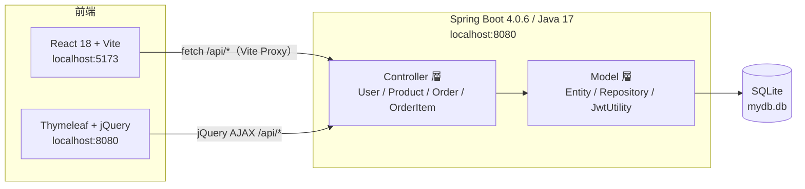
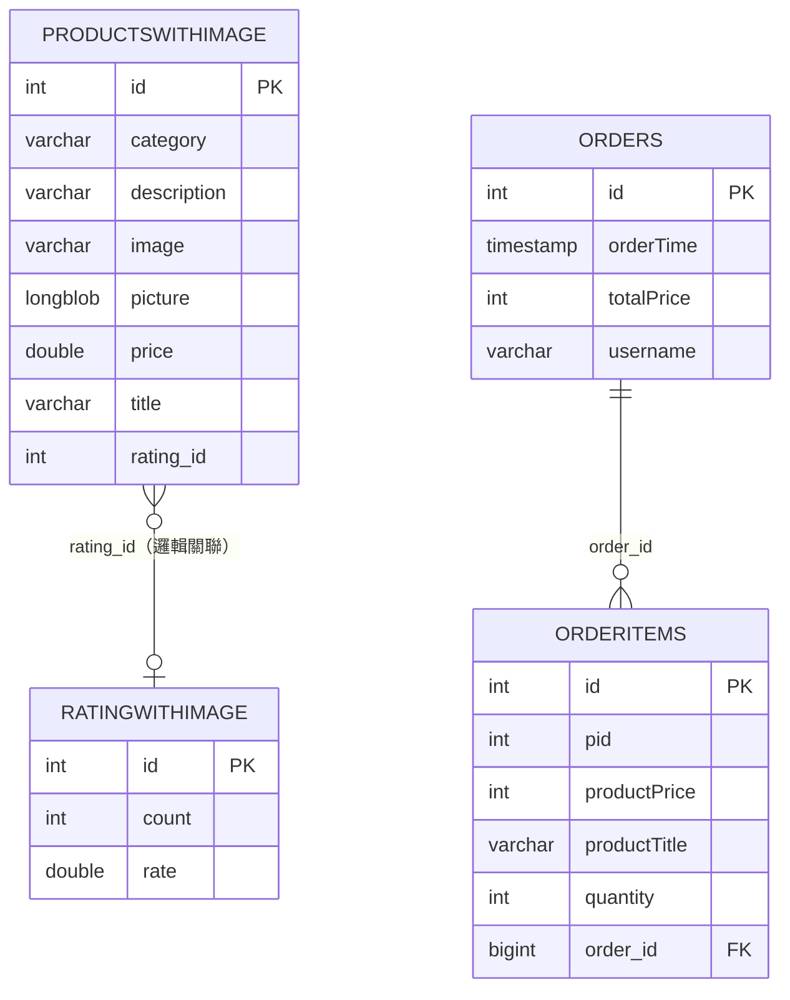

# 後端需求規格書（SRS）：shoppingusercart

> **專案**：簡易購物車系統 — 後端  
> **文件版本**：v1.0  
> **日期**：2026-11-04  
> **對應程式碼**：`shoppingusercart/`  
> **文件性質**：以現有程式碼為基礎的軟體需求規格書（As-Is + To-Be）  
> **相關文件**：[前端需求規格書](frontend-requirements.md)｜[後端教學文件](backend-guide.md)｜[專案總覽](README.md)

---

## 0. 文件修訂紀錄

| 版本 | 日期 | 說明 |
|------|------|------|
| v1.0 | 2026-11-04 | 初版。依 `shoppingusercart` 實際程式碼、`pom.xml`、`application.properties` 與 `docs/database/init-sqlite.sql` 整理 |

---

## 1. 文件目的與範圍

### 1.1 目的

本文件定義「簡易購物車系統」後端的**功能需求、API 契約、資料模型、非功能需求與驗收準則**，作為下列工作的共同依據：

- 前後端串接與介面確認
- 功能開發、修正與 Code Review
- 測試案例設計與驗收
- 後續重構（Service 層、DTO、Spring Security）的範圍界定

### 1.2 範圍（In Scope）

| 類別 | 內容 |
|------|------|
| 認證 | 以記憶體帳號密碼登入，簽發 JWT |
| 產品 | 查詢產品清單 |
| 訂單 | 建立訂單（主檔 + 明細）、依使用者查詢、查全部、查單筆 |
| 訂單明細 | 依訂單編號查詢明細 |
| 舊版頁面 | Thymeleaf + jQuery 登入頁（相容用途） |
| 維運 | Actuator 健康檢查 |
| 資料 | SQLite `mydb.db` 的四張資料表 |

### 1.3 不在範圍（Out of Scope）

- 會員註冊、修改密碼、忘記密碼
- 產品新增／修改／刪除（後台管理）
- 金流、物流、發票、退款
- 購物車資料持久化（目前購物車只存在前端記憶體）
- 多語系、電子郵件通知
- 正式環境部署腳本與 CI/CD

### 1.4 讀者對象

後端工程師、前端工程師、測試人員、專案負責人、進行程式碼審查的人。

### 1.5 需求優先級定義（MoSCoW）

| 優先級 | 定義 |
|--------|------|
| **Must** | 系統核心流程，缺少即無法完成購物 |
| **Should** | 重要但可暫時以人工或替代方式處理 |
| **Could** | 加分功能，資源允許再做 |
| **Won't** | 本期明確不做 |

### 1.6 實作狀態定義

| 狀態 | 定義 |
|------|------|
| **已實作** | 程式碼存在且行為符合本文件描述 |
| **部分實作** | 程式碼存在，但缺少驗證、授權、錯誤處理或規格不一致 |
| **未實作** | 目前沒有對應程式碼 |

---

## 2. 專案概述

### 2.1 背景

`shoppingusercart` 是一個教學用的迷你購物車後端，使用 Spring Boot + Spring Data JPA + SQLite，提供 REST API 給 React 前端（`usercart_react`）與舊版 jQuery 頁面使用。設計目標是「用最少的程式碼跑通登入、看產品、下單、查訂單」的完整流程。

### 2.2 專案目標

1. 提供穩定的登入與 JWT 簽發機制。
2. 提供產品清單查詢。
3. 支援一次送出多筆明細的訂單建立。
4. 支援使用者查詢自己的歷史訂單與明細。
5. 保持資料庫免安裝（SQLite 單一檔案），降低教學門檻。

### 2.3 成功指標

| 指標 | 目標值 |
|------|--------|
| 核心 API 可用率（本機） | 100%（登入、產品、下單、查訂單） |
| 產品查詢回應時間 | 20 筆資料下 < 500 ms |
| 訂單建立成功後資料一致性 | 主檔與明細筆數、金額一致 |
| 啟動失敗可診斷性 | 日誌能指出是資料表或資料庫路徑問題 |

### 2.4 系統情境圖



---

## 3. 利害關係人與角色

| 角色 | 說明 | 目前系統能力 |
|------|------|--------------|
| 訪客 | 尚未登入的使用者 | 可看產品；不可下單；訂單頁顯示「請先登入」 |
| 會員 | 以測試帳號登入者 | 可下單、查自己的訂單 |
| 管理員 | 需要查看全部訂單的角色 | **未實作角色權限**，目前任何人皆可呼叫查全部訂單 API |
| 開發／維運 | 啟動服務、排查問題 | 可用 `/actuator/health`、SQL 日誌 |

**測試帳號**（密碼皆為 `1234`）：`admin`、`guest`、`mary`、`george`、`john`。

---

## 4. 系統架構與技術限制

### 4.1 技術棧

| 項目 | 版本／技術 | 用途 |
|------|------------|------|
| Java | 17 | 執行環境 |
| Spring Boot | 4.0.6 | 應用框架 |
| Spring Web | Starter | REST Controller |
| Spring Data JPA | Starter | Repository / Entity |
| Hibernate Community Dialects | 內建 | SQLite 方言 |
| SQLite JDBC | 3.53.2.0 | SQLite 驅動 |
| Thymeleaf | Starter | 舊版頁面 |
| Lombok | 內建 | `@Data` 產生 getter/setter |
| JJWT | 0.9.1 | JWT 產生與解析 |
| JAXB API | 2.3.1 | 補足 Java 17 移除的 `javax.xml.bind` |
| Actuator | Starter | `/actuator/health` |
| Maven | 3.x | 建置 |

### 4.2 分層與套件

```text
demo.usercart
├─ Sbusercart0413Application.java   # 主啟動類
├─ controller
│  ├─ UserController.java           # 登入、JWT
│  ├─ ProductController.java        # 產品查詢
│  ├─ OrderController.java          # 訂單建立與查詢
│  └─ OrderItemController.java      # 訂單明細查詢
└─ model
   ├─ Product.java / Order.java / OrderItem.java
   ├─ ProductRepository.java / OrderRepository.java / ItemRepository.java
   └─ JwtUtility.java
```

> 目前**沒有 Service 層、DTO 層、全域例外處理**。Controller 直接呼叫 Repository。

### 4.3 執行環境與設定

| 設定 | 值 | 說明 |
|------|-----|------|
| 連接埠 | `8080` | Spring Boot 預設 |
| 資料庫 | `jdbc:sqlite:mydb.db` | **相對路徑**，需在 `shoppingusercart/` 目錄啟動 |
| Schema 策略 | `hbm2ddl.auto=validate` | 只驗證，不建表 |
| 命名策略 | `PhysicalNamingStrategyStandardImpl` | 保留 camelCase 欄位名 |
| SQL 日誌 | `show-sql=true`、`format_sql=true` | 開發除錯用 |

### 4.4 架構限制

| 編號 | 限制 | 影響 |
|------|------|------|
| CON-BE-01 | SQLite 同時只允許一個寫入者 | 高併發下可能出現 `database is locked` |
| CON-BE-02 | 資料表由外部 SQL 腳本建立 | 啟動前必須先有 `mydb.db` 與正確 schema |
| CON-BE-03 | 使用者帳號存在記憶體 | 重啟即重置，無法註冊 |
| CON-BE-04 | 金額欄位為整數（`int`） | 產品小數價格會被截斷 |
| CON-BE-05 | 沒有角色與權限模型 | 無法區分會員與管理員 |

---

## 5. 功能需求

### 5.1 功能需求總表

| ID | 名稱 | 優先級 | 狀態 | 對應 API |
|----|------|--------|------|----------|
| FR-BE-01 | 使用者登入並取得 JWT | Must | 部分實作 | `POST /api/user/login` |
| FR-BE-02 | JWT 驗證與使用者識別 | Must | 部分實作 | 所有需驗證 API |
| FR-BE-03 | 查詢產品清單 | Must | 已實作 | `GET /api/products` |
| FR-BE-04 | 建立訂單（主檔 + 明細） | Must | 部分實作 | `POST /api/orders` |
| FR-BE-05 | 查詢指定使用者的訂單 | Must | 部分實作 | `GET /api/orders/{username}` |
| FR-BE-06 | 查詢全部訂單 | Should | 已實作 | `GET /api/orders` |
| FR-BE-07 | 查詢單筆訂單 | Should | 已實作 | `GET /api/orders/orderid/{orderid}` |
| FR-BE-08 | 查詢訂單明細 | Must | 已實作 | `GET /api/items/{orderid}` |
| FR-BE-09 | 舊版登入頁 | Could | 部分實作 | `GET /api/user/login` |
| FR-BE-10 | 健康檢查 | Should | 已實作 | `GET /actuator/health` |
| FR-BE-11 | 登出 | Could | 未實作 | — |
| FR-BE-12 | 使用者註冊 | Won't（本期） | 未實作 | — |

---

### 5.2 詳細需求

#### FR-BE-01 使用者登入並取得 JWT

| 欄位 | 內容 |
|------|------|
| 優先級 | Must |
| 狀態 | 部分實作 |
| 觸發 | 使用者於前端送出帳號密碼 |
| 輸入 | `username`、`password`（JSON） |
| 輸出 | 成功：`200 {"token":"..."}`；失敗：`401 {"message":"帳號或密碼錯誤"}` |

**處理流程**

1. 接收 `POST /api/user/login` 的 JSON。
2. 比對記憶體中的測試帳號清單。
3. 成功時以 `JwtUtility.generateToken(username)` 簽發 JWT（HS512，有效期 1 天）。
4. 將帳號寫入 HTTP Session（目前後續未使用）。
5. 回傳 token。

**業務規則**

| 編號 | 規則 |
|------|------|
| BR-BE-01 | 帳號與密碼必須完全相符（區分大小寫） |
| BR-BE-02 | 登入成功才簽發 token；失敗不得回傳任何 token |
| BR-BE-03 | Token 的 `sub` 必須是使用者名稱 |
| BR-BE-04 | Token 有效期為簽發後 86,400,000 毫秒（1 天） |

**錯誤情境**

| 情境 | 目前行為 | 目標行為 |
|------|----------|----------|
| 帳密錯誤 | `401` + 訊息 | 維持 |
| 缺少 `password` | `NullPointerException` → `500` | `400` + 欄位驗證訊息 |
| 缺少 `username` | `401` | `400` |
| 帳號不存在 | `401` | `401`（不透露帳號是否存在） |

**驗收條件**

- [ ] 以 `admin` / `1234` 登入回傳 `200` 且含非空 `token`。
- [ ] 以 `admin` / `wrong` 登入回傳 `401`，且回應不含 `token`。
- [ ] 缺少 `password` 時回傳 `4xx`，不可回傳 `500`。
- [ ] Token payload 的 `sub` 為 `admin`。

---

#### FR-BE-02 JWT 驗證與使用者識別

| 欄位 | 內容 |
|------|------|
| 優先級 | Must |
| 狀態 | 部分實作 |
| 觸發 | 呼叫需要身分識別的 API（目前僅建立訂單） |
| 輸入 | `Authorization: Bearer <token>` |
| 輸出 | 解析出的使用者名稱 |

**業務規則**

| 編號 | 規則 |
|------|------|
| BR-BE-05 | 標頭格式必須為 `Bearer ` + token |
| BR-BE-06 | Token 簽章無效、過期或格式錯誤時，必須回傳 `401`，不可回傳 `500` |
| BR-BE-07 | 伺服器應以 Token 內的 `sub` 作為下單者，**不可信任 Request Body 的 `username`** |
| BR-BE-08 | 查詢訂單時必須驗證「目前使用者 = 訂單擁有者」 |

**錯誤情境**

| 情境 | 目前行為 | 目標行為 |
|------|----------|----------|
| 缺少 `Authorization` 標頭 | `400`（Spring 缺少必要標頭） | `401` |
| Token 無效／過期 | `extractUsername` 丟例外 → `500` | `401` |
| Token 有效但查詢他人訂單 | 仍可查詢 | `403` 或 `404` |

**驗收條件**

- [ ] 無效 token 呼叫 `POST /api/orders` 回傳 `401`。
- [ ] 缺少 `Authorization` 回傳 `401`。
- [ ] 以 A 的 token 查詢 B 的訂單會被拒絕。

---

#### FR-BE-03 查詢產品清單

| 欄位 | 內容 |
|------|------|
| 優先級 | Must |
| 狀態 | 已實作 |
| 觸發 | 前端進入產品列表頁 |
| 輸入 | 無 |
| 輸出 | `200` + 產品陣列 |

**業務規則**

| 編號 | 規則 |
|------|------|
| BR-BE-09 | 回傳 `productswithimage` 全部資料 |
| BR-BE-10 | 不回傳 `picture`（二進位大圖） |
| BR-BE-11 | 欄位至少包含 `id`、`title`、`description`、`category`、`price`、`image`、`rating_id` |
| BR-BE-12 | 此 API 不需登入 |

**驗收條件**

- [ ] `GET /api/products` 回傳 `200` 與 20 筆資料（依種子資料）。
- [ ] 每筆資料不含 `picture` 欄位。
- [ ] 未帶 token 也能成功呼叫。

---

#### FR-BE-04 建立訂單（主檔 + 明細）

| 欄位 | 內容 |
|------|------|
| 優先級 | Must |
| 狀態 | 部分實作 |
| 觸發 | 使用者在購物車按下「送出訂單」 |
| 輸入 | `Authorization` 標頭 + 訂單 JSON（含 `items`） |
| 輸出 | `200` + 儲存後的訂單（含自動產生的 `id`） |

**處理流程**

1. 解析 JWT 取得使用者名稱。
2. 將 `orderTime` 設為伺服器目前時間。
3. 為每筆明細設定 `item.order = order`，建立雙向關聯。
4. `orderRepo.save(order)`，因 `CascadeType.ALL` 一併寫入明細。
5. 將每筆明細的 `order` 設回 `null`，避免 JSON 循環。
6. 回傳儲存結果。

**業務規則**

| 編號 | 規則 |
|------|------|
| BR-BE-13 | `orderTime` 必須由伺服器產生，不可採用前端值 |
| BR-BE-14 | 訂單必須至少有一筆明細 |
| BR-BE-15 | `quantity` 必須為正整數（≥ 1） |
| BR-BE-16 | `totalPrice` 應由伺服器依「產品單價 × 數量」重新計算 |
| BR-BE-17 | 明細應保存下單當下的 `productTitle` 與 `productPrice`（交易快照） |
| BR-BE-18 | 訂單擁有者應來自 JWT 的 `sub` |
| BR-BE-19 | 主檔與明細必須在同一個交易中寫入，失敗時全部回滾 |
| BR-BE-20 | 金額應使用 `BigDecimal` 或最小貨幣單位，避免浮點誤差 |

**錯誤情境**

| 情境 | 目前行為 | 目標行為 |
|------|----------|----------|
| 無 token | `400` | `401` |
| Token 無效 | `500` | `401` |
| `items` 為空 | 仍建立 0 元訂單 | `400` |
| `quantity` ≤ 0 | 仍寫入 | `400` |
| `totalPrice` 與明細不符 | 照單全收 | 伺服器重算 |
| 產品不存在 | 仍寫入 `pid` | `400` / `404` |

**驗收條件**

- [ ] 送出 2 筆明細後，`orders` 新增 1 筆、`orderitems` 新增 2 筆且 `order_id` 正確。
- [ ] 回應中的 `id` 為資料庫自動產生。
- [ ] `orderTime` 為伺服器時間。
- [ ] 偽造 `totalPrice` 不會影響伺服器計算結果（目標行為）。
- [ ] 空明細或數量 0 會被拒絕（目標行為）。

---

#### FR-BE-05 查詢指定使用者的訂單

| 欄位 | 內容 |
|------|------|
| 優先級 | Must |
| 狀態 | 部分實作 |
| 觸發 | 使用者進入訂單頁 |
| 輸入 | 路徑參數 `username` |
| 輸出 | `200` + 訂單陣列（含明細） |

**業務規則**

| 編號 | 規則 |
|------|------|
| BR-BE-21 | 依 `orders.username` 精確查詢 |
| BR-BE-22 | 查無資料回傳空陣列 `[]`，不可回傳 `null` |
| BR-BE-23 | 必須驗證呼叫者與 `username` 一致 |
| BR-BE-24 | 回應應避免每筆明細重複帶回完整 `order` 物件 |

**驗收條件**

- [ ] `admin` 查詢 `admin` 回傳 2 筆種子訂單。
- [ ] 查詢不存在的使用者回傳 `[]`。
- [ ] 未登入或查詢他人訂單會被拒絕（目標行為）。
- [ ] 回應大小不含循環巢狀的 `order.items`。

---

#### FR-BE-06 查詢全部訂單

| 欄位 | 內容 |
|------|------|
| 優先級 | Should |
| 狀態 | 已實作（但無權限控管） |
| 輸入 | 無 |
| 輸出 | `200` + 訂單陣列（`items` 為 `null`） |

**業務規則**

| 編號 | 規則 |
|------|------|
| BR-BE-25 | 僅管理員可呼叫（目標行為） |
| BR-BE-26 | 清單不回傳明細，避免過大 |
| BR-BE-27 | 應支援分頁與排序（目標行為） |

**驗收條件**

- [ ] `GET /api/orders` 回傳所有訂單且 `items` 為 `null`。
- [ ] 非管理員呼叫回傳 `403`（目標行為）。

---

#### FR-BE-07 查詢單筆訂單

| 欄位 | 內容 |
|------|------|
| 優先級 | Should |
| 狀態 | 已實作 |
| 輸入 | 路徑參數 `orderid` |
| 輸出 | `200` + 訂單（`items` 為 `null`） |

**業務規則**

| 編號 | 規則 |
|------|------|
| BR-BE-28 | 查無資料應回傳 `404`（目前回傳 `200` + `null`） |
| BR-BE-29 | 必須驗證訂單擁有者或管理員 |

**驗收條件**

- [ ] 存在的訂單回傳 `200` 與正確欄位。
- [ ] 不存在的訂單回傳 `404`（目標行為）。

---

#### FR-BE-08 查詢訂單明細

| 欄位 | 內容 |
|------|------|
| 優先級 | Must |
| 狀態 | 已實作 |
| 輸入 | 路徑參數 `orderid` |
| 輸出 | `200` + 明細陣列 |

**業務規則**

| 編號 | 規則 |
|------|------|
| BR-BE-30 | 依 `orderitems.order_id` 查詢 |
| BR-BE-31 | 查無明細回傳 `[]` |
| BR-BE-32 | 回應中的 `order` 必須為 `null`，避免循環 |
| BR-BE-33 | 必須驗證呼叫者有權檢視該訂單 |

**驗收條件**

- [ ] 訂單 1 回傳 3 筆明細。
- [ ] 不存在的訂單回傳 `[]`。
- [ ] 每筆明細的 `order` 為 `null`。

---

#### FR-BE-09 舊版登入頁

| 欄位 | 內容 |
|------|------|
| 優先級 | Could |
| 狀態 | 部分實作 |
| 輸入 | `GET /api/user/login` |
| 輸出 | Thymeleaf 視圖 `usercart` |

**說明**：`UserController.showLogin()` 回傳 `ModelAndView("usercart")`，Thymeleaf 會尋找 `src/main/resources/templates/usercart.html`。目前專案僅有 `src/main/resources/static/usercart.html`，**缺少 `templates/` 目錄**，因此此端點可能回傳 `500`（模板不存在）。

**目標行為（二選一）**

1. 將頁面移到 `templates/usercart.html` 並修正靜態資源路徑；或
2. 移除舊版端點，改由 `/usercart.html` 直接提供靜態頁。

**驗收條件**

- [ ] `GET /api/user/login` 能正確顯示登入頁，或端點已移除且文件同步更新。

---

#### FR-BE-10 健康檢查

| 欄位 | 內容 |
|------|------|
| 優先級 | Should |
| 狀態 | 已實作 |
| 輸入 | `GET /actuator/health` |
| 輸出 | `200 {"status":"UP"}` |

**驗收條件**

- [ ] 後端啟動後回傳 `200` 且 `status` 為 `UP`。

---

#### FR-BE-11 登出

| 欄位 | 內容 |
|------|------|
| 優先級 | Could |
| 狀態 | 未實作 |
| 說明 | JWT 為無狀態，登出需由前端刪除 token；若需伺服器端撤銷，需加入黑名單或短效 token + refresh token |

**驗收條件**

- [ ] 前端登出後不再持有 token。
- [ ] （選配）伺服器端可撤銷指定 token。

---

#### FR-BE-12 使用者註冊

| 欄位 | 內容 |
|------|------|
| 優先級 | Won't（本期） |
| 狀態 | 未實作 |
| 說明 | 目前帳號寫死於記憶體，若要做註冊需新增 `users` 資料表、密碼雜湊與唯一性檢查 |

---

## 6. API 規格

### 6.1 共通約定

| 項目 | 規格 |
|------|------|
| Base URL | `http://localhost:8080` |
| API 前綴 | `/api` |
| 內容類型 | `application/json; charset=UTF-8` |
| 認證標頭 | `Authorization: Bearer <JWT>` |
| 時間格式 | ISO-8601（例如 `2026-11-04T10:15:30`） |
| 金額單位 | 新台幣元（整數；目標為兩位小數） |
| CORS | 目前 `@CrossOrigin` 允許所有來源 |
| 編碼 | UTF-8 |

### 6.2 端點總表

| 方法 | 路徑 | 功能 | 需 Token | 成功 | 主要錯誤 |
|------|------|------|----------|------|----------|
| POST | `/api/user/login` | 登入取得 JWT | 否 | 200 | 401 |
| GET | `/api/user/login` | 舊版登入頁 | 否 | 200 | 500（模板缺失） |
| GET | `/api/products` | 產品清單 | 否 | 200 | 500 |
| POST | `/api/orders` | 建立訂單 | 是 | 200 | 400／401／500 |
| GET | `/api/orders/{username}` | 使用者訂單 | 否（現況） | 200 | 500 |
| GET | `/api/orders` | 全部訂單 | 否（現況） | 200 | 500 |
| GET | `/api/orders/orderid/{orderid}` | 單筆訂單 | 否（現況） | 200 | 500 |
| GET | `/api/items/{orderid}` | 訂單明細 | 否（現況） | 200 | 500 |
| GET | `/actuator/health` | 健康檢查 | 否 | 200 | — |

---

### 6.3 詳細規格

#### 6.3.1 `POST /api/user/login`

**Request**

| 位置 | 欄位 | 型別 | 必填 | 說明 |
|------|------|------|------|------|
| Body | `username` | string | 是 | 帳號 |
| Body | `password` | string | 是 | 密碼 |

```json
{
  "username": "admin",
  "password": "1234"
}
```

**Response 200**

```json
{
  "token": "eyJhbGciOiJIUzUxMiJ9.eyJzdWIiOiJhZG1pbiIsImlhdCI6MTc2MjIyMjIyMiwiZXhwIjoxNzYyMzA4NjIyfQ.signature"
}
```

**Response 401**

```json
{
  "message": "帳號或密碼錯誤"
}
```

**備註**

- 回應只有 `token`，沒有使用者名稱、角色或到期時間。
- 目標版本建議回傳 `{ "token": "...", "username": "...", "expiresIn": 86400 }`。

---

#### 6.3.2 `GET /api/user/login`

回傳 Thymeleaf 視圖 `usercart`（舊版 jQuery 頁面）。目前 `templates/usercart.html` 不存在，見 FR-BE-09。

---

#### 6.3.3 `GET /api/products`

**Response 200**

```json
[
  {
    "id": 1,
    "title": "Fjallraven - Foldsack No. 1 Backpack, Fits 15 Laptops",
    "description": "Your perfect pack for everyday use and walks in the forest...",
    "category": "men's clothing",
    "price": 109.95,
    "image": "https://fakestoreapi.com/img/81fPKd-2AYL._AC_SL1500_t.png",
    "rating_id": 1
  }
]
```

**備註**

- `picture` 欄位未映射至 Entity，因此不會回傳。
- 無分頁參數；目標版本建議支援 `?page=&size=&sort=`。

---

#### 6.3.4 `POST /api/orders`

**Request Headers**

| 標頭 | 必填 | 說明 |
|------|------|------|
| `Authorization` | 是 | `Bearer <token>` |
| `Content-Type` | 是 | `application/json` |

**Request Body**

| 欄位 | 型別 | 必填 | 說明 |
|------|------|------|------|
| `username` | string | 否（現況會寫入） | 下單者；目標版本應忽略，改用 Token |
| `totalPrice` | number | 是 | 總金額；目標版本由伺服器重算 |
| `items` | array | 是 | 明細陣列，至少 1 筆 |
| `items[].pid` | number | 是 | 產品編號 |
| `items[].productTitle` | string | 是 | 產品名稱快照 |
| `items[].productPrice` | number | 是 | 產品單價快照（現況轉為整數） |
| `items[].quantity` | number | 是 | 數量，≥ 1 |

```json
{
  "username": "admin",
  "totalPrice": 143.9,
  "items": [
    {
      "pid": 1,
      "productTitle": "Fjallraven - Foldsack No. 1 Backpack, Fits 15 Laptops",
      "productPrice": 109.95,
      "quantity": 1
    },
    {
      "pid": 2,
      "productTitle": "Mens Casual Premium Slim Fit T-Shirts",
      "productPrice": 22.3,
      "quantity": 1
    }
  ]
}
```

**Response 200**

```json
{
  "id": 3,
  "username": "admin",
  "orderTime": "2026-11-04T10:15:30.123456",
  "totalPrice": 143,
  "items": [
    {
      "id": 6,
      "pid": 1,
      "productTitle": "Fjallraven - Foldsack No. 1 Backpack, Fits 15 Laptops",
      "productPrice": 109,
      "quantity": 1,
      "order": null
    },
    {
      "id": 7,
      "pid": 2,
      "productTitle": "Mens Casual Premium Slim Fit T-Shirts",
      "productPrice": 22,
      "quantity": 1,
      "order": null
    }
  ]
}
```

**備註（現況）**

- `totalPrice` 與 `productPrice` 為 `int`，小數會被截斷（143.9 → 143）。
- `username` 取自 Request Body，**不是** Token 的 `sub`。
- `orderTime` 由伺服器設定。
- 明細的 `order` 在回傳前被設為 `null`。

---

#### 6.3.5 `GET /api/orders/{username}`

**Path 參數**

| 名稱 | 型別 | 說明 |
|------|------|------|
| `username` | string | 使用者名稱 |

**Response 200**

```json
[
  {
    "id": 1,
    "username": "admin",
    "orderTime": "2026-08-16T12:32:59.186",
    "totalPrice": 143,
    "items": [
      {
        "id": 1,
        "pid": 1,
        "productTitle": "Fjallraven - Foldsack No. 1 Backpack, Fits 15 Laptops",
        "productPrice": 109,
        "quantity": 1,
        "order": {
          "id": 1,
          "username": "admin",
          "orderTime": "2026-08-16T12:32:59.186",
          "totalPrice": 143
        }
      }
    ]
  }
]
```

**備註（現況）**

- 未驗證 Token。
- 明細中的 `order` 未設為 `null`，回應較大且含重複資訊。

---

#### 6.3.6 `GET /api/orders`

**Response 200**

```json
[
  {
    "id": 1,
    "username": "admin",
    "orderTime": "2026-08-16T12:32:59.186",
    "totalPrice": 143,
    "items": null
  }
]
```

**備註（現況）**：未驗證身分；`items` 被設為 `null`。

---

#### 6.3.7 `GET /api/orders/orderid/{orderid}`

**Response 200（存在）**

```json
{
  "id": 1,
  "username": "admin",
  "orderTime": "2026-08-16T12:32:59.186",
  "totalPrice": 143,
  "items": null
}
```

**Response 200（不存在，現況）**

```json
null
```

> 目標版本應改為 `404`。

---

#### 6.3.8 `GET /api/items/{orderid}`

**Response 200**

```json
[
  {
    "id": 1,
    "pid": 1,
    "productTitle": "Fjallraven - Foldsack No. 1 Backpack, Fits 15 Laptops",
    "productPrice": 109,
    "quantity": 1,
    "order": null
  }
]
```

---

#### 6.3.9 `GET /actuator/health`

```json
{
  "status": "UP"
}
```

---

## 7. 資料模型

### 7.1 ER 圖



### 7.2 資料表與資料字典

#### `productswithimage`（產品）

| 欄位 | 型別 | 必填 | 說明 |
|------|------|------|------|
| `id` | int | 是 | 主鍵 |
| `category` | varchar(255) | 否 | 分類 |
| `description` | varchar(2048) | 否 | 描述 |
| `image` | varchar(255) | 否 | 圖片網址 |
| `picture` | longblob | 否 | 舊版二進位圖片，Entity 未映射 |
| `price` | double | 是 | 單價 |
| `title` | varchar(255) | 否 | 產品名稱 |
| `rating_id` | int | 否 | 對應 `ratingwithimage.id`（無 DB FK） |

#### `ratingwithimage`（評分）

| 欄位 | 型別 | 必填 | 說明 |
|------|------|------|------|
| `id` | int | 是 | 主鍵 |
| `count` | int | 是 | 評分人數 |
| `rate` | double | 是 | 平均星等 |

> 目前沒有 `Rating` Entity 與 Repository，API 不會回傳星等。

#### `orders`（訂單主檔）

| 欄位 | 型別 | 必填 | 說明 |
|------|------|------|------|
| `id` | INTEGER | 是 | 主鍵，自動遞增 |
| `orderTime` | TIMESTAMP(26) | 否 | 下單時間（SQLite 存 epoch 毫秒） |
| `totalPrice` | INT | 是 | 總金額（整數） |
| `username` | varchar(255) | 否 | 下單者 |

#### `orderitems`（訂單明細）

| 欄位 | 型別 | 必填 | 說明 |
|------|------|------|------|
| `id` | INTEGER | 是 | 主鍵，自動遞增 |
| `pid` | INT | 是 | 產品編號（無 DB FK） |
| `productPrice` | INT | 是 | 下單當下單價（整數快照） |
| `productTitle` | varchar(255) | 否 | 下單當下名稱（快照） |
| `quantity` | INT | 是 | 數量 |
| `order_id` | bigint | 否 | 所屬訂單（邏輯 FK） |

### 7.3 關聯與完整性規則

| 編號 | 規則 |
|------|------|
| DR-BE-01 | `orders` 1 對多 `orderitems`，由 `orderitems.order_id` 維護 |
| DR-BE-02 | 刪除訂單時，明細應一併刪除（`CascadeType.ALL`；DB 腳本未宣告 FK） |
| DR-BE-03 | `orderitems.pid` 不建立 FK，保留歷史訂單不受產品刪除影響 |
| DR-BE-04 | `productswithimage.rating_id` 僅為邏輯關聯 |
| DR-BE-05 | `orders.username` 應建立索引（腳本已建立） |
| DR-BE-06 | `orderitems.order_id` 應建立索引（腳本已建立） |
| DR-BE-07 | 金額欄位不可為負數 |
| DR-BE-08 | `quantity` 必須 ≥ 1 |

### 7.4 種子資料

| 資料表 | 筆數 | 說明 |
|--------|------|------|
| `productswithimage` | 20 | 來自 Fake Store API 的示範商品 |
| `ratingwithimage` | 20 | 對應商品的評分 |
| `orders` | 2 | 皆為 `admin` |
| `orderitems` | 5 | 對應 2 筆訂單 |

重建指令：

```bash
cd shoppingusercart
sqlite3 mydb.db ".read ../docs/database/init-sqlite.sql"
```

### 7.5 金額與時間處理規則

| 編號 | 規則 | 現況 |
|------|------|------|
| BR-BE-34 | 金額計算應避免浮點誤差，使用 `BigDecimal` 或整數最小單位 | 前端用 JS number、後端用 `int`，小數被截斷 |
| BR-BE-35 | 下單時間一律使用伺服器時間 | 已符合 |
| BR-BE-36 | 時間以 ISO-8601 輸出 | Jackson 預設符合 |
| BR-BE-37 | 訂單金額應等於明細「單價 × 數量」總和 | 目前未驗證 |

---

## 8. 非功能需求

| ID | 類別 | 需求 | 目標值／說明 | 現況 |
|----|------|------|--------------|------|
| NFR-BE-01 | 效能 | 產品清單查詢 | 20 筆 < 500 ms | 符合 |
| NFR-BE-02 | 效能 | 訂單建立 | < 1 s | 符合 |
| NFR-BE-03 | 擴充性 | 產品資料量成長時支援分頁 | `page`／`size` 參數 | 未實作 |
| NFR-BE-04 | 可靠性 | 訂單主檔與明細原子寫入 | 交易回滾 | `save` 具交易，但未測失敗情境 |
| NFR-BE-05 | 安全性 | 密碼不可明碼儲存 | BCrypt | 未符合 |
| NFR-BE-06 | 安全性 | JWT 密鑰由環境變數提供 | 長度 ≥ 256 bits | 未符合（寫死 `MySecretKey`） |
| NFR-BE-07 | 安全性 | 所有訂單 API 需驗證與授權 | Spring Security + Filter | 未符合 |
| NFR-BE-08 | 可維護性 | Controller 不直接操作 Repository | 增加 Service 層 | 未符合 |
| NFR-BE-09 | 可維護性 | API 使用 DTO，不直接回傳 Entity | DTO + Mapper | 未符合 |
| NFR-BE-10 | 可觀測性 | 使用結構化日誌 | SLF4J，禁用 `System.out` | 未符合 |
| NFR-BE-11 | 相容性 | 可在 Java 17 執行 | 已設定 | 符合 |
| NFR-BE-12 | 資料完整性 | 資料庫 FK 與索引 | 腳本補上 FK | 部分符合（索引有、FK 無） |
| NFR-BE-13 | 可測試性 | 單元／整合測試覆蓋核心 API | MockMvc + Testcontainers/SQLite | 僅 `contextLoads` |
| NFR-BE-14 | 可攜性 | 可切換 PostgreSQL／MySQL | 設定檔切換 | 依賴已具備、設定未啟用 |

---

## 9. 錯誤處理與回應格式

### 9.1 現況

- 沒有 `@RestControllerAdvice`。
- 無效 JWT 例外直接變成 `500`。
- 查無資料回傳 `200` + `null`。
- 錯誤訊息格式不統一（有時 `{message}`、有時空 body、有時 Spring 預設格式）。

### 9.2 目標規格：統一錯誤格式

```json
{
  "timestamp": "2026-11-04T10:15:30",
  "status": 401,
  "error": "UNAUTHORIZED",
  "code": "AUTH_INVALID_TOKEN",
  "message": "Token 無效或已過期",
  "path": "/api/orders"
}
```

### 9.3 錯誤碼表（目標）

| HTTP | code | 情境 |
|------|------|------|
| 400 | `VALIDATION_ERROR` | 欄位缺漏、數量 ≤ 0、明細為空 |
| 400 | `INVALID_PRICE` | 金額格式錯誤或為負 |
| 401 | `AUTH_INVALID_CREDENTIALS` | 帳密錯誤 |
| 401 | `AUTH_MISSING_TOKEN` | 缺少 Authorization |
| 401 | `AUTH_INVALID_TOKEN` | Token 無效或過期 |
| 403 | `FORBIDDEN` | 無權存取他人訂單 |
| 404 | `ORDER_NOT_FOUND` | 訂單不存在 |
| 404 | `PRODUCT_NOT_FOUND` | 產品不存在 |
| 409 | `DUPLICATE_RESOURCE` | 重複建立（未來註冊） |
| 500 | `INTERNAL_ERROR` | 未預期錯誤 |

---

## 10. 安全性需求

| ID | 需求 | 優先級 | 現況 |
|----|------|--------|------|
| SEC-BE-01 | 密碼以 BCrypt 雜湊儲存 | Must | 未符合（明碼） |
| SEC-BE-02 | JWT 密鑰由環境變數注入，不可寫死 | Must | 未符合 |
| SEC-BE-03 | 所有寫入 API 必須驗證 JWT | Must | 部分符合（僅建立訂單） |
| SEC-BE-04 | 查詢訂單必須驗證擁有者 | Must | 未符合 |
| SEC-BE-05 | 下單者一律取自 Token `sub` | Must | 未符合（取 Body） |
| SEC-BE-06 | CORS 僅允許信任的來源 | Should | 未符合（`*`） |
| SEC-BE-07 | 金額由伺服器計算，避免前端竄改 | Must | 未符合 |
| SEC-BE-08 | 限制登入嘗試次數（Rate Limiting） | Should | 未實作 |
| SEC-BE-09 | 錯誤訊息不洩漏堆疊或內部資訊 | Should | 未符合 |
| SEC-BE-10 | 正式環境使用 HTTPS | Must | 未涵蓋（本機開發） |
| SEC-BE-11 | JWT 有效期縮短並支援撤銷 | Should | 未實作（1 天、無撤銷） |
| SEC-BE-12 | 輸入長度與型別驗證（Bean Validation） | Should | 未實作 |

---

## 11. 限制、假設與相依性

### 11.1 假設

- 前端與後端在同一台開發機執行。
- 使用者已具備測試帳號。
- 產品資料由 SQL 腳本預先建立。
- 圖片來自外部 `fakestoreapi.com`，需要網路。

### 11.2 相依性

| 相依對象 | 說明 |
|----------|------|
| `mydb.db` | 必須存在且 schema 正確 |
| SQLite JDBC | 版本需與 Hibernate 方言相容 |
| JAXB API | JJWT 0.9.1 在 Java 17 的必要依賴 |
| 前端 | 依賴本文件第 6 章 API 契約 |

### 11.3 啟動注意事項

- 必須在 `shoppingusercart/` 目錄執行 `mvn spring-boot:run`，否則 SQLite 相對路徑會指向錯誤位置。
- `hbm2ddl.auto=validate` 不會自動建表。
- 若 `mydb.db` 為 0 bytes，啟動會失敗。

---

## 12. 現況落差與改善建議（Gap Analysis）

| 編號 | 落差 | 風險 | 建議 | 優先級 |
|------|------|------|------|--------|
| GAP-BE-01 | 下單者取自 Body 而非 Token | 可冒用他人名義下單 | `order.setUsername(jwtSubject)` | 高 |
| GAP-BE-02 | 查詢訂單未驗證身分 | 個資外洩 | 加 Spring Security + 擁有者檢查 | 高 |
| GAP-BE-03 | 金額由前端提供且整數截斷 | 金額錯誤、可竄改 | 後端重算 + `BigDecimal` | 高 |
| GAP-BE-04 | 無效 JWT 回 500 | 使用者體驗差、洩漏堆疊 | 全域例外處理 → 401 | 高 |
| GAP-BE-05 | 密碼明碼、密鑰寫死 | 帳號與 Token 可被偽造 | BCrypt + 環境變數 | 高 |
| GAP-BE-06 | 無 Service 層／DTO | 難測試、難維護、循環序列化 | 分層重構 | 中 |
| GAP-BE-07 | 查無資料回 200 + null | 前端難以判斷 | 回 404 | 中 |
| GAP-BE-08 | 無分頁 | 資料量大時效能差 | `Pageable` | 中 |
| GAP-BE-09 | 舊版頁面模板缺失 | 端點 500 | 補 `templates/` 或移除端點 | 中 |
| GAP-BE-10 | 無輸入驗證 | 空明細、負數可寫入 | Bean Validation | 中 |
| GAP-BE-11 | Repository 泛型 ID 不一致（`Long` vs `Integer`） | 易混淆 | 統一為 `Integer` | 低 |
| GAP-BE-12 | `System.out.println` 與 trace 日誌 | 正式環境噪音 | SLF4J + 調整層級 | 低 |
| GAP-BE-13 | CORS `*` | 任意來源可呼叫 | 白名單 | 低 |
| GAP-BE-14 | DB 無 FK 約束 | 可能產生孤兒明細 | 補 FK 或定期檢查 | 低 |

---

## 13. 驗收準則與測試案例

> 以下以 `http://localhost:8080`、資料庫已初始化為前提。

| ID | 測試案例 | 步驟 | 預期結果 |
|----|----------|------|----------|
| TC-BE-01 | 健康檢查 | `GET /actuator/health` | `200`、`status=UP` |
| TC-BE-02 | 產品清單 | `GET /api/products` | `200`、20 筆、無 `picture` |
| TC-BE-03 | 登入成功 | `POST /api/user/login`，`admin/1234` | `200`、有 `token` |
| TC-BE-04 | 登入失敗 | `POST /api/user/login`，`admin/wrong` | `401`、無 `token` |
| TC-BE-05 | 缺少密碼 | Body 只給 `username` | `4xx`（目標）、非 `500` |
| TC-BE-06 | 建立訂單 | 帶有效 token 與 2 筆明細 | `200`、訂單 id 遞增、明細 2 筆 |
| TC-BE-07 | 無 token 下單 | 不帶 `Authorization` | `401`（目標） |
| TC-BE-08 | 無效 token 下單 | `Bearer invalid` | `401`（目標） |
| TC-BE-09 | 查詢使用者訂單 | `GET /api/orders/admin` | `200`、2 筆 |
| TC-BE-10 | 查詢不存在使用者 | `GET /api/orders/nobody` | `200`、`[]` |
| TC-BE-11 | 查詢訂單明細 | `GET /api/items/1` | `200`、3 筆、`order=null` |
| TC-BE-12 | 查詢不存在訂單 | `GET /api/orders/orderid/99999` | `404`（目標） |
| TC-BE-13 | 金額一致性 | 下單後比對 `totalPrice` 與明細加總 | 兩者相等（目標） |
| TC-BE-14 | 交易完整性 | 模擬明細寫入失敗 | 主檔不留下資料（目標） |

### 13.1 curl 範例

```bash
# 登入
curl -s -X POST http://localhost:8080/api/user/login \
  -H "Content-Type: application/json" \
  -d "{\"username\":\"admin\",\"password\":\"1234\"}"

# 產品
curl -s http://localhost:8080/api/products

# 下單
TOKEN="<貼上 token>"
curl -s -X POST http://localhost:8080/api/orders \
  -H "Content-Type: application/json" \
  -H "Authorization: Bearer $TOKEN" \
  -d "{\"username\":\"admin\",\"totalPrice\":132.25,\"items\":[{\"pid\":1,\"productTitle\":\"Backpack\",\"productPrice\":109.95,\"quantity\":1},{\"pid\":2,\"productTitle\":\"T-Shirt\",\"productPrice\":22.3,\"quantity\":1}]}"

# 訂單與明細
curl -s http://localhost:8080/api/orders/admin
curl -s http://localhost:8080/api/items/1
```

---

## 14. 需求追溯表

| 需求 | 程式碼位置 | API | 測試案例 |
|------|------------|-----|----------|
| FR-BE-01 | `UserController.login`、`JwtUtility.generateToken` | `POST /api/user/login` | TC-BE-03、04、05 |
| FR-BE-02 | `JwtUtility.extractUsername`、`OrderController.createOrder` | 需驗證 API | TC-BE-07、08 |
| FR-BE-03 | `ProductController.getProducts`、`ProductRepository` | `GET /api/products` | TC-BE-02 |
| FR-BE-04 | `OrderController.createOrder`、`Order.items` cascade | `POST /api/orders` | TC-BE-06、13、14 |
| FR-BE-05 | `OrderController.getOrdersByUser`、`OrderRepository.findByUsername` | `GET /api/orders/{username}` | TC-BE-09、10 |
| FR-BE-06 | `OrderController.getAllOrders` | `GET /api/orders` | — |
| FR-BE-07 | `OrderController.getOrdersById` | `GET /api/orders/orderid/{id}` | TC-BE-12 |
| FR-BE-08 | `OrderItemController.getByOrderId`、`ItemRepository.findByOrderId` | `GET /api/items/{id}` | TC-BE-11 |
| FR-BE-09 | `UserController.showLogin` | `GET /api/user/login` | — |
| FR-BE-10 | Actuator | `GET /actuator/health` | TC-BE-01 |

---

## 15. 附錄

### 15.1 常見錯誤與排查

| 症狀 | 可能原因 | 處理 |
|------|----------|------|
| `no such table: productswithimage` | 啟動目錄錯誤或 DB 未初始化 | 在 `shoppingusercart/` 啟動並執行初始化腳本 |
| `database is locked` | 其他程序佔用 SQLite | 關閉 DB Browser 或重複啟動的後端 |
| 登入回 `500` | 缺少 `password` 導致 NPE | 補上欄位驗證 |
| 下單回 `500` | Token 無效／格式錯誤 | 檢查 `Authorization` 與 `Bearer ` 前綴 |
| `NoClassDefFoundError: javax/xml/bind/DatatypeConverter` | 缺少 JAXB API | 確認 `jaxb-api:2.3.1` 已下載 |
| 舊版登入頁 `500` | 缺少 `templates/usercart.html` | 補模板或改用靜態頁 |

### 15.2 與前端文件的對應

前端呼叫的 API 與本文件第 6 章一一對應，詳細的畫面行為、狀態管理與驗收案例請見 **[前端需求規格書](frontend-requirements.md)**。

---

> 本文件描述的是「以現況程式碼為基礎的需求」。標示「目標行為」的項目代表尚未實作，實作前需經專案負責人確認優先級。
