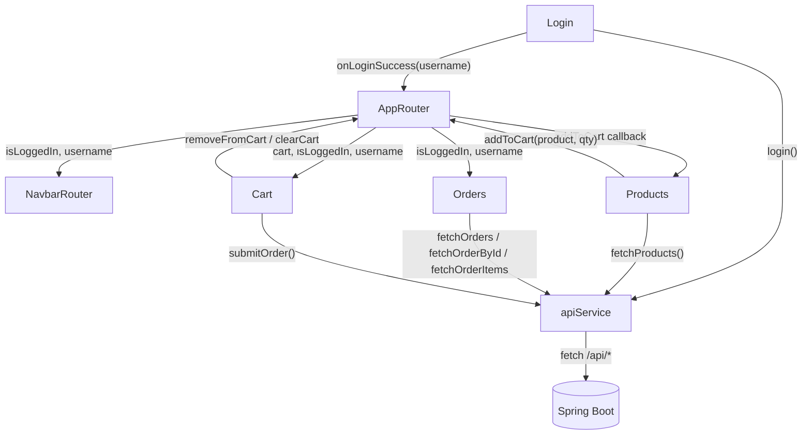

# 前端教學文件：React 18 + Vite + React Router 購物車

> 對應專案：`usercart_react/usercart-react`
> 技術版本：React 18.2 / Vite 7.3 / React Router DOM 7.x / Bootstrap 5.3
> 閱讀前提：會 JavaScript 基本語法、知道 `const` / 箭頭函式 / 陣列方法（`map`、`filter`、`reduce`）。

---

## 目錄

1. [專案簡介與技術棧](#1-專案簡介與技術棧)
2. [環境準備](#2-環境準備)
3. [建立專案骨架](#3-建立專案骨架)
4. [設定檔](#4-設定檔)
5. [目錄結構與元件架構](#5-目錄結構與元件架構)
6. [API 層：apiService.js](#6-api-層apiservicejs)
7. [根元件與路由](#7-根元件與路由)
8. [元件實作](#8-元件實作)
9. [狀態管理與資料流](#9-狀態管理與資料流)
10. [路由細節](#10-路由細節)
11. [樣式：Bootstrap 5](#11-樣式bootstrap-5)
12. [API 對照表與請求範例](#12-api-對照表與請求範例)
13. [執行與驗證](#13-執行與驗證)
14. [建置與部署](#14-建置與部署)
15. [已知問題與改進](#15-已知問題與改進)
16. [練習題](#16-練習題)
17. [附錄：常見錯誤](#17-附錄常見錯誤)

---

## 1. 專案簡介與技術棧

### 1.1 這個前端在做什麼

`usercart-react` 是購物車系統的 React 版本，主要功能：

| 頁面 | 路由 | 功能 |
|------|------|------|
| 登入 | `/login` | 輸入帳密、取得 JWT、存入 `localStorage` |
| 產品列表 | `/products` | 取得 20 筆產品、每頁 4 筆分頁、選擇數量加入購物車 |
| 購物車 | `/cart` | 顯示明細、刪除、計算總金額、送出訂單 |
| 訂單 | `/orders` | 查詢自己的訂單、查看單筆訂單明細 |
| 根路徑 | `/` | 重新導向 `/login` |

### 1.2 技術棧

| 技術 | 版本 | 角色 | 為什麼選它 |
|------|------|------|------------|
| React | 18.2 | UI 元件與狀態 | 以元件為單位組合畫面 |
| Vite | 7.3 | 開發伺服器、打包 | 啟動快、設定少、支援 ESM |
| React Router DOM | 7.x | 前端路由 | 讓 URL 與畫面同步 |
| Bootstrap | 5.3 | CSS 框架 | 不用自己寫版面 |
| Fetch API | 瀏覽器原生 | HTTP 請求 | 不需要額外安裝 axios |
| npm | 10+ | 套件管理 | 安裝依賴與執行 script |

> 💡 **為什麼不用 axios？**
> 本專案只用 GET/POST，`fetch` 已足夠。axios 的好處是攔截器、自動 JSON 轉換、取消請求等；若專案變大可以再換。

### 1.3 兩個根元件：`App.jsx` 與 `AppRouter.jsx`

專案裡有兩個根元件：

| 檔案 | 說明 | 是否啟用 |
|------|------|----------|
| `App.jsx` | 用 `currentPage` state + 條件渲染切換頁面 | ❌ 沒有被 `main.jsx` 引用 |
| `AppRouter.jsx` | 用 React Router 的 `BrowserRouter` / `Routes` / `Route` | ✅ 啟用中 |

`main.jsx` 目前匯入的是：

```javascript
import AppRouter from './AppRouter'
```

所以瀏覽器實際跑的是 `AppRouter`。`App.jsx` 是另一種「不用 Router」的入門寫法，很適合對照學習。本文件會先講 `AppRouter`，再補充 `App.jsx` 的差異。

---

## 2. 環境準備

### 2.1 必要工具

| 工具 | 建議版本 | 檢查指令 |
|------|----------|----------|
| Node.js | 20.19+ 或 22.12+（Vite 7 要求） | `node -v` |
| npm | 10 以上 | `npm -v` |
| 瀏覽器 | Chrome / Edge / Firefox | — |
| 後端 | `shoppingusercart` 跑在 8080 | `curl http://localhost:8080/api/products` |

> ⚠️ Vite 7 對 Node 版本有要求。若 `node -v` 太舊，`npm run dev` 會直接報錯。建議用 nvm 或官方安裝檔升級到 Node 20 LTS 以上。

### 2.2 前後端一起跑

前端開發時會把 `/api` 代理到 `http://localhost:8080`，所以：

```text
終端機 1：shoppingusercart → http://localhost:8080
終端機 2：usercart-react   → http://localhost:5173
```

如果只跑前端，產品列表與登入都會失敗。

---

## 3. 建立專案骨架

### 3.1 用 Vite 建立

```bash
npm create vite@latest usercart-react -- --template react
cd usercart-react
npm install
```

### 3.2 安裝本專案用到的套件

```bash
npm install bootstrap react-router-dom
```

### 3.3 啟動

```bash
npm run dev
```

預設會看到：

```text
VITE v7.x.x  ready in xxx ms
➜  Local:   http://localhost:5173/
```

### 3.4 從零到本專案的差異

| 步驟 | Vite 預設 | 本專案 |
|------|-----------|--------|
| 根元件 | `App.jsx` | `AppRouter.jsx`（`main.jsx` 改匯入） |
| CSS | `index.css` / `App.css` | 匯入 Bootstrap CSS |
| 路由 | 無 | `react-router-dom` |
| API | 無 | `src/api/apiService.js` |
| 元件 | `App.jsx` 一個 | `components/` 底下多個 |

---

## 4. 設定檔

### 4.1 `package.json`

```json
{
  "name": "usercart-react",
  "private": true,
  "version": "1.0.0",
  "type": "module",
  "scripts": {
    "dev": "vite",
    "build": "vite build",
    "preview": "vite preview"
  },
  "dependencies": {
    "bootstrap": "^5.3.0",
    "react": "^18.2.0",
    "react-dom": "^18.2.0",
    "react-router-dom": "^7.18.5"
  },
  "devDependencies": {
    "@vitejs/plugin-react": "^5.2.0",
    "vite": "^7.3.7"
  },
  "allowScripts": {
    "esbuild@0.28.2": true
  }
}
```

| 欄位 | 說明 |
|------|------|
| `"type": "module"` | 讓 `.js` 檔使用 ES Module（`import` / `export`） |
| `scripts.dev` | 啟動開發伺服器（含 HMR） |
| `scripts.build` | 產生 `dist/` 生產版 |
| `scripts.preview` | 本機預覽 `dist/` |
| `dependencies` | 執行時需要的套件 |
| `devDependencies` | 只有開發／建置時需要 |
| `allowScripts` | npm 的安裝腳本白名單（此專案用來允許 esbuild） |

> `react-router-dom` 雖然安裝 7.x，但本專案使用的是 v6 就存在的 API（`BrowserRouter`、`Routes`、`Route`、`NavLink`、`Navigate`），所以程式碼風格與 v6 相同。升級時仍要留意 v7 的 breaking changes。

### 4.2 `vite.config.js`

```javascript
import { defineConfig } from 'vite'
import react from '@vitejs/plugin-react'

export default defineConfig({
  plugins: [react()],
  server: {
    // 將 /api 請求代理到後端，避免 CORS 問題
    proxy: {
      '/api': 'http://localhost:8080'
    }
  }
})
```

#### 為什麼需要 Proxy？

沒有 Proxy 時，瀏覽器會直接呼叫：

```text
http://localhost:8080/api/products
```

對瀏覽器來說，這是**不同來源**（5173 → 8080），會觸發 CORS 檢查。後端雖然有 `@CrossOrigin`，但 Proxy 是更乾淨的做法：

```text
瀏覽器 → http://localhost:5173/api/products
                 ↓ Vite 代理
            http://localhost:8080/api/products
```

對瀏覽器而言，請求一直是同源（5173），所以不會有 CORS 問題。

#### Proxy 的運作細節

```javascript
proxy: {
  '/api': 'http://localhost:8080'
}
```

等價於：

```javascript
proxy: {
  '/api': {
    target: 'http://localhost:8080',
    changeOrigin: true
  }
}
```

只要是 `/api` 開頭的路徑，都會被轉發。像 `/assets`、`/src` 這種 Vite 自己的路徑不受影響。

> ⚠️ Proxy 只在 `npm run dev` 的開發伺服器生效。`npm run build` 產生的靜態檔案需要由真正的 Web Server（Nginx、Spring Boot）提供，並自行設定反向代理。詳見 [第 14 章](#14-建置與部署)。

### 4.3 `index.html`

```html
<!DOCTYPE html>
<html lang="zh-Hant">
  <head>
    <meta charset="UTF-8" />
    <meta name="viewport" content="width=device-width, initial-scale=1.0" />
    <title>簡易商城</title>
  </head>
  <body>
    <div id="root"></div>
    <script type="module" src="/src/main.jsx"></script>
  </body>
</html>
```

| 重點 | 說明 |
|------|------|
| `<div id="root">` | React 掛載點 |
| `type="module"` | 使用 ES Module |
| `/src/main.jsx` | Vite 的進入點 |
| `lang="zh-Hant"` | 繁體中文 |

### 4.4 `src/main.jsx`

```javascript
import React from 'react'
import ReactDOM from 'react-dom/client'
import 'bootstrap/dist/css/bootstrap.min.css'
// import App from './App'
import AppRouter from './AppRouter'

ReactDOM.createRoot(document.getElementById('root')).render(
  <React.StrictMode>
    <AppRouter />
  </React.StrictMode>
)
```

| 程式碼 | 說明 |
|--------|------|
| `import 'bootstrap/dist/css/bootstrap.min.css'` | 全域載入 Bootstrap 樣式 |
| `ReactDOM.createRoot(...)` | React 18 的建立根節點方式 |
| `<React.StrictMode>` | 開發模式會刻意重複執行某些生命週期，幫你找出副作用問題 |
| `<AppRouter />` | 目前啟用的根元件 |

> 💡 **StrictMode 的影響**：在開發模式下，`useEffect` 可能會執行兩次。你會看到 `/api/products` 被呼叫兩次，這是正常的，生產版不會。若你不希望重複請求，可以移除 StrictMode，但不建議——它幫你提早發現副作用寫錯。

---

## 5. 目錄結構與元件架構

### 5.1 目錄

```text
usercart-react/
├─ index.html
├─ package.json
├─ vite.config.js
└─ src/
   ├─ main.jsx                 # 進入點
   ├─ AppRouter.jsx            # React Router 版根元件（啟用）
   ├─ App.jsx                  # 條件渲染版根元件（未啟用）
   ├─ api/
   │  └─ apiService.js         # 所有 fetch 封裝
   └─ components/
      ├─ NavbarRouter.jsx      # Router 版導覽列
      ├─ Navbar.jsx            # 條件渲染版導覽列
      ├─ Login.jsx             # 登入頁
      ├─ Products.jsx          # 產品列表
      ├─ Cart.jsx              # 購物車
      └─ Orders.jsx            # 訂單
```

### 5.2 元件樹（啟用中的版本）

```text
main.jsx
└─ StrictMode
   └─ AppRouter
      └─ BrowserRouter
         ├─ NavbarRouter
         └─ Routes
            ├─ /          → Navigate to /login
            ├─ /login     → Login
            ├─ /products  → Products
            ├─ /cart      → Cart
            └─ /orders    → Orders
```

### 5.3 責任劃分

| 元件 | 責任 | 拥有的 state |
|------|------|--------------|
| `AppRouter` | 全域狀態、路由、登入與購物車邏輯 | `isLoggedIn`、`username`、`cart` |
| `NavbarRouter` | 導覽列、顯示登入狀態 | 無（props） |
| `Login` | 帳密輸入、呼叫登入 API | `username`、`password`、`errorMsg` |
| `Products` | 取得產品、分頁、數量輸入 | `products`、`quantities`、`currentPage` |
| `Cart` | 顯示購物車、送出訂單 | 無（props） |
| `Orders` | 取得訂單、載入明細 | `orders`、`selectedOrder`、`orderItems` |

這種「把共用狀態放在最上層，再用 props 往下傳」的模式叫 **State Lifting（狀態提升）**。好處是資料流清楚；缺點是元件層級變深時會出現 **Prop Drilling**。

---

## 6. API 層：apiService.js

把所有 `fetch` 集中在一個檔案，元件就不需要知道 URL、header、錯誤處理細節。

### 6.1 完整程式碼

```javascript
// 所有後端 API 呼叫集中管理，使用 Fetch API 取代 jQuery $.ajax
const BASE_URL = '/api'

export async function login(username, password) {
  const res = await fetch(`${BASE_URL}/user/login`, {
    method: 'POST',
    headers: { 'Content-Type': 'application/json' },
    body: JSON.stringify({ username, password })
  })
  if (!res.ok) throw new Error('帳號或密碼錯誤')
  return res.json()
}

export async function fetchProducts() {
  const res = await fetch(`${BASE_URL}/products`)
  if (!res.ok) throw new Error('載入產品失敗')
  return res.json()
}

function authHeaders() {
  return {
    'Content-Type': 'application/json',
    Authorization: `Bearer ${localStorage.getItem('token')}`
  }
}

export async function fetchOrders(username) {
  const res = await fetch(`${BASE_URL}/orders/${username}`, {
    headers: authHeaders()
  })
  if (!res.ok) throw new Error('載入訂單失敗')
  return res.json()
}

export async function fetchOrderById(orderId) {
  const res = await fetch(`${BASE_URL}/orders/orderid/${orderId}`, {
    headers: authHeaders()
  })
  if (!res.ok) throw new Error('載入訂單詳情失敗')
  return res.json()
}

export async function fetchOrderItems(orderId) {
  const res = await fetch(`${BASE_URL}/items/${orderId}`, {
    headers: authHeaders()
  })
  if (!res.ok) throw new Error('載入商品明細失敗')
  return res.json()
}

export async function submitOrder(username, cart) {
  const total = cart.reduce((sum, item) => sum + item.price * item.quantity, 0)
  const order = {
    username,
    totalPrice: total,
    items: cart.map(p => ({
      pid: p.id,
      productTitle: p.title,
      productPrice: p.price,
      quantity: p.quantity
    }))
  }
  const res = await fetch(`${BASE_URL}/orders`, {
    method: 'POST',
    headers: authHeaders(),
    body: JSON.stringify(order)
  })
  if (!res.ok) throw new Error('送出訂單失敗')
  return res.json()
}
```

### 6.2 設計重點

| 設計 | 說明 |
|------|------|
| `BASE_URL = '/api'` | 相對路徑，開發時由 Vite Proxy 轉發；生產時由反向代理轉發 |
| `async/await` | 讓非同步程式看起來像同步 |
| `if (!res.ok) throw` | `fetch` 不會因為 4xx/5xx 自動丟錯，必須自己檢查 |
| `return res.json()` | 把回應 body 解析成 JavaScript 物件 |
| `authHeaders()` | 每次呼叫才讀 `localStorage`，確保拿到最新 token |
| `submitOrder` | 把購物車格式轉成後端要的 `items` 格式 |

### 6.3 前端購物車物件 vs 後端訂單格式

購物車裡的物件長這樣（來自 `/api/products`）：

```javascript
{
  id: 1,
  title: "Fjallraven - Foldsack No. 1 Backpack, Fits 15 Laptops",
  price: 109.95,
  quantity: 2,
  image: "https://...",
  category: "men's clothing",
  description: "...",
  rating_id: 1
}
```

送出前會轉成：

```javascript
{
  pid: 1,                         // ← 由 id 改名
  productTitle: "Fjallraven...",  // ← 由 title 改名
  productPrice: 109.95,           // ← 由 price 改名
  quantity: 2
}
```

| 前端購物車 | 後端 `OrderItem` | 轉換 |
|------------|------------------|------|
| `id` | `pid` | `p.id` |
| `title` | `productTitle` | `p.title` |
| `price` | `productPrice` | `p.price` |
| `quantity` | `quantity` | 同名 |

> ⚠️ 後端 `productPrice` 是 `int`，所以 `109.95` 會被截成 `109`。這是目前前端與後端型別不一致的地方，會造成金額誤差。

### 6.4 錯誤處理的不足

目前的 `throw new Error('...')` 有幾個問題：

1. **不管後端回什麼，訊息都一樣**：401 和 500 都顯示「帳號或密碼錯誤」。
2. **沒有讀取後端錯誤 body**：後端可能回 `{"message":"..."}`，但前端丟掉了。
3. **沒有處理網路錯誤**：後端沒開時，`fetch` 會 reject，錯誤訊息是 `Failed to fetch`，對使用者不友善。
4. **`authHeaders()` 在沒有 token 時會送 `Bearer null`**：後端解析會失敗。

改善版本：

```javascript
async function request(path, options = {}) {
  const res = await fetch(`${BASE_URL}${path}`, options)

  if (!res.ok) {
    let message = `請求失敗（${res.status}）`
    try {
      const body = await res.json()
      if (body.message) message = body.message
    } catch {
      // 回應不是 JSON，維持預設訊息
    }
    throw new Error(message)
  }

  if (res.status === 204) return null
  return res.json()
}
```

之後每個 API 都改用 `request()`，錯誤處理就只寫一次。

---

## 7. 根元件與路由

### 7.1 `AppRouter.jsx`（啟用中）

```javascript
// AppRouter：React Router 版根元件（不修改原 App.jsx）
import { useState } from 'react'
import { BrowserRouter, Routes, Route, Navigate } from 'react-router-dom'
import NavbarRouter from './components/NavbarRouter'
import Login from './components/Login'
import Products from './components/Products'
import Cart from './components/Cart'
import Orders from './components/Orders'

function AppRouter() {
  const [isLoggedIn, setIsLoggedIn] = useState(false)
  const [username, setUsername] = useState('')
  const [cart, setCart] = useState([])

  function handleLoginSuccess(user) {
    sessionStorage.setItem('username', user)
    setIsLoggedIn(true)
    setUsername(user)
  }

  function addToCart(product, quantity) {
    setCart(prev => [...prev, { ...product, quantity: Number(quantity) }])
    alert(`已將 ${product.title} 加入購物車`)
  }

  function removeFromCart(index) {
    setCart(prev => prev.filter((_, i) => i !== index))
  }

  function clearCart() {
    setCart([])
  }

  return (
    <BrowserRouter>
      <NavbarRouter isLoggedIn={isLoggedIn} username={username} />
      <div className="container mt-4">
        <Routes>
          <Route path="/" element={<Navigate to="/login" replace />} />
          <Route
            path="/login"
            element={<Login onLoginSuccess={handleLoginSuccess} />}
          />
          <Route path="/products" element={<Products addToCart={addToCart} />} />
          <Route
            path="/cart"
            element={
              <Cart
                cart={cart}
                removeFromCart={removeFromCart}
                clearCart={clearCart}
                isLoggedIn={isLoggedIn}
                username={username}
              />
            }
          />
          <Route
            path="/orders"
            element={<Orders isLoggedIn={isLoggedIn} username={username} />}
          />
        </Routes>
      </div>
    </BrowserRouter>
  )
}

export default AppRouter
```

#### 逐段說明

| 程式碼 | 說明 |
|--------|------|
| `useState(false)` | 登入狀態；初始為未登入 |
| `useState('')` | 目前使用者名稱 |
| `useState([])` | 購物車陣列 |
| `handleLoginSuccess(user)` | 登入成功後由 `Login` 呼叫；寫入 `sessionStorage` 並更新 state |
| `addToCart(product, quantity)` | 用展開語法複製產品，附加 `quantity` |
| `setCart(prev => [...prev, newItem])` | 用函式型更新，避免閉包拿到舊 state |
| `removeFromCart(index)` | 用 `filter` 刪除指定索引 |
| `clearCart()` | 送出訂單成功後清空 |
| `<BrowserRouter>` | 啟用 HTML5 History 路由 |
| `<Navigate to="/login" replace />` | `/` 自動導向 `/login`；`replace` 不留下歷史紀錄 |
| `element={<... />}` | React Router v6/v7 的寫法（不是舊版 `component={...}`） |

#### 為什麼 `handleLoginSuccess` 只收 `user`，但 `Login` 傳了兩個參數？

`Login.jsx` 裡是：

```javascript
onLoginSuccess(username, res.token)
```

但 `AppRouter` 的定義是：

```javascript
function handleLoginSuccess(user) { ... }
```

JavaScript 會忽略多出來的第二個參數，所以不會錯。Token 已經在 `Login` 內寫入 `localStorage`，不需要再傳給父層。

> 💡 這是一個「介面不一致」的小陷阱。比較好的做法是讓 callback 只傳父層需要的資料，或讓父層負責儲存 token。

### 7.2 `App.jsx`（未啟用，另一種寫法）

```javascript
import { useState } from 'react'
import Navbar from './components/Navbar'
import Login from './components/Login'
import Products from './components/Products'
import Cart from './components/Cart'
import Orders from './components/Orders'

// App 是根元件，負責管理全域共享狀態 (Global State)
function App() {
  const [currentPage, setCurrentPage] = useState('login')
  const [isLoggedIn, setIsLoggedIn] = useState(false)
  const [username, setUsername] = useState('')
  const [cart, setCart] = useState([])

  function handleLoginSuccess(user) {
    sessionStorage.setItem('username', user)
    setIsLoggedIn(true)
    setUsername(user)
  }

  function addToCart(product, quantity) {
    setCart(prev => [...prev, { ...product, quantity: Number(quantity) }])
    alert(`已將 ${product.title} 加入購物車`)
  }

  function removeFromCart(index) {
    setCart(prev => prev.filter((_, i) => i !== index))
  }

  function clearCart() {
    setCart([])
  }

  return (
    <>
      <Navbar
        currentPage={currentPage}
        setCurrentPage={setCurrentPage}
        isLoggedIn={isLoggedIn}
        username={username}
      />
      <div className="container mt-4">
        {currentPage === 'login' && (
          <Login onLoginSuccess={handleLoginSuccess} />
        )}
        {currentPage === 'products' && (
          <Products addToCart={addToCart} />
        )}
        {currentPage === 'cart' && (
          <Cart
            cart={cart}
            removeFromCart={removeFromCart}
            clearCart={clearCart}
            isLoggedIn={isLoggedIn}
            username={username}
          />
        )}
        {currentPage === 'orders' && (
          <Orders isLoggedIn={isLoggedIn} username={username} />
        )}
      </div>
    </>
  )
}

export default App
```

#### `App.jsx` vs `AppRouter.jsx`

| 面向 | `App.jsx`（條件渲染） | `AppRouter.jsx`（Router） |
|------|----------------------|---------------------------|
| 頁面切換 | `currentPage` state | URL 路徑 |
| 上一頁／下一頁 | 不支援 | 瀏覽器支援 |
| 重新整理 | 回到預設頁 | 停留在目前路徑（需伺服器 fallback） |
| 分享連結 | 只能分享首頁 | 可分享 `/products` |
| 程式碼 | 較短 | 多一層 Router 設定 |
| 導覽列 | `Navbar.jsx`（用 callback） | `NavbarRouter.jsx`（用 `NavLink`） |

> 教學建議：先理解 `App.jsx` 的條件渲染，再學 `AppRouter.jsx` 的路由。兩者的全域狀態邏輯幾乎一樣，差別只在「畫面切換的方式」。

---

## 8. 元件實作

### 8.1 `NavbarRouter.jsx`

```javascript
// 導覽列元件（React Router 版）：使用 NavLink 進行路由導覽
import { NavLink } from 'react-router-dom'

function NavbarRouter({ isLoggedIn, username }) {
  const navItems = [
    { path: '/login', label: '帳戶登入' },
    { path: '/products', label: '產品列表' },
    { path: '/orders', label: '訂單' },
    { path: '/cart', label: '購物車' }
  ]

  return (
    <nav className="navbar navbar-expand-lg navbar-dark bg-dark">
      <div className="container-fluid">
        <NavLink className="navbar-brand" to="/products">
          我的商城
        </NavLink>
        <div className="collapse navbar-collapse">
          <ul className="navbar-nav me-auto mb-2 mb-lg-0">
            {navItems.map(({ path, label }) => (
              <li className="nav-item" key={path}>
                <NavLink
                  to={path}
                  className={({ isActive }) =>
                    `nav-link ${isActive ? 'active' : ''}`
                  }
                >
                  {label}
                </NavLink>
              </li>
            ))}
          </ul>
          <span className="navbar-text text-white">
            {isLoggedIn ? `歡迎，${username}` : '未登入'}
          </span>
        </div>
      </div>
    </nav>
  )
}

export default NavbarRouter
```

#### 重點

| 寫法 | 說明 |
|------|------|
| `NavLink` | 像 `<a>`，但會自動加上 `active` class |
| `className={({ isActive }) => ...}` | v6/v7 的函式型 className |
| `key={path}` | React 列表需要穩定 key |
| `isLoggedIn ? ... : ...` | 條件渲染文字 |
| `to="/products"` | 品牌標誌連到產品頁 |

> 這個導覽列**不會擋未登入使用者**。未登入也能點「訂單」，只是 `Orders` 會顯示「請先登入」。真正的路由守衛見 [第 15 章](#15-已知問題與改進)。

### 8.2 `Navbar.jsx`（`App.jsx` 版）

```javascript
// 導覽列元件：接收當前頁面與切換函式作為 props
function Navbar({ currentPage, setCurrentPage, isLoggedIn, username }) {
  const navItems = [
    { key: 'login', label: '帳戶登入' },
    { key: 'products', label: '產品列表' },
    { key: 'orders', label: '訂單' },
    { key: 'cart', label: '購物車' }
  ]

  return (
    <nav className="navbar navbar-expand-lg navbar-dark bg-dark">
      <div className="container-fluid">
        <span className="navbar-brand">我的商城</span>
        <div className="collapse navbar-collapse">
          <ul className="navbar-nav me-auto mb-2 mb-lg-0">
            {navItems.map(({ key, label }) => (
              <li className="nav-item" key={key}>
                <a
                  className={`nav-link ${currentPage === key ? 'active' : ''}`}
                  href="#"
                  onClick={e => { e.preventDefault(); setCurrentPage(key) }}
                >
                  {label}
                </a>
              </li>
            ))}
          </ul>
          <span className="navbar-text text-white">
            {isLoggedIn ? `歡迎，${username}` : '未登入'}
          </span>
        </div>
      </div>
    </nav>
  )
}

export default Navbar
```

對照重點：

- `href="#"` + `e.preventDefault()`：避免頁面跳到頂端
- `currentPage === key`：手動判斷 active
- `setCurrentPage(key)`：把點擊事件往上傳

### 8.3 `Login.jsx`

```javascript
import { useState } from 'react'
import { login } from '../api/apiService'

function Login({ onLoginSuccess }) {
  // 受控輸入元件 (Controlled Input)：用 state 追蹤輸入值
  const [username, setUsername] = useState('')
  const [password, setPassword] = useState('')
  const [errorMsg, setErrorMsg] = useState('')

  async function handleLogin(e) {
    e.preventDefault()
    try {
      const res = await login(username, password)
      localStorage.setItem('token', res.token)
      onLoginSuccess(username, res.token)
      setErrorMsg('')
      alert('登入成功！')
    } catch {
      setErrorMsg('帳號或密碼錯誤')
    }
  }

  return (
    <div>
      <h3>帳戶登入</h3>
      <input
        type="text"
        className="form-control mb-1 w-25"
        placeholder="admin"
        value={username}
        onChange={e => setUsername(e.target.value)}
      />
      <input
        type="password"
        className="form-control mb-1 w-25"
        placeholder="1234"
        value={password}
        onChange={e => setPassword(e.target.value)}
      />
      <button className="btn btn-primary" onClick={handleLogin}>
        登入
      </button>
      {errorMsg && <div className="mt-2 text-danger">{errorMsg}</div>}
    </div>
  )
}

export default Login
```

#### 受控輸入（Controlled Input）

| 元素 | state | 事件 |
|------|-------|------|
| 帳號 `<input>` | `username` | `onChange` → `setUsername` |
| 密碼 `<input type="password">` | `password` | `onChange` → `setPassword` |

`value={username}` 讓畫面永遠反映 state；使用者打字時觸發 `onChange` 更新 state，形成單向資料流。

#### 登入流程

```text
使用者輸入帳密
   ↓
按下「登入」→ handleLogin
   ↓
login(username, password) → POST /api/user/login
   ↓ 成功
localStorage.setItem('token', res.token)
onLoginSuccess(username, res.token) → AppRouter 更新 isLoggedIn / username
   ↓
alert('登入成功！')
```

#### 注意事項

1. `onLoginSuccess(username, res.token)` 傳了兩個參數，但父層只收一個；第二個會被忽略。
2. `catch` 沒有接收 error 參數，所以無法區分「帳密錯誤」與「後端沒開」。
3. 沒有檢查空白輸入；送出空字串會得到 401。
4. 沒有 `loading` 狀態，連點按鈕會送出多次請求。
5. 使用 `alert` 不是很好的 UX，正式專案可改用 toast。

### 8.4 `Products.jsx`

```javascript
import { useState, useEffect } from 'react'
import { fetchProducts } from '../api/apiService'

function Products({ addToCart }) {
  const [products, setProducts] = useState([])
  // 每個產品各自獨立的數量 state，以 productId 為 key
  const [quantities, setQuantities] = useState({})
  // 分頁 state
  const [currentPage, setCurrentPage] = useState(1)
  const perPage = 4

  // useEffect 替代 jQuery 的 document.ready + loadProducts()
  useEffect(() => {
    fetchProducts().then(data => {
      setProducts(data)
      // 初始化每個產品數量為 1
      const initQty = {}
      data.forEach(p => { initQty[p.id] = 1 })
      setQuantities(initQty)
    })
  }, []) // 空陣列 = 只在元件掛載時執行一次

  function handleQtyChange(productId, value) {
    setQuantities(prev => ({ ...prev, [productId]: Number(value) }))
  }

  const totalPages = Math.ceil(products.length / perPage)
  const currentProducts = products.slice((currentPage - 1) * perPage, currentPage * perPage)
  const pageNumbers = Array.from({ length: totalPages }, (_, i) => i + 1)

  function handlePageChange(page) {
    setCurrentPage(page)
  }

  return (
    <div>
      <h3>產品列表</h3>
      <div className="row">
        {currentProducts.map(product => (
          <div className="col-md-3" key={product.id}>
            <div className="card mb-3">
              <div className="card-body">
                <h5 className="card-title">{product.title}</h5>
                
                <p className="card-text">價格：{product.price} 元</p>
                <p className="card-text">
                  購買數量：
                  <input
                    type="number"
                    min="1"
                    value={quantities[product.id] ?? 1}
                    onChange={e => handleQtyChange(product.id, e.target.value)}
                    style={{ width: '60px' }}
                  />
                </p>
                <button
                  className="btn btn-success"
                  onClick={() => addToCart(product, quantities[product.id] ?? 1)}
                >
                  加入購物車
                </button>
              </div>
            </div>
          </div>
        ))}
      </div>
      {totalPages > 1 && (
        <nav>
          <ul className="pagination justify-content-center">
            <li className={`page-item ${currentPage === 1 ? 'disabled' : ''}`}>
              <button className="page-link" onClick={() => handlePageChange(currentPage - 1)}>
                上一頁
              </button>
            </li>
            {pageNumbers.map(page => (
              <li className={`page-item ${currentPage === page ? 'active' : ''}`} key={page}>
                <button className="page-link" onClick={() => handlePageChange(page)}>
                  {page}
                </button>
              </li>
            ))}
            <li className={`page-item ${currentPage === totalPages ? 'disabled' : ''}`}>
              <button className="page-link" onClick={() => handlePageChange(currentPage + 1)}>
                下一頁
              </button>
            </li>
          </ul>
        </nav>
      )}
    </div>
  )
}

export default Products
```

#### `useEffect` 的角色

```javascript
useEffect(() => {
  fetchProducts().then(data => {
    setProducts(data)
    const initQty = {}
    data.forEach(p => { initQty[p.id] = 1 })
    setQuantities(initQty)
  })
}, [])
```

| 部分 | 說明 |
|------|------|
| `useEffect` | 在元件渲染後執行副作用（資料請求） |
| `[]` | 依賴陣列為空 → 只在掛載時執行一次 |
| `.then(data => ...)` | fetch 成功後更新兩個 state |

在 StrictMode 下，這個 effect 會執行兩次，所以開發時會看到兩次 `/api/products` 請求。生產版只會一次。

#### 為什麼數量要用物件？

```javascript
const [quantities, setQuantities] = useState({})
// { 1: 1, 2: 3, 3: 1, ... }
```

每個產品都有自己的數量。如果用單一 `quantity` state，切換產品時會互相覆蓋。

更新時用展開語法保留其他產品：

```javascript
setQuantities(prev => ({ ...prev, [productId]: Number(value) }))
```

#### 分頁邏輯

```javascript
const totalPages = Math.ceil(products.length / perPage)
const currentProducts = products.slice(
  (currentPage - 1) * perPage,
  currentPage * perPage
)
const pageNumbers = Array.from({ length: totalPages }, (_, i) => i + 1)
```

以 20 筆、每頁 4 筆為例：

| currentPage | slice 範圍 | 顯示 |
|-------------|------------|------|
| 1 | 0～3 | 第 1～4 筆 |
| 2 | 4～7 | 第 5～8 筆 |
| 5 | 16～19 | 第 17～20 筆 |

`Array.from({ length: totalPages }, (_, i) => i + 1)` 產生 `[1,2,3,4,5]`。

#### 注意事項

1. `fetchProducts()` 沒有 `.catch()`；後端沒開時會出現未處理的 Promise rejection，畫面空白。
2. `currentPage` 沒有在資料變動時重置；目前資料固定，所以沒事。
3. `Number(value)` 若輸入框被清空，會變成 `0`；`min="1"` 只是 HTML 提示，使用者仍可輸入 0 或負數。
4. `addToCart` 允許同一產品重複加入，購物車會出現多列。
5. 圖片是外部網址，沒有 `onError` fallback。

### 8.5 `Cart.jsx`

```javascript
import { submitOrder } from '../api/apiService'

function Cart({ cart, removeFromCart, clearCart, isLoggedIn, username }) {
  const total = cart.reduce((sum, item) => sum + item.price * item.quantity, 0)

  async function handleSubmitOrder() {
    if (!isLoggedIn) {
      alert('請先登入！')
      return
    }
    try {
      await submitOrder(username, cart)
      alert('訂單已送出！')
      clearCart()
    } catch {
      alert('送出訂單失敗')
    }
  }

  return (
    <div>
      <h3>購物車</h3>
      <ul className="list-group mb-2">
        {cart.length === 0 ? (
          <li className="list-group-item">購物車是空的</li>
        ) : (
          cart.map((item, index) => (
            <li
              key={index}
              className="list-group-item d-flex justify-content-between align-items-center"
            >
              {item.title} - {item.price} 元，數量：{item.quantity}
              <button
                className="btn btn-sm btn-danger"
                onClick={() => removeFromCart(index)}
              >
                刪除
              </button>
            </li>
          ))
        )}
      </ul>
      <p>
        <strong>總金額：</strong>{total} 元
      </p>
      <button className="btn btn-primary mt-3" onClick={handleSubmitOrder}>
        送出訂單
      </button>
    </div>
  )
}

export default Cart
```

#### 重點

| 程式碼 | 說明 |
|--------|------|
| `cart.reduce(...)` | 每次 render 都重新計算總金額（derived state） |
| `cart.length === 0 ? ... : ...` | 空購物車提示 |
| `key={index}` | 使用索引當 key；項目順序變動時可能出錯 |
| `removeFromCart(index)` | 由父層用 `filter` 刪除 |
| `handleSubmitOrder` | 先檢查登入，再呼叫 API |
| `clearCart()` | 只有成功才清空 |

#### 為什麼總金額不存成 state？

```javascript
const total = cart.reduce((sum, item) => sum + item.price * item.quantity, 0)
```

總金額完全由 `cart` 推導而來。如果另外存一個 `total` state，就必須在每次加入／刪除時同步更新，容易不一致。**Derived state 能算就不要存**。

#### 注意事項

1. `key={index}`：如果在中間刪除項目，React 可能重用錯誤的 DOM。較好的 key 是 `item.id`（但同一產品可能重複，需搭配唯一 key）。
2. `total` 可能是浮點數，例如 `109.95 + 22.3 = 132.25`；顯示時可能出現 `132.25000000000003`。建議 `total.toFixed(2)`。
3. 後端 `totalPrice` 是 `int`，所以送到後端會被截斷。
4. 沒有 `submitting` 狀態，連點會送出多筆訂單。
5. 沒有數量編輯功能，只能刪除再加。
6. 購物車只存在記憶體，重新整理就消失。

### 8.6 `Orders.jsx`

```javascript
import { useState, useEffect } from 'react'
import { fetchOrders, fetchOrderById, fetchOrderItems } from '../api/apiService'

function Orders({ isLoggedIn, username }) {
  const [orders, setOrders] = useState([])
  const [selectedOrder, setSelectedOrder] = useState(null)
  const [orderItems, setOrderItems] = useState([])

  useEffect(() => {
    if (isLoggedIn && username) {
      fetchOrders(username).then(setOrders).catch(() => {})
    }
  }, [isLoggedIn, username])

  async function handleShowDetails(orderId) {
    // Promise.all 同時發出兩個請求，等兩個都完成後再更新畫面
    const [order, items] = await Promise.all([
      fetchOrderById(orderId),
      fetchOrderItems(orderId)
    ])
    setSelectedOrder(order)
    setOrderItems(items)
  }

  if (!isLoggedIn) {
    return <div className="text-danger mt-3">請先登入！</div>
  }

  return (
    <div>
      <h3>訂單管理</h3>

      {/* 訂單列表表頭 */}
      <div className="row fw-bold border-bottom pb-2 mb-2">
        <div className="col-md-3">訂單編號</div>
        <div className="col-md-3">訂單用戶</div>
        <div className="col-md-3">訂單時間</div>
        <div className="col-md-3">操作</div>
      </div>

      {orders.map(order => (
        <div className="row mt-2" key={order.id}>
          <div className="col-md-3">{order.id}</div>
          <div className="col-md-3">{order.username}</div>
          <div className="col-md-3">{order.orderTime}</div>
          <div className="col-md-3">
            <button
              className="btn btn-success btn-sm"
              onClick={() => handleShowDetails(order.id)}
            >
              顯示訂購商品
            </button>
          </div>
        </div>
      ))}

      {/* 商品明細 — 只在選擇訂單後顯示 */}
      {selectedOrder && (
        <>
          <h4 className="mt-4">商品明細（訂單 #{selectedOrder.id}）</h4>
          <div className="row fw-bold border-bottom pb-2 mb-2">
            <div className="col-md-3">產品編號</div>
            <div className="col-md-3">產品名稱</div>
            <div className="col-md-3">產品價格</div>
            <div className="col-md-3">數量</div>
          </div>
          {orderItems.map((item, i) => (
            <div className="row mt-1" key={i}>
              <div className="col-md-3">{item.pid}</div>
              <div className="col-md-3">{item.productTitle}</div>
              <div className="col-md-3">{item.productPrice}</div>
              <div className="col-md-3">{item.quantity}</div>
            </div>
          ))}
        </>
      )}
    </div>
  )
}

export default Orders
```

#### 重點

| 程式碼 | 說明 |
|--------|------|
| `useEffect(..., [isLoggedIn, username])` | 登入狀態或使用者改變時重新抓訂單 |
| `if (isLoggedIn && username)` | 未登入不發請求 |
| `.catch(() => {})` | 吞掉錯誤，畫面不會壞，但使用者不知道失敗 |
| `Promise.all([...])` | 同時抓訂單與明細，兩個都完成才更新 |
| `if (!isLoggedIn) return ...` | 元件層級的守衛 |
| `selectedOrder && (...)` | 有選到訂單才顯示明細區塊 |
| `key={i}` | 明細用索引當 key（資料不會重排，尚可接受） |

#### 為什麼用 `Promise.all`？

```javascript
const [order, items] = await Promise.all([
  fetchOrderById(orderId),
  fetchOrderItems(orderId)
])
```

`Promise.all` 會並行發出兩個請求，總等待時間約等於「較慢的那個」，而不是兩者相加。這比：

```javascript
const order = await fetchOrderById(orderId)
const items = await fetchOrderItems(orderId)
```

快一倍。

#### 注意事項

1. `handleShowDetails` 沒有 `try/catch`，任何一個請求失敗都會產生 unhandled rejection。
2. 沒有 `loading` 狀態，按下按鈕後畫面沒有回饋。
3. 訂單列表沒有「查無資料」提示，空陣列時只顯示表頭。
4. `orderTime` 直接顯示原始字串，沒有格式化。
5. 重新整理後 `isLoggedIn` 變回 `false`，即使 token 還在 `localStorage`。
6. 沒有分頁，訂單很多時會全部載入。

---

## 9. 狀態管理與資料流

### 9.1 狀態一覽

| State | 擁有者 | 型別 | 初始值 | 是否持久化 |
|-------|--------|------|--------|------------|
| `isLoggedIn` | `AppRouter` | boolean | `false` | ❌ |
| `username` | `AppRouter` | string | `''` | 寫入 `sessionStorage`，但沒有在啟動時讀回 |
| `cart` | `AppRouter` | array | `[]` | ❌ |
| `token` | 無（直接放 localStorage） | string | — | ✅ `localStorage` |
| `products` | `Products` | array | `[]` | ❌ |
| `quantities` | `Products` | object | `{}` | ❌ |
| `currentPage` | `Products` | number | `1` | ❌ |
| `orders` | `Orders` | array | `[]` | ❌ |
| `selectedOrder` | `Orders` | object/null | `null` | ❌ |
| `orderItems` | `Orders` | array | `[]` | ❌ |
| `errorMsg` | `Login` | string | `''` | ❌ |

### 9.2 資料流圖



### 9.3 Props vs State

| 名詞 | 定義 | 例子 |
|------|------|------|
| State | 元件自己擁有、可以改變的資料 | `Products` 的 `products` |
| Props | 由父層傳入、子元件只能讀 | `Cart` 的 `cart` |
| Callback | 父層傳給子層的函式，讓子層通知父層 | `addToCart` |
| Derived state | 由其他 state 計算出來的值 | `total`、`totalPages`、`currentProducts` |

### 9.4 為什麼不把 `cart` 放在 `Cart` 元件裡？

因為 `Products` 需要「加入購物車」，`Navbar` 可能想顯示購物車數量，`Cart` 需要顯示內容。這些元件是兄弟關係，沒有共同的父層 state 就無法共享。

把 `cart` 提升到 `AppRouter`，再透過 props 傳下去，是最直覺的做法。當專案變大時，可以改用 Context：

```javascript
const CartContext = createContext()

<CartContext.Provider value={{ cart, addToCart, removeFromCart }}>
  ...
</CartContext.Provider>
```

---

## 10. 路由細節

### 10.1 `BrowserRouter` 是什麼

```javascript
<BrowserRouter>
  <Routes>
    <Route path="/login" element={<Login />} />
  </Routes>
</BrowserRouter>
```

- 使用 HTML5 History API 改變 URL，不會整頁重新載入
- URL 看起來很乾淨：`/products`、`/cart`
- 需要伺服器支援「任何路徑都回傳 `index.html`」，否則重新整理 `/products` 會 404

替代方案：

| Router | URL 範例 | 優點 | 缺點 |
|--------|----------|------|------|
| `BrowserRouter` | `/products` | 乾淨、SEO 友善 | 需要伺服器 fallback |
| `HashRouter` | `/#/products` | 不需要伺服器設定 | URL 較醜 |
| `MemoryRouter` | 不顯示 | 適合測試 | 無法分享 |

### 10.2 `Navigate` 的用途

```javascript
<Route path="/" element={<Navigate to="/login" replace />} />
```

- 使用者打開 `http://localhost:5173/` 時，自動跳到 `/login`
- `replace` 表示「取代目前歷史紀錄」，按上一頁不會回到 `/`
- 如果沒有 `replace`，使用者按上一頁會在 `/` 與 `/login` 之間循環

### 10.3 `NavLink` 的 active 樣式

```javascript
<NavLink
  to={path}
  className={({ isActive }) => `nav-link ${isActive ? 'active' : ''}`}
>
```

`NavLink` 會判斷目前 URL 是否符合 `to`，符合時 `isActive` 為 `true`。Bootstrap 的 `.nav-link.active` 會讓文字變亮。

### 10.4 目前缺少的 404 路由

```javascript
<Routes>
  ...
  <Route path="*" element={<NotFound />} />
</Routes>
```

如果沒有這行，使用者輸入 `/abc` 會看到空白頁。建議補上。

### 10.5 路由守衛（進階）

目前「未登入不能看訂單」是在 `Orders` 元件內部判斷：

```javascript
if (!isLoggedIn) {
  return <div className="text-danger mt-3">請先登入！</div>
}
```

這種做法雖然有效，但每個需要保護的頁面都要寫一次。比較好的做法是抽成 `ProtectedRoute`：

```javascript
import { Navigate } from 'react-router-dom'

function ProtectedRoute({ isLoggedIn, children }) {
  if (!isLoggedIn) {
    return <Navigate to="/login" replace />
  }
  return children
}

// 使用
<Route
  path="/orders"
  element={
    <ProtectedRoute isLoggedIn={isLoggedIn}>
      <Orders isLoggedIn={isLoggedIn} username={username} />
    </ProtectedRoute>
  }
/>
```

---

## 11. 樣式：Bootstrap 5

### 11.1 載入方式

本專案在 `main.jsx` 直接匯入 CSS：

```javascript
import 'bootstrap/dist/css/bootstrap.min.css'
```

這種方式只載入 CSS，**沒有載入 Bootstrap 的 JavaScript**。本專案不需要 Modal、Dropdown 等 JS 元件，所以足夠。

若需要 Bootstrap JS：

```bash
npm install bootstrap
```

```javascript
import 'bootstrap/dist/js/bootstrap.bundle.min.js'
```

### 11.2 常用 class 對照

| Class | 效果 | 本專案使用處 |
|-------|------|--------------|
| `container`、`container-fluid` | 版面容器 | 外層、導覽列 |
| `row`、`col-md-3`、`col-md-4` | 網格 | 產品卡片、訂單表格 |
| `card`、`card-body`、`card-title` | 卡片 | 產品 |
| `btn btn-primary`、`btn-success`、`btn-danger` | 按鈕 | 登入、加入購物車、刪除 |
| `form-control` | 輸入框 | 登入、數量 |
| `list-group`、`list-group-item` | 清單 | 購物車 |
| `navbar navbar-dark bg-dark` | 深色導覽列 | `NavbarRouter` |
| `text-danger` | 紅字 | 錯誤訊息 |
| `pagination`、`page-item`、`page-link` | 分頁 | `Products` |
| `d-flex justify-content-between align-items-center` | Flex 排版 | 購物車項目 |
| `fw-bold` | 粗體 | 表頭 |
| `mt-3`、`mb-2`、`pb-2` | 間距 | 各處 |

### 11.3 客製樣式

目前專案沒有額外的 CSS 檔。若要調整，可以新增 `src/index.css` 並在 `main.jsx` 匯入：

```css
.product-card img {
  object-fit: contain;
  height: 200px;
}
```

---

## 12. API 對照表與請求範例

### 12.1 `apiService.js` 對照

| 函式 | 方法 | 路徑 | 請求 body | 回傳 | 使用元件 |
|------|------|------|-----------|------|----------|
| `login(username, password)` | POST | `/api/user/login` | `{username, password}` | `{token}` | `Login` |
| `fetchProducts()` | GET | `/api/products` | — | `Product[]` | `Products` |
| `fetchOrders(username)` | GET | `/api/orders/{username}` | — | `Order[]` | `Orders` |
| `fetchOrderById(orderId)` | GET | `/api/orders/orderid/{orderId}` | — | `Order` | `Orders` |
| `fetchOrderItems(orderId)` | GET | `/api/items/{orderId}` | — | `OrderItem[]` | `Orders` |
| `submitOrder(username, cart)` | POST | `/api/orders` | `{username, totalPrice, items[]}` | `Order` | `Cart` |

### 12.2 前端型別（建議）

目前專案是純 JavaScript，沒有 TypeScript。若要用 TypeScript，建議定義：

```typescript
export interface Product {
  id: number
  title: string
  description: string
  category: string
  price: number
  image: string
  rating_id: number
}

export interface OrderItem {
  id: number
  pid: number
  productTitle: string
  productPrice: number
  quantity: number
  order?: unknown
}

export interface Order {
  id: number
  username: string
  orderTime: string
  totalPrice: number
  items: OrderItem[] | null
}

export interface LoginResponse {
  token: string
}

export interface CartItem extends Product {
  quantity: number
}
```

> 有了型別，`p.title` 打成 `p.titel` 會在編譯時被抓到。這是本專案可以升級的方向之一。

### 12.3 請求／回應範例

**登入**

```javascript
// 請求
POST /api/user/login
{ "username": "admin", "password": "1234" }

// 回應 200
{ "token": "eyJhbGciOiJIUzUxMiJ9..." }
```

**取得產品**

```javascript
// 請求
GET /api/products

// 回應 200（節錄）
[
  {
    "id": 1,
    "title": "Fjallraven - Foldsack No. 1 Backpack, Fits 15 Laptops",
    "description": "...",
    "category": "men's clothing",
    "price": 109.95,
    "image": "https://fakestoreapi.com/img/81fPKd-2AYL._AC_SL1500_t.png",
    "rating_id": 1
  }
]
```

**送出訂單**

```javascript
// 請求
POST /api/orders
Authorization: Bearer <token>
{
  "username": "admin",
  "totalPrice": 143,
  "items": [
    {
      "pid": 1,
      "productTitle": "Fjallraven - Foldsack No. 1 Backpack, Fits 15 Laptops",
      "productPrice": 109,
      "quantity": 1
    }
  ]
}

// 回應 200
{
  "id": 3,
  "username": "admin",
  "orderTime": "2026-11-02T10:15:30.123",
  "totalPrice": 143,
  "items": [
    {
      "id": 6,
      "pid": 1,
      "productTitle": "Fjallraven - Foldsack No. 1 Backpack, Fits 15 Laptops",
      "productPrice": 109,
      "quantity": 1,
      "order": null
    }
  ]
}
```

**查詢訂單**

```javascript
GET /api/orders/admin
Authorization: Bearer <token>
```

> 注意：後端目前**不會驗證** GET 訂單的 token，所以 `Authorization` 標頭其實沒有作用。這是後端的安全缺口，不是前端寫錯。

---

## 13. 執行與驗證

### 13.1 啟動順序

```bash
# 終端機 1：後端
cd shoppingusercart
mvn spring-boot:run

# 終端機 2：前端
cd usercart_react/usercart-react
npm install
npm run dev
```

### 13.2 瀏覽器操作清單

| 步驟 | 操作 | 預期 |
|------|------|------|
| 1 | 開 `http://localhost:5173/` | 自動跳轉 `/login` |
| 2 | 輸入 `admin` / `1234`，按登入 | 彈出「登入成功！」，導覽列顯示「歡迎，admin」 |
| 3 | 開 DevTools → Application → Local Storage | 看到 `token` |
| 4 | 開 DevTools → Session Storage | 看到 `username = admin` |
| 5 | 點「產品列表」 | 顯示 4 張產品卡片與分頁 |
| 6 | 改數量、按「加入購物車」 | 彈出加入成功 |
| 7 | 點「購物車」 | 顯示項目與總金額 |
| 8 | 按「送出訂單」 | 彈出「訂單已送出！」，購物車清空 |
| 9 | 點「訂單」 | 顯示訂單列表 |
| 10 | 按「顯示訂購商品」 | 顯示明細 |

### 13.3 用 DevTools 觀察

打開 Chrome DevTools：

| 面板 | 看什麼 |
|------|--------|
| Network | 每個 `/api/*` 請求的 method、status、payload、response |
| Console | `console.error`、未處理的 Promise rejection |
| Application → Local Storage | `token` 是否存在 |
| Application → Session Storage | `username` 是否存在 |
| React DevTools | 元件樹、props、state |

### 13.4 用瀏覽器直接測 API

在網址列輸入：

```text
http://localhost:8080/api/products
```

應該看到 JSON。若看不到，先確認後端。

### 13.5 用 curl / PowerShell 測 API

```bash
curl http://localhost:8080/api/products
```

```powershell
Invoke-RestMethod -Uri http://localhost:8080/api/products
```

---

## 14. 建置與部署

### 14.1 產生生產版

```bash
npm run build
```

會產生：

```text
dist/
├─ index.html
└─ assets/
   ├─ index-xxxx.css
   └─ index-xxxx.js
```

`dist/` 是純靜態檔案，可以放到任何 Web Server。

### 14.2 本機預覽

```bash
npm run preview
```

預設 `http://localhost:4173`。

> ⚠️ `npm run preview` 是預覽靜態檔案，**不一定會套用 `server.proxy`**。若要在 preview 模式下呼叫後端，建議在 `vite.config.js` 加上 `preview.proxy`，或直接把 `dist/` 放到有反向代理的 Web Server。實際行為依 Vite 版本而定，請以你的版本測試為準。

### 14.3 部署選項 A：Nginx + 反向代理（推薦）

```nginx
server {
    listen 80;
    server_name shop.example.com;

    root /var/www/usercart/dist;
    index index.html;

    # React Router：任何前端路徑都回 index.html
    location / {
        try_files $uri $uri/ /index.html;
    }

    # API 反向代理到 Spring Boot
    location /api/ {
        proxy_pass http://localhost:8080;
        proxy_set_header Host $host;
        proxy_set_header X-Real-IP $remote_addr;
        proxy_set_header X-Forwarded-For $proxy_add_x_forwarded_for;
        proxy_set_header X-Forwarded-Proto $scheme;
    }
}
```

這樣做的好處：

- 前端與 API 同源，不需要 CORS
- `BrowserRouter` 重新整理不會 404（`try_files` fallback）
- 後端不用暴露在公開網路上

### 14.4 部署選項 B：放到 Spring Boot 的 static

把 `dist/` 內容複製到：

```text
shoppingusercart/src/main/resources/static/
```

然後啟動後端，開 `http://localhost:8080/`。

需要注意：

1. `BrowserRouter` 的路徑（`/products`）重新整理會 404，除非加一個 forwarding controller。
2. `apiService` 的 `/api` 相對路徑在 8080 同源下可用。
3. 後端已有 `/api/user/login` GET 回傳 Thymeleaf 頁面，與 React 的 `/login` 不衝突（路徑不同）。

Forwarding controller 範例：

```java
@Controller
public class SpaForwardController {

    @GetMapping({"/login", "/products", "/cart", "/orders"})
    public String forward() {
        return "forward:/index.html";
    }
}
```

> 這種做法適合小型專案；大型專案建議前后端分開部署。

### 14.5 環境變數化 API 網址

目前 `BASE_URL` 寫死 `/api`。若前端與後端不同網域，可以改成：

```javascript
const BASE_URL = import.meta.env.VITE_API_BASE_URL ?? '/api'
```

`.env.development`：

```text
VITE_API_BASE_URL=/api
```

`.env.production`：

```text
VITE_API_BASE_URL=https://api.example.com/api
```

使用時機：

| 情境 | `BASE_URL` |
|------|------------|
| 本機 Vite Proxy | `/api` |
| Nginx 同源反向代理 | `/api` |
| 前後端不同網域 | `https://api.example.com/api` |

> 若使用不同網域，後端必須設定正確的 CORS，且不能只用 `@CrossOrigin(origins="*")` 搭配 credentials。

### 14.6 建置檢查清單

```text
□ npm run build 沒有錯誤
□ dist/index.html 存在
□ 重新整理 /products 不會 404（Nginx try_files 或 forwarding controller）
□ /api 請求有正確代理
□ localStorage token 沒有寫死在程式碼
□ console 沒有未處理的錯誤
□ 手機版版面正常（Bootstrap grid）
```

---

## 15. 已知問題與改進

### 15.1 登入狀態無法跨重新整理

**現象**：登入後按 F5，導覽列變回「未登入」，訂單頁顯示「請先登入」。

**原因**：`isLoggedIn` 與 `username` 只存在 React state。`sessionStorage` 雖然有寫入 `username`，但初始化時沒有讀回。

**修正**：

```javascript
const [isLoggedIn, setIsLoggedIn] = useState(
  () => Boolean(sessionStorage.getItem('username'))
)
const [username, setUsername] = useState(
  () => sessionStorage.getItem('username') ?? ''
)
```

更完整的做法是啟動時呼叫一個 `/api/user/me` 驗證 token 是否仍有效。

### 15.2 沒有登出功能

**修正**：

```javascript
function logout() {
  localStorage.removeItem('token')
  sessionStorage.removeItem('username')
  setIsLoggedIn(false)
  setUsername('')
  setCart([])
}
```

在 `NavbarRouter` 加一顆按鈕，或加一個 `/logout` 路由。

### 15.3 未登入仍可進入 `/orders`

目前靠 `Orders` 內部判斷。建議加 `ProtectedRoute`（見 [10.5](#105-路由守衛進階)）。

### 15.4 沒有 404 頁面

加：

```javascript
<Route path="*" element={<NotFound />} />
```

### 15.5 錯誤處理不一致

- `Products`：沒有 `.catch()`
- `Orders`：`.catch(() => {})` 吞掉錯誤
- `Login`：所有錯誤都顯示「帳密錯誤」
- `Cart`：所有錯誤都顯示「送出訂單失敗」

**修正**：統一用 `apiService` 的 `request()`，回傳可讀的錯誤訊息，並在每個元件加 `error` state。

### 15.6 沒有 loading 狀態

使用者在等待 API 時看不到回饋。建議：

```javascript
const [loading, setLoading] = useState(false)

async function handleShowDetails(orderId) {
  setLoading(true)
  try {
    const [order, items] = await Promise.all([...])
    setSelectedOrder(order)
    setOrderItems(items)
  } catch (err) {
    alert(err.message)
  } finally {
    setLoading(false)
  }
}
```

### 15.7 金額精度問題

- 前端 `total` 可能是浮點數
- 後端 `totalPrice` / `productPrice` 是 `int`
- 結果：小數被截斷

**短期修正**：

```javascript
const total = cart.reduce(...)
const displayTotal = total.toFixed(2)
```

**長期修正**：後端改用 `BigDecimal` + `DECIMAL(10,2)`，前端顯示 `Intl.NumberFormat`。

### 15.8 重複加入購物車

目前每次加入都 push 一筆，同一產品會出現多列。若希望合併：

```javascript
function addToCart(product, quantity) {
  setCart(prev => {
    const existing = prev.find(item => item.id === product.id)
    if (existing) {
      return prev.map(item =>
        item.id === product.id
          ? { ...item, quantity: item.quantity + Number(quantity) }
          : item
      )
    }
    return [...prev, { ...product, quantity: Number(quantity) }]
  })
}
```

### 15.9 數量沒有驗證

`Number('')` 是 `0`，`Number('abc')` 是 `NaN`。建議：

```javascript
const qty = Math.max(1, Math.floor(Number(value) || 1))
```

並在 `addToCart` 前再檢查一次。

### 15.10 使用 `alert`

`alert` 會阻擋畫面，體驗不好。建議用 Bootstrap Toast 或自製通知元件。

### 15.11 Token 存在 `localStorage`

`localStorage` 可被 JavaScript 讀取，若網站有 XSS，token 會外洩。更安全的做法是 HttpOnly Cookie + CSRF 防護。教學階段先用 `localStorage` 是可接受的簡化。

### 15.12 Prop Drilling

目前 `AppRouter` 把 `cart`、`isLoggedIn`、`username`、多個 callback 往下傳。元件變多後會很冗長。可以改用 Context：

```javascript
const ShopContext = createContext(null)

export function useShop() {
  return useContext(ShopContext)
}
```

或使用 Zustand / Redux Toolkit / TanStack Query。

### 15.13 沒有前端測試

`package.json` 沒有測試 script。建議加 Vitest + React Testing Library：

```bash
npm install -D vitest @testing-library/react @testing-library/jest-dom jsdom
```

測試重點：

- `Login` 輸入後呼叫 `login`
- `Products` 載入後顯示 4 筆
- `Cart` 總金額計算
- `Orders` 未登入顯示提示

---

## 16. 練習題

### 練習 1 ★：加上登出按鈕

**目標**：導覽列右側新增「登出」，點擊後清除 token 與狀態。

**完成標準**：

- `NavbarRouter` 在已登入時顯示「登出」按鈕
- 點擊後 `localStorage` 的 `token` 被移除
- `sessionStorage` 的 `username` 被移除
- `isLoggedIn` 變 `false`、`cart` 清空
- 自動導向 `/login`

**難度**：★

---

### 練習 2 ★★：重新整理後保持登入

**目標**：F5 後仍顯示「歡迎，admin」，訂單頁可直接載入。

**提示**：

```javascript
const [isLoggedIn, setIsLoggedIn] = useState(
  () => Boolean(sessionStorage.getItem('username'))
)
const [username, setUsername] = useState(
  () => sessionStorage.getItem('username') ?? ''
)
```

**進階**：新增 `GET /api/user/me`，用 token 驗證身分；若 token 過期則自動登出。

**完成標準**：

- 登入後 F5，導覽列仍顯示使用者
- 未登入直接開 `/orders` 会被導向 `/login`
- token 過期時有明確提示

**難度**：★★

---

### 練習 3 ★★：為產品與訂單加上 Loading / Error / Empty 狀態

**目標**：不要讓使用者面對空白畫面。

**完成標準**：

- 載入中顯示「載入中...」或 spinner
- 失敗顯示錯誤訊息與「重試」按鈕
- 空資料顯示「目前沒有產品／訂單」
- `Products` 與 `Orders` 都有這三種狀態

**難度**：★★

---

### 練習 4 ★★：改善購物車金額與數量

**目標**：

1. 同一產品重複加入時合併數量
2. 數量至少為 1，且必須是整數
3. 總金額顯示到小數第二位
4. 送出時按鈕 disable，避免重複下單
5. 送出成功後顯示訂單編號

**完成標準**：

- 加入同一產品兩次，購物車只有一列且數量累加
- 輸入 `0`、`-1`、空白都會被修正為 `1`
- 總金額顯示 `132.25` 而不是 `132.25000000000003`
- 連點「送出訂單」只會產生一筆訂單

**難度**：★★

---

### 練習 5 ★★★：新增訂單詳情路由 `/orders/:id`

**目標**：把「顯示訂購商品」改成獨立頁面，可用網址直接分享。

**提示**：

```javascript
import { useParams, Link } from 'react-router-dom'

function OrderDetail() {
  const { id } = useParams()
  // 用 id 呼叫 fetchOrderById / fetchOrderItems
}
```

**完成標準**：

- `/orders` 的按鈕改用 `<Link to={`/orders/${order.id}`}>`
- `/orders/:id` 顯示訂單資訊與明細
- 重新整理 `/orders/1` 仍能顯示（Nginx fallback 或 Vite dev server）
- 查無訂單時顯示 404 訊息
- 有「返回訂單列表」連結

**難度**：★★★

---

### 練習 6 ★★★：用 Context 取代 Prop Drilling

**目標**：把 `cart`、`isLoggedIn`、`username`、`addToCart`、`removeFromCart`、`clearCart` 放進 `ShopContext`。

**完成標準**：

- 新增 `src/context/ShopContext.jsx`
- `AppRouter` 用 Provider 包住 Routes
- `NavbarRouter`、`Products`、`Cart`、`Orders` 改用 `useShop()`
- 元件 props 大幅減少
- 功能與原本完全一致

**難度**：★★★

---

## 17. 附錄：常見錯誤

### 17.1 啟動與建置

| 訊息 | 原因 | 解法 |
|------|------|------|
| `Vite requires Node.js version ...` | Node 太舊 | 升級到 Node 20.19+ / 22.12+ |
| `Cannot find module 'react-router-dom'` | 沒安裝依賴 | `npm install` |
| `Failed to resolve import './AppRouter'` | 檔名或路徑錯 | 確認 `src/AppRouter.jsx` 存在 |
| `EADDRINUSE: address already in use 5173` | 5173 被占用 | 關閉舊的 Vite，或 `npm run dev -- --port 5174` |
| `Unexpected token '<'` | 伺服器回 HTML 而不是 JS | 通常是路徑錯或部署 fallback 錯 |
| 建置後畫面空白 | asset 路徑錯／base 設定錯 | 檢查 `vite.config.js` 的 `base` |

### 17.2 API 與網路

| 訊息 | 原因 | 解法 |
|------|------|------|
| `Failed to fetch` | 後端沒開、proxy 沒生效、網址錯 | 先確認 8080 可用 |
| `404 /api/products` | Proxy target 錯或後端路徑錯 | 檢查 `vite.config.js` |
| `CORS policy` | 直接呼叫 8080，沒走 proxy | 用相對路徑 `/api`，或後端設 CORS |
| `401 Unauthorized` | 帳密錯或 token 過期 | 重新登入 |
| `500` 登入 | 後端 JWT／JAXB 問題 | 看後端 log |
| `Bearer null` | 沒有 token 就呼叫需認證 API | 先登入，或加 token 檢查 |
| 圖片破圖 | 外部圖片網址失效／無網路 | 換圖片或加 fallback |

### 17.3 React 行為

| 現象 | 原因 | 說明 |
|------|------|------|
| `useEffect` 執行兩次 | StrictMode | 開發模式正常行為 |
| 狀態更新後畫面沒變 | 直接修改陣列／物件 | 要用新物件（`[...prev]`、`{...prev}`） |
| `setState` 後馬上讀 state 拿到舊值 | state 更新是非同步 | 用 `useEffect` 或函式型更新 |
| `Each child in a list should have a unique key` | `map` 缺少 `key` | 加 `key={item.id}` |
| 重新整理 `/products` 404 | History 路由缺少 fallback | Nginx `try_files` 或 forwarding controller |
| 登入後 F5 變未登入 | state 沒持久化 | 從 `sessionStorage` 初始化 |

### 17.4 實用指令

```bash
# 安裝依賴
npm install

# 啟動開發伺服器
npm run dev

# 指定 port
npm run dev -- --port 5174

# 建置
npm run build

# 預覽建置結果
npm run preview

# 檢查套件版本
npm list react react-dom react-router-dom vite bootstrap

# 清除 node_modules 重裝
rm -rf node_modules package-lock.json
npm install
```

> Windows PowerShell 清除資料夾：
>
> ```powershell
> Remove-Item -Recurse -Force node_modules
> Remove-Item package-lock.json
> npm install
> ```

### 17.5 延伸閱讀

- React 官方文件：<https://react.dev/>
- React Router：<https://reactrouter.com/>
- Vite：<https://vite.dev/guide/>
- Bootstrap 5：<https://getbootstrap.com/docs/5.3/>
- Fetch API：<https://developer.mozilla.org/zh-TW/docs/Web/API/Fetch_API>

---

> 前後端都讀完了嗎？回到 **[專案總覽](README.md)**，挑一個練習題開始改造吧。
