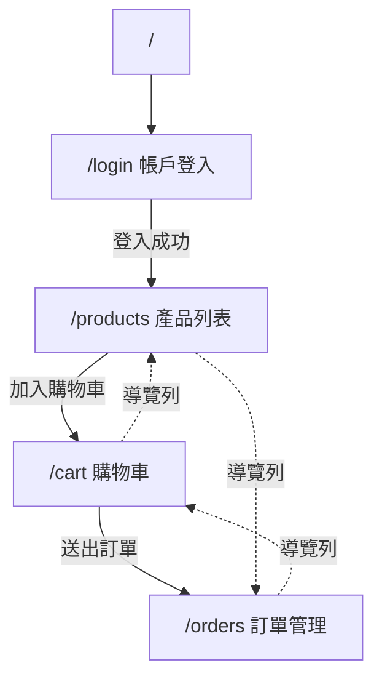
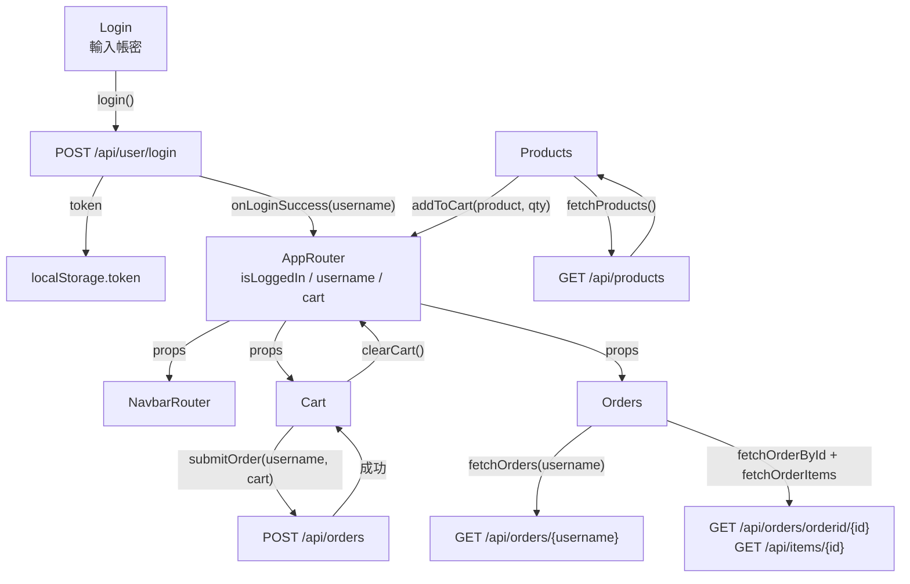

# 前端需求規格書（SRS）：usercart-react

> **專案**：簡易購物車系統 — 前端  
> **文件版本**：v1.0  
> **日期**：2026-11-04  
> **對應程式碼**：`usercart_react/usercart-react/`  
> **文件性質**：以現有程式碼為基礎的軟體需求規格書（As-Is + To-Be）  
> **相關文件**：[後端需求規格書](backend-requirements.md)｜[前端教學文件](frontend-guide.md)｜[專案總覽](README.md)

---

## 0. 文件修訂紀錄

| 版本 | 日期 | 說明 |
|------|------|------|
| v1.0 | 2026-11-04 | 初版。依 `src/` 實際元件、`apiService.js`、`vite.config.js` 與 `package.json` 整理 |

---

## 1. 文件目的與範圍

### 1.1 目的

本文件定義購物車前端的**畫面需求、互動行為、狀態管理、API 整合契約、非功能需求與驗收準則**，作為：

- UI／UX 設計與實作依據
- 前後端 API 串接的對照基準
- 測試案例與驗收清單
- 後續重構（登入狀態保存、路由守衛、loading/error 狀態）的範圍界定

### 1.2 範圍（In Scope）

| 類別 | 內容 |
|------|------|
| 導覽 | 上方導覽列與四個主要頁面路由 |
| 登入 | 帳密輸入、呼叫登入 API、保存 token |
| 產品 | 產品卡片、數量選擇、加入購物車、前端分頁 |
| 購物車 | 明細列表、刪除、總金額、送出訂單 |
| 訂單 | 訂單列表、訂單明細 |
| 狀態 | 登入狀態、使用者名稱、購物車內容 |
| 建置 | Vite 開發伺服器與 API Proxy |

### 1.3 不在範圍（Out of Scope）

- 會員註冊、第三方登入（Google／Facebook）
- 產品搜尋、分類篩選、排序
- 收藏清單、優惠券、運費計算
- 金流付款頁
- 多語系（i18n）
- PWA、離線模式
- 單元測試框架建置（目前無測試）

### 1.4 讀者對象

前端工程師、UI／UX 設計師、後端工程師、測試人員、專案負責人。

### 1.5 需求優先級定義（MoSCoW）

| 優先級 | 定義 |
|--------|------|
| **Must** | 核心購物流程，缺少即無法完成下單 |
| **Should** | 重要體驗或穩定性需求 |
| **Could** | 加分功能 |
| **Won't** | 本期明確不做 |

### 1.6 實作狀態定義

| 狀態 | 定義 |
|------|------|
| **已實作** | 程式碼存在且行為符合描述 |
| **部分實作** | 程式碼存在，但缺少錯誤處理、持久化或無障礙 |
| **未實作** | 目前沒有對應程式碼 |

---

## 2. 產品概述

### 2.1 背景

`usercart-react` 是購物車系統的 React 前端，使用 React 18 + Vite + React Router + Bootstrap 5，透過 Fetch API 呼叫 Spring Boot 後端。主要用途是讓使用者完成「登入 → 瀏覽產品 → 加入購物車 → 送出訂單 → 查看訂單」的流程。

### 2.2 目標使用者

| 角色 | 需求 |
|------|------|
| 訪客 | 瀏覽產品、了解價格 |
| 會員 | 登入後下單、查看自己的訂單 |
| 教學讀者 | 透過此專案理解 React Hooks、路由與 API 串接 |

### 2.3 設計原則

1. **元件單一職責**：每個頁面一個元件，根元件負責共享狀態。
2. **API 集中管理**：所有 `fetch` 呼叫集中在 `api/apiService.js`。
3. **沿用 Bootstrap**：不自行開發 CSS 框架。
4. **以功能優先**：教學導向，先求流程可跑通，再談體驗與安全。

### 2.4 名詞定義

| 名詞 | 說明 |
|------|------|
| 購物車（cart） | 前端記憶體中的陣列，元素為產品 + 數量 |
| 訂單（order） | 後端 `orders` 資料表的一筆主檔 |
| 明細（order item） | 後端 `orderitems` 資料表的一筆資料 |
| Token | 登入後取得的 JWT，存放於 `localStorage` |
| 登入狀態 | 前端 `isLoggedIn` state，重新整理即重置 |

---

## 3. 系統環境與技術限制

### 3.1 技術棧

| 項目 | 版本 | 用途 |
|------|------|------|
| React | 18.2 | UI 元件與狀態 |
| React DOM | 18.2 | 渲染 |
| React Router DOM | 7.x | 前端路由 |
| Vite | 7.3 | 開發伺服器與打包 |
| Bootstrap | 5.3 | 版面與樣式 |
| Fetch API | 瀏覽器原生 | 呼叫後端 |

### 3.2 執行方式

```bash
cd usercart_react/usercart-react
npm install
npm run dev      # 開發，預設 http://localhost:5173
npm run build    # 產生 dist/
npm run preview  # 預覽打包結果
```

### 3.3 API Proxy

`vite.config.js` 將 `/api` 代理到後端，避免開發時 CORS：

```js
server: {
  proxy: {
    '/api': 'http://localhost:8080'
  }
}
```

> 因此**必須先啟動後端**，且前端需以 `npm run dev` 啟動，代理才會生效。

### 3.4 技術限制

| 編號 | 限制 | 影響 |
|------|------|------|
| CON-FE-01 | 沒有 TypeScript | 欄位型別靠人工對照 |
| CON-FE-02 | 沒有狀態管理套件（Redux／Zustand） | 共享狀態以 props 傳遞 |
| CON-FE-03 | 購物車只存在記憶體 | 重新整理即清空 |
| CON-FE-04 | 登入狀態只存在 state | 重新整理即視為未登入 |
| CON-FE-05 | 沒有測試與 lint script | 品質靠人工驗證 |
| CON-FE-06 | 產品圖片依賴外部網址 | 無網路時破圖 |

---

## 4. 資訊架構與路由

### 4.1 路由表

| 路徑 | 頁面元件 | 說明 | 未登入時 |
|------|----------|------|----------|
| `/` | — | 重新導向 `/login` | 導向登入 |
| `/login` | `Login` | 帳戶登入 | 可瀏覽 |
| `/products` | `Products` | 產品列表 | 可瀏覽、可加入購物車 |
| `/cart` | `Cart` | 購物車 | 可瀏覽；送出時提示登入 |
| `/orders` | `Orders` | 訂單管理 | 顯示「請先登入！」 |
| 其他 | 無 | **未定義 404** | 只顯示導覽列與空白內容 |

### 4.2 頁面關係圖



### 4.3 元件樹

```text
main.jsx
└─ AppRouter.jsx                # 啟用中：React Router 版
   ├─ BrowserRouter
   ├─ NavbarRouter.jsx          # 導覽列
   └─ Routes
      ├─ /login    → Login.jsx
      ├─ /products → Products.jsx
      ├─ /cart     → Cart.jsx
      └─ /orders   → Orders.jsx

App.jsx                         # 未啟用：以 currentPage state 切頁的舊版根元件
Navbar.jsx                      # 未啟用：搭配 App.jsx 的導覽列
```

> `main.jsx` 目前匯入 `AppRouter`，`App.jsx` 與 `Navbar.jsx` 保留作為教學對照，**不影響實際畫面**。

---

## 5. 功能需求

### 5.1 功能需求總表

| ID | 名稱 | 優先級 | 狀態 | 對應元件 |
|----|------|--------|------|----------|
| FR-FE-01 | 全域導覽列與路由 | Must | 已實作 | `NavbarRouter`、`AppRouter` |
| FR-FE-02 | 帳密登入 | Must | 已實作 | `Login` |
| FR-FE-03 | 登入狀態保存與還原 | Must | 部分實作 | `AppRouter`、`Login` |
| FR-FE-04 | 登出 | Should | 未實作 | — |
| FR-FE-05 | 產品列表載入 | Must | 已實作 | `Products` |
| FR-FE-06 | 產品分頁 | Should | 已實作（前端分頁） | `Products` |
| FR-FE-07 | 數量選擇與加入購物車 | Must | 已實作 | `Products`、`AppRouter` |
| FR-FE-08 | 購物車檢視與刪除 | Must | 已實作 | `Cart` |
| FR-FE-09 | 購物車總金額計算 | Must | 部分實作 | `Cart`、`apiService` |
| FR-FE-10 | 送出訂單 | Must | 部分實作 | `Cart`、`apiService` |
| FR-FE-11 | 訂單列表 | Must | 已實作 | `Orders` |
| FR-FE-12 | 訂單明細 | Must | 已實作 | `Orders` |
| FR-FE-13 | 未登入保護 | Must | 部分實作 | `Cart`、`Orders` |
| FR-FE-14 | 載入／錯誤／空狀態 | Should | 部分實作 | 全部頁面 |
| FR-FE-15 | 響應式版面 | Should | 部分實作 | `NavbarRouter`、各頁 |
| FR-FE-16 | 表單可用性與無障礙 | Should | 部分實作 | `Login`、`Products` |
| FR-FE-17 | 重複商品合併 | Could | 未實作 | `AppRouter` |
| FR-FE-18 | 訂單總金額顯示 | Could | 未實作 | `Orders` |

---

### 5.2 詳細需求

#### FR-FE-01 全域導覽列與路由

| 欄位 | 內容 |
|------|------|
| 優先級 | Must |
| 狀態 | 已實作 |
| 觸發 | 應用程式載入、使用者點擊導覽連結 |
| 輸出 | 導覽列 + 對應頁面 |

**行為規格**

1. 導覽列固定在頁面上方，深色背景（`navbar-dark bg-dark`）。
2. 品牌文字「我的商城」連到 `/products`。
3. 選單項目依序為：帳戶登入（`/login`）、產品列表（`/products`）、訂單（`/orders`）、購物車（`/cart`）。
4. 目前路由的選單項目加上 `active` 樣式（`NavLink`）。
5. 導覽列右側顯示 `歡迎，{username}` 或「未登入」。
6. 進入 `/` 自動導向 `/login`。

**驗收條件**

- [ ] 點擊每個選單項目都能切換到正確頁面，且不重新整理。
- [ ] 目前頁面對應的選單項目有 `active` 樣式。
- [ ] 登入後導覽列顯示使用者名稱；未登入顯示「未登入」。
- [ ] 直接開啟 `/` 會導向 `/login`。

**已知落差**

- `navbar-expand-lg` 搭配 `collapse` 但**沒有漢堡選單按鈕**，小螢幕下選單不會展開。
- 沒有 404 路由，未知路徑只顯示空白內容。

---

#### FR-FE-02 帳密登入

| 欄位 | 內容 |
|------|------|
| 優先級 | Must |
| 狀態 | 已實作 |
| 觸發 | 使用者按下「登入」 |
| 輸入 | 帳號、密碼 |
| 輸出 | 成功：提示「登入成功！」並更新登入狀態；失敗：顯示「帳號或密碼錯誤」 |

**畫面規格**

| 元素 | 規格 |
|------|------|
| 標題 | `帳戶登入` |
| 帳號輸入框 | `type=text`、placeholder `admin`、寬度 `w-25` |
| 密碼輸入框 | `type=password`、placeholder `1234`、寬度 `w-25` |
| 登入按鈕 | Bootstrap `btn btn-primary`，文字「登入」 |
| 錯誤訊息 | 紅色文字（`text-danger`），僅在登入失敗時顯示 |

**行為規格**

1. 輸入框為受控元件，值由 `useState` 管理。
2. 點擊登入後呼叫 `login(username, password)`。
3. 成功時：
   - 將 `res.token` 寫入 `localStorage.token`
   - 呼叫 `onLoginSuccess(username, res.token)`
   - 清除錯誤訊息
   - `alert('登入成功！')`
4. 失敗時顯示「帳號或密碼錯誤」，不顯示後端原始訊息。

**業務規則**

| 編號 | 規則 |
|------|------|
| BR-FE-01 | 帳號與密碼不可為空（目前未驗證，目標需驗證） |
| BR-FE-02 | 登入成功才可寫入 token |
| BR-FE-03 | 前端不可儲存密碼 |
| BR-FE-04 | 錯誤訊息不可洩漏帳號是否存在 |

**驗收條件**

- [ ] 輸入 `admin` / `1234` 後顯示成功提示，導覽列變為「歡迎，admin」。
- [ ] 輸入錯誤密碼時顯示「帳號或密碼錯誤」，且不寫入 token。
- [ ] 重新整理後 token 仍在 `localStorage`（但登入狀態會重置，見 FR-FE-03）。
- [ ] 空白帳號或密碼按下登入時有明確提示（目標行為）。

**已知落差**

- 沒有 `<form>`，按 Enter 不會送出。
- 沒有「登入中」停用按鈕，可能重複點擊。
- 沒有 input `label`，僅靠 placeholder。

---

#### FR-FE-03 登入狀態保存與還原

| 欄位 | 內容 |
|------|------|
| 優先級 | Must |
| 狀態 | 部分實作 |
| 說明 | 目前 `isLoggedIn` 只存在 React state |

**現況行為**

| 資料 | 儲存位置 | 是否用於還原 |
|------|----------|--------------|
| `isLoggedIn` | `AppRouter` state | 否 |
| `username` | `AppRouter` state + `sessionStorage.username` | 否（未讀取） |
| `token` | `localStorage.token` | 否（未驗證） |

**目標行為**

1. 應用啟動時讀取 `localStorage.token` 與 `sessionStorage.username`。
2. 若有 token，呼叫後端驗證或解析到期時間。
3. 驗證成功則還原 `isLoggedIn=true` 與 `username`。
4. 驗證失敗則清除 token 並導向 `/login`。

**驗收條件**

- [ ] 登入後重新整理，仍保持登入狀態（目標）。
- [ ] Token 過期後重新整理，自動登出並提示（目標）。
- [ ] 登出後 `localStorage` 與 `sessionStorage` 的相關資料被清除。

---

#### FR-FE-04 登出

| 欄位 | 內容 |
|------|------|
| 優先級 | Should |
| 狀態 | 未實作 |

**目標行為**

1. 導覽列提供「登出」按鈕（僅登入後顯示）。
2. 點擊後清除 `localStorage.token`、`sessionStorage.username`、`isLoggedIn`、`username`、`cart`。
3. 導向 `/login` 並提示「已登出」。

**驗收條件**

- [ ] 登出後導覽列顯示「未登入」。
- [ ] 登出後無法送出訂單。
- [ ] 上一頁無法回到需登入的頁面狀態。

---

#### FR-FE-05 產品列表載入

| 欄位 | 內容 |
|------|------|
| 優先級 | Must |
| 狀態 | 已實作 |
| 觸發 | 進入 `/products` |
| 輸入 | 無 |
| 輸出 | 產品卡片清單 |

**行為規格**

1. 元件掛載時呼叫 `fetchProducts()`（`GET /api/products`）。
2. 成功後將產品存入 `products` state。
3. 為每個產品初始化數量為 `1`（以 `product.id` 為 key）。
4. 每張卡片顯示：名稱、圖片、價格、數量輸入框、加入購物車按鈕。
5. 卡片以 `col-md-3` 排列，每列 4 張。

**驗收條件**

- [ ] 進入頁面後自動載入 20 筆產品。
- [ ] 每張卡片顯示名稱、圖片、價格。
- [ ] 圖片載入失敗時不影響其他卡片（目標：顯示替代圖）。
- [ ] API 失敗時顯示錯誤訊息（目標）。

**已知落差**

- 沒有 `catch`，API 失敗會產生未處理的 Promise rejection。
- 沒有 loading 狀態，載入期間畫面空白。
- 沒有顯示分類、描述、評分。

---

#### FR-FE-06 產品分頁

| 欄位 | 內容 |
|------|------|
| 優先級 | Should |
| 狀態 | 已實作（前端分頁） |
| 規則 | 每頁 4 筆，依回傳順序顯示 |

**行為規格**

1. `perPage = 4`，`totalPages = Math.ceil(products.length / 4)`。
2. 以 `slice` 取出當前頁資料。
3. 顯示「上一頁」、頁碼按鈕、「下一頁」。
4. 第一頁時「上一頁」停用；最後一頁時「下一頁」停用。
5. 目前頁碼按鈕加上 `active` 樣式。
6. 只有一頁時不顯示分頁列。

**驗收條件**

- [ ] 20 筆產品顯示 5 頁，每頁 4 筆。
- [ ] 點擊頁碼切換到正確資料。
- [ ] 第一頁與最後一頁的按鈕正確停用。
- [ ] 切換頁面不會重新呼叫 API（目標可維持，或改為伺服器分頁）。

---

#### FR-FE-07 數量選擇與加入購物車

| 欄位 | 內容 |
|------|------|
| 優先級 | Must |
| 狀態 | 已實作 |
| 觸發 | 使用者調整數量後按「加入購物車」 |
| 輸入 | 產品物件、數量 |
| 輸出 | 購物車新增一筆、提示訊息 |

**行為規格**

1. 數量輸入框為 `type=number`、`min=1`、預設 `1`。
2. 變更數量時更新 `quantities[productId]`。
3. 點擊加入後呼叫 `addToCart(product, quantity)`。
4. 根元件以 `setCart(prev => [...prev, { ...product, quantity: Number(quantity) }])` 新增。
5. 顯示 `alert('已將 {title} 加入購物車')`。

**業務規則**

| 編號 | 規則 |
|------|------|
| BR-FE-05 | 數量必須為正整數 |
| BR-FE-06 | 加入購物車不需登入 |
| BR-FE-07 | 同一產品重複加入應合併數量（目標；目前會產生多筆） |

**驗收條件**

- [ ] 數量改為 3 後加入，購物車顯示數量 3。
- [ ] 加入後出現提示訊息。
- [ ] 數量為 0 或負數時被阻擋（目標）。
- [ ] 同產品重複加入時合併為一筆（目標）。

---

#### FR-FE-08 購物車檢視與刪除

| 欄位 | 內容 |
|------|------|
| 優先級 | Must |
| 狀態 | 已實作 |
| 觸發 | 進入 `/cart` |
| 輸出 | 購物車明細、總金額、送出按鈕 |

**行為規格**

1. 標題「購物車」。
2. 空購物車顯示「購物車是空的」。
3. 每筆顯示：產品名稱、單價、數量、刪除按鈕。
4. 刪除按鈕依索引移除該筆（`removeFromCart(index)`）。
5. 下方顯示總金額。
6. 最下方顯示「送出訂單」按鈕。

**驗收條件**

- [ ] 空購物車顯示「購物車是空的」，總金額為 0。
- [ ] 刪除某筆後，該筆消失且總金額同步更新。
- [ ] 多筆相同產品可分別刪除（現況）。
- [ ] 重新整理後購物車清空（現況限制）。

**已知落差**

- 使用陣列索引作為 `key`，刪除後可能造成 React 重用錯誤。
- 空購物車時「送出訂單」仍可點擊。

---

#### FR-FE-09 購物車總金額計算

| 欄位 | 內容 |
|------|------|
| 優先級 | Must |
| 狀態 | 部分實作 |
| 規則 | `total = Σ(item.price × item.quantity)` |

**行為規格**

1. `Cart` 以 `reduce` 計算總金額並顯示。
2. `submitOrder` 再以相同公式計算一次並放入 `totalPrice`。

**業務規則**

| 編號 | 規則 |
|------|------|
| BR-FE-08 | 總金額應顯示至小數點後兩位（目標） |
| BR-FE-09 | 計算結果僅供顯示；正式金額仍應由後端計算 |
| BR-FE-10 | 數量變更後總金額必須即時更新 |

**驗收條件**

- [ ] 2 筆商品（109.95 × 1 + 22.3 × 1）顯示 132.25（目標顯示格式）。
- [ ] 刪除商品後總金額正確減少。
- [ ] 數量改變後總金額正確增加。

**已知落差**

- 使用 JavaScript 浮點數，可能出現 `132.24999999999997`。
- 後端 `productPrice` 為整數，送出後小數被截斷，前後端金額不一致。

---

#### FR-FE-10 送出訂單

| 欄位 | 內容 |
|------|------|
| 優先級 | Must |
| 狀態 | 部分實作 |
| 觸發 | 使用者按下「送出訂單」 |
| 輸入 | `username`、`cart` |
| 輸出 | 成功：提示「訂單已送出！」並清空購物車；失敗：提示「送出訂單失敗」 |

**行為規格**

1. 若 `isLoggedIn` 為 false，顯示 `alert('請先登入！')` 並中止。
2. 呼叫 `submitOrder(username, cart)`。
3. `submitOrder` 組合以下 JSON：

```json
{
  "username": "admin",
  "totalPrice": 132.25,
  "items": [
    {
      "pid": 1,
      "productTitle": "Fjallraven - Foldsack No. 1 Backpack, Fits 15 Laptops",
      "productPrice": 109.95,
      "quantity": 1
    }
  ]
}
```

4. 請求帶 `Authorization: Bearer <localStorage.token>`。
5. 成功後提示並呼叫 `clearCart()`。
6. 失敗後提示「送出訂單失敗」。

**業務規則**

| 編號 | 規則 |
|------|------|
| BR-FE-11 | 未登入不可送出 |
| BR-FE-12 | 空購物車不可送出（目標） |
| BR-FE-13 | 送出期間按鈕應停用，避免重複下單（目標） |
| BR-FE-14 | 成功後才可清空購物車 |
| BR-FE-15 | 金額與品項需與畫面一致 |

**驗收條件**

- [ ] 未登入按送出顯示「請先登入！」且不發送請求。
- [ ] 登入後送出成功，購物車清空。
- [ ] 後端失敗時顯示錯誤且購物車保留。
- [ ] 空購物車按送出時被阻擋（目標）。
- [ ] 連續點擊只產生一筆訂單（目標）。

**已知落差**

- 空購物車仍會送出 `items: []`，後端會建立 0 元訂單。
- 沒有二次確認（confirm）。
- 沒有 loading／停用狀態。
- 錯誤訊息沒有區分 401、400、500。

---

#### FR-FE-11 訂單列表

| 欄位 | 內容 |
|------|------|
| 優先級 | Must |
| 狀態 | 已實作 |
| 觸發 | 進入 `/orders` 且已登入 |
| 輸入 | `username` |
| 輸出 | 訂單列表 |

**行為規格**

1. 若未登入，顯示紅字「請先登入！」。
2. 已登入時於 `useEffect` 呼叫 `fetchOrders(username)`。
3. 表頭欄位：訂單編號、訂單用戶、訂單時間、操作。
4. 每列顯示 `id`、`username`、`orderTime`、按鈕「顯示訂購商品」。
5. 載入失敗時**靜默忽略**（`catch(() => {})`）。

**驗收條件**

- [ ] `admin` 登入後看到 2 筆種子訂單。
- [ ] 每筆顯示編號、用戶、時間與操作按鈕。
- [ ] 未登入時顯示「請先登入！」且不呼叫 API。
- [ ] 載入失敗時顯示錯誤訊息（目標）。
- [ ] 無訂單時顯示「目前沒有訂單」（目標）。

**已知落差**

- 沒有顯示總金額。
- `orderTime` 直接顯示 ISO 字串，未本地化。
- 沒有 loading／空資料狀態。
- 錯誤被吞掉，使用者不知道發生什麼事。

---

#### FR-FE-12 訂單明細

| 欄位 | 內容 |
|------|------|
| 優先級 | Must |
| 狀態 | 已實作 |
| 觸發 | 點擊「顯示訂購商品」 |
| 輸入 | `orderId` |
| 輸出 | 該訂單的明細表格 |

**行為規格**

1. 以 `Promise.all` 同時呼叫：
   - `fetchOrderById(orderId)` → `GET /api/orders/orderid/{orderId}`
   - `fetchOrderItems(orderId)` → `GET /api/items/{orderId}`
2. 將結果存入 `selectedOrder` 與 `orderItems`。
3. 顯示標題「商品明細（訂單 #{id}）」。
4. 表頭：產品編號、產品名稱、產品價格、數量。
5. 每列顯示 `pid`、`productTitle`、`productPrice`、`quantity`。

**驗收條件**

- [ ] 點擊訂單 1 顯示 3 筆明細。
- [ ] 明細欄位與後端回傳一致。
- [ ] 切換不同訂單時明細同步更新。
- [ ] 其中一個 API 失敗時顯示錯誤（目標）。

**已知落差**

- 沒有 `try/catch`，失敗會產生未處理的 Promise rejection。
- 明細 `key` 使用索引。
- 沒有顯示小計（單價 × 數量）。

---

#### FR-FE-13 未登入保護

| 欄位 | 內容 |
|------|------|
| 優先級 | Must |
| 狀態 | 部分實作 |
| 說明 | 目前只有「提示」與「按鈕阻擋」，沒有路由守衛 |

**現況行為**

| 頁面 | 未登入行為 |
|------|------------|
| `/products` | 可瀏覽、可加入購物車 |
| `/cart` | 可瀏覽；送出時提示「請先登入！」 |
| `/orders` | 顯示「請先登入！」 |

**目標行為**

1. 以 `<ProtectedRoute>` 包裝 `/orders`（必要時 `/cart`）。
2. 未登入時導向 `/login`，並記錄原本要前往的路徑。
3. 登入成功後導回原路徑。

**驗收條件**

- [ ] 未登入直接輸入 `/orders` 會被導向 `/login`（目標）。
- [ ] 登入後自動回到原本想去的頁面（目標）。
- [ ] 未登入仍可瀏覽產品（維持）。

---

#### FR-FE-14 載入／錯誤／空狀態

| 欄位 | 內容 |
|------|------|
| 優先級 | Should |
| 狀態 | 部分實作 |

**需求**

| 頁面 | Loading | Error | Empty |
|------|---------|-------|-------|
| 產品列表 | 未實作 | 未實作 | 未實作 |
| 購物車 | 不需要 | 未實作 | 已實作（文字） |
| 訂單列表 | 未實作 | 靜默失敗 | 未實作 |
| 訂單明細 | 未實作 | 未實作 | 未實作 |

**驗收條件**

- [ ] API 請求期間顯示「載入中…」或 spinner。
- [ ] API 失敗時顯示可理解的錯誤訊息與重試按鈕。
- [ ] 空資料時顯示友善文字，而不是空白。

---

#### FR-FE-15 響應式版面

| 欄位 | 內容 |
|------|------|
| 優先級 | Should |
| 狀態 | 部分實作 |

**需求**

1. 桌機（≥ 992px）：產品每列 4 張（`col-md-3`）。
2. 平板（768–991px）：每列 2～3 張。
3. 手機（< 768px）：每列 1 張。
4. 導覽列在手機上可展開／收合。
5. 表格在手機上可橫向捲動或改為卡片式。

**驗收條件**

- [ ] 360px 寬度下無水平溢出。
- [ ] 手機可操作導覽列所有連結（目標）。
- [ ] 訂單表格在手機上仍可閱讀。

**已知落差**

- 導覽列缺少漢堡選單按鈕。
- 訂單以 `row` + `col-md-3` 模擬表格，手機上會擠成單欄，尚可閱讀但無表頭對齊。

---

#### FR-FE-16 表單可用性與無障礙

| 欄位 | 內容 |
|------|------|
| 優先級 | Should |
| 狀態 | 部分實作 |

**需求**

1. 每個輸入框都有對應 `<label>`（可用 `visually-hidden`）。
2. 錯誤訊息以 `role="alert"` 或 `aria-live` 宣告。
3. 所有互動元素可用鍵盤操作。
4. 圖片有 `alt`（目前已符合）。
5. 色彩對比符合 WCAG AA。
6. 不以顏色作為唯一狀態提示。

**驗收條件**

- [ ] 使用 Tab 可依序完成登入。
- [ ] 螢幕閱讀器可讀出輸入框用途。
- [ ] 錯誤訊息會被輔助技術朗讀（目標）。

---

#### FR-FE-17 重複商品合併

| 欄位 | 內容 |
|------|------|
| 優先級 | Could |
| 狀態 | 未實作 |
| 說明 | 目前每次加入都會新增一列 |

**目標行為**：加入購物車時，若 `pid` 已存在，則累加數量而非新增一列。

**驗收條件**

- [ ] 同產品加入兩次（數量 1 + 2）後，購物車只有一列且數量為 3。

---

#### FR-FE-18 訂單總金額顯示

| 欄位 | 內容 |
|------|------|
| 優先級 | Could |
| 狀態 | 未實作 |
| 說明 | 後端回傳 `totalPrice`，但訂單列表未顯示 |

**驗收條件**

- [ ] 訂單列表新增「總金額」欄位並顯示 `order.totalPrice`。

---

## 6. 頁面規格

### 6.1 `/login` 帳戶登入頁

| 項目 | 規格 |
|------|------|
| 目的 | 取得 JWT 並建立登入狀態 |
| 版面 | 標題 + 兩個輸入框 + 按鈕 + 錯誤訊息，垂直排列 |
| 主要元件 | `Login` |
| 狀態 | `username`、`password`、`errorMsg` |
| API | `POST /api/user/login` |
| 成功 | 儲存 token、更新全域狀態、alert |
| 失敗 | 顯示錯誤訊息 |

### 6.2 `/products` 產品列表頁

| 項目 | 規格 |
|------|------|
| 目的 | 瀏覽產品並加入購物車 |
| 版面 | 卡片格狀（`row` + `col-md-3`）+ 分頁列 |
| 主要元件 | `Products` |
| 狀態 | `products`、`quantities`、`currentPage` |
| API | `GET /api/products` |
| 互動 | 數量輸入、加入購物車、分頁切換 |
| 空狀態 | 未實作 |

### 6.3 `/cart` 購物車頁

| 項目 | 規格 |
|------|------|
| 目的 | 確認品項與金額並送出訂單 |
| 版面 | 明細清單（`list-group`）+ 總金額 + 送出按鈕 |
| 主要元件 | `Cart` |
| 狀態 | 由根元件傳入 `cart`、`isLoggedIn`、`username` |
| API | `POST /api/orders` |
| 互動 | 刪除品項、送出訂單 |
| 空狀態 | 「購物車是空的」 |

### 6.4 `/orders` 訂單管理頁

| 項目 | 規格 |
|------|------|
| 目的 | 查看歷史訂單與明細 |
| 版面 | 訂單列表 + 明細區塊 |
| 主要元件 | `Orders` |
| 狀態 | `orders`、`selectedOrder`、`orderItems` |
| API | `GET /api/orders/{username}`、`GET /api/orders/orderid/{id}`、`GET /api/items/{id}` |
| 互動 | 顯示明細 |
| 未登入 | 「請先登入！」 |
| 空狀態 | 未實作 |

---

## 7. 狀態管理與資料流

### 7.1 全域狀態（AppRouter）

| 狀態 | 型別 | 初始值 | 用途 | 生命週期 |
|------|------|--------|------|----------|
| `isLoggedIn` | boolean | `false` | 是否已登入 | 重新整理重置 |
| `username` | string | `''` | 目前使用者 | 重新整理重置 |
| `cart` | array | `[]` | 購物車品項 | 重新整理清空 |

### 7.2 元件區域狀態

| 元件 | 狀態 | 用途 |
|------|------|------|
| `Login` | `username`、`password`、`errorMsg` | 表單輸入與錯誤 |
| `Products` | `products`、`quantities`、`currentPage` | 產品資料、數量、分頁 |
| `Orders` | `orders`、`selectedOrder`、`orderItems` | 訂單與明細 |

### 7.3 資料流圖



### 7.4 持久化策略

| 資料 | 儲存位置 | 現況 | 建議 |
|------|----------|------|------|
| Token | `localStorage` | 寫入但不讀取 | 啟動時讀取並驗證 |
| 使用者名稱 | `sessionStorage` | 寫入但不讀取 | 啟動時還原 |
| 登入狀態 | React state | 不持久化 | 由 token 推導 |
| 購物車 | React state | 不持久化 | 可存 `localStorage` 或後端 |

---

## 8. API 整合規格

### 8.1 `apiService.js` 函式對照

| 函式 | 方法 | 路徑 | 認證 | 成功回傳 | 失敗處理 |
|------|------|------|------|----------|----------|
| `login(username, password)` | POST | `/api/user/login` | 否 | `{ token }` | 丟出「帳號或密碼錯誤」 |
| `fetchProducts()` | GET | `/api/products` | 否 | 產品陣列 | 丟出「載入產品失敗」 |
| `fetchOrders(username)` | GET | `/api/orders/{username}` | 帶 token | 訂單陣列 | 丟出「載入訂單失敗」 |
| `fetchOrderById(orderId)` | GET | `/api/orders/orderid/{orderId}` | 帶 token | 訂單物件 | 丟出「載入訂單詳情失敗」 |
| `fetchOrderItems(orderId)` | GET | `/api/items/{orderId}` | 帶 token | 明細陣列 | 丟出「載入商品明細失敗」 |
| `submitOrder(username, cart)` | POST | `/api/orders` | 帶 token | 訂單物件 | 丟出「送出訂單失敗」 |

### 8.2 共通請求標頭

```js
{
  'Content-Type': 'application/json',
  'Authorization': `Bearer ${localStorage.getItem('token')}`
}
```

> 未登入時 `localStorage.getItem('token')` 為 `null`，會送出 `Bearer null`。目標版本應在無 token 時不帶此標頭。

### 8.3 欄位對照（送出訂單）

| 前端購物車欄位 | 後端 `OrderItem` 欄位 | 轉換 |
|----------------|----------------------|------|
| `item.id` | `pid` | 直接對應 |
| `item.title` | `productTitle` | 直接對應 |
| `item.price` | `productPrice` | 後端轉整數（會截斷小數） |
| `item.quantity` | `quantity` | `Number()` 轉換 |
| `Σ(price × quantity)` | `totalPrice` | 前端計算 |
| `username` | `username` | 來自全域狀態 |

### 8.4 與後端契約的差異

| 項目 | 前端期待 | 後端現況 | 影響 |
|------|----------|----------|------|
| 登入回傳 | `{ token }` | `{ token }` | 一致 |
| 產品欄位 | `id/title/image/price` | 皆有回傳 | 一致 |
| 訂單時間 | 可讀字串 | ISO 字串 | 直接顯示不友善 |
| 查無訂單 | `404` | `200 null` | 前端會誤判成功 |
| 錯誤格式 | 固定訊息 | 不統一 | 難以顯示具體原因 |
| 金額精度 | 小數 | 整數 | 金額不一致 |
| 授權 | 帶 token | GET 不驗證 | 安全落差 |

---

## 9. UI／UX 需求

### 9.1 視覺規範

| 項目 | 規範 |
|------|------|
| 框架 | Bootstrap 5.3 |
| 導覽列 | `navbar-dark bg-dark` |
| 主要按鈕 | `btn btn-primary` |
| 成功按鈕 | `btn btn-success` |
| 危險按鈕 | `btn btn-danger` |
| 內容容器 | `container mt-4` |
| 產品卡片 | `card mb-3` + `col-md-3` |

### 9.2 回饋訊息

| 情境 | 方式 | 現況 |
|------|------|------|
| 登入成功 | `alert` | 已實作 |
| 登入失敗 | 行內紅字 | 已實作 |
| 加入購物車 | `alert` | 已實作 |
| 未登入下單 | `alert` | 已實作 |
| 下單成功／失敗 | `alert` | 已實作 |
| API 載入中 | 無 | 未實作 |
| API 失敗 | 多數無 | 部分實作 |

> 目標：以 Toast 或行內提示取代 `alert`，避免阻斷操作。

### 9.3 文案規範

| 位置 | 文案 |
|------|------|
| 品牌 | 我的商城 |
| 導覽 | 帳戶登入／產品列表／訂單／購物車 |
| 登入標題 | 帳戶登入 |
| 產品標題 | 產品列表 |
| 購物車標題 | 購物車 |
| 訂單標題 | 訂單管理 |
| 空購物車 | 購物車是空的 |
| 未登入 | 請先登入！ |

---

## 10. 非功能需求

| ID | 類別 | 需求 | 目標值／說明 | 現況 |
|----|------|------|--------------|------|
| NFR-FE-01 | 效能 | 首次載入 | 3 秒內可互動（本機） | 大致符合 |
| NFR-FE-02 | 效能 | 路由切換 | < 100 ms | 符合 |
| NFR-FE-03 | 效能 | 產品分頁 | 資料量大時改伺服器分頁 | 前端分頁 |
| NFR-FE-04 | 相容性 | 支援 Chrome／Edge／Firefox／Safari 最新版 | ES2020+ | 符合 |
| NFR-FE-05 | 相容性 | 最小寬度 360px | 無水平溢出 | 部分符合 |
| NFR-FE-06 | 可用性 | 所有 API 有 loading／error 回饋 | 使用者知道發生什麼事 | 未符合 |
| NFR-FE-07 | 可用性 | 破壞性操作需確認 | 刪除、送出訂單 | 未符合 |
| NFR-FE-08 | 可用性 | 防止重複送出 | 按鈕停用 | 未符合 |
| NFR-FE-09 | 無障礙 | 表單有 label、錯誤可朗讀 | WCAG AA | 部分符合 |
| NFR-FE-10 | 安全性 | Token 不放在 URL | 僅 localStorage | 符合 |
| NFR-FE-11 | 安全性 | 不在前端儲存密碼 | 登入後即丟棄 | 符合 |
| NFR-FE-12 | 安全性 | 正式環境使用 HTTPS | 避免 token 被攔截 | 未涵蓋 |
| NFR-FE-13 | 可維護性 | API 呼叫集中管理 | 已集中於 `apiService.js` | 符合 |
| NFR-FE-14 | 可維護性 | 元件命名與結構一致 | PascalCase、單一職責 | 符合 |
| NFR-FE-15 | 可測試性 | 具備測試與 lint | Vitest + ESLint | 未實作 |
| NFR-FE-16 | 可部署性 | `npm run build` 可產出靜態檔 | `dist/` | 符合 |

---

## 11. 前後端契約對照

| 前端需求 | 後端需求 | API | 備註 |
|----------|----------|-----|------|
| FR-FE-02 登入 | FR-BE-01 | `POST /api/user/login` | 取得 JWT |
| FR-FE-03 狀態還原 | FR-BE-02 | 需新增驗證端點或解析 token | 目前無 |
| FR-FE-05 產品列表 | FR-BE-03 | `GET /api/products` | 一次取全部 |
| FR-FE-10 送出訂單 | FR-BE-04 | `POST /api/orders` | 金額與身分待修正 |
| FR-FE-11 訂單列表 | FR-BE-05 | `GET /api/orders/{username}` | 需授權 |
| FR-FE-12 訂單明細 | FR-BE-07、FR-BE-08 | `GET /api/orders/orderid/{id}`、`GET /api/items/{id}` | 可合併為單一 API |
| FR-FE-13 未登入保護 | FR-BE-02 | — | 前端路由守衛 |
| FR-FE-04 登出 | FR-BE-11 | — | 前端清除 token |

---

## 12. 驗收準則與測試案例

| ID | 測試案例 | 前置條件 | 步驟 | 預期結果 |
|----|----------|----------|------|----------|
| TC-FE-01 | 預設導向 | 後端已啟動 | 開啟 `http://localhost:5173/` | 導向 `/login` |
| TC-FE-02 | 登入成功 | 帳號 `admin/1234` | 輸入帳密後按登入 | 顯示成功、導覽列顯示 `admin`、`localStorage.token` 有值 |
| TC-FE-03 | 登入失敗 | — | 輸入 `admin/wrong` | 顯示「帳號或密碼錯誤」、無 token |
| TC-FE-04 | 空白登入 | — | 不輸入直接按登入 | 顯示驗證提示（目標） |
| TC-FE-05 | 產品載入 | 已登入 | 點「產品列表」 | 顯示 4 張卡片、共 5 頁 |
| TC-FE-06 | 分頁切換 | 產品已載入 | 點第 2 頁 | 顯示第 5～8 筆產品 |
| TC-FE-07 | 加入購物車 | 產品已載入 | 數量改 2，按加入 | 提示成功，購物車出現該商品 ×2 |
| TC-FE-08 | 重複加入 | 購物車已有商品 | 同商品再加入 | 目前新增一列（目標：合併數量） |
| TC-FE-09 | 刪除品項 | 購物車有 2 筆 | 刪除第 1 筆 | 只剩 1 筆，總金額更新 |
| TC-FE-10 | 空車送出 | 購物車為空、已登入 | 按送出訂單 | 應阻擋（目標）；目前會建立 0 元訂單 |
| TC-FE-11 | 未登入送出 | 未登入、購物車有商品 | 按送出訂單 | 顯示「請先登入！」，不發請求 |
| TC-FE-12 | 送出成功 | 已登入、購物車有商品 | 按送出訂單 | 提示成功、購物車清空、後端新增訂單 |
| TC-FE-13 | 訂單列表 | 以 `admin` 登入 | 進入訂單頁 | 顯示 2 筆訂單 |
| TC-FE-14 | 訂單明細 | 訂單列表已載入 | 點訂單 1 的「顯示訂購商品」 | 顯示 3 筆明細 |
| TC-FE-15 | 未登入訂單頁 | 未登入 | 進入 `/orders` | 顯示「請先登入！」 |
| TC-FE-16 | 重新整理 | 已登入 | 按 F5 | 目前變成未登入（目標：保持登入） |
| TC-FE-17 | 後端離線 | 後端未啟動 | 進入產品頁 | 目前無提示（目標：顯示錯誤） |
| TC-FE-18 | 手機版面 | 360px 寬 | 開啟網站 | 無水平溢出、導覽可操作（目標） |

### 12.1 測試資料

| 帳號 | 密碼 | 預期訂單數 |
|------|------|------------|
| `admin` | `1234` | 2 |
| `guest` | `1234` | 0 |
| `mary` | `1234` | 0 |
| `george` | `1234` | 0 |
| `john` | `1234` | 0 |

---

## 13. 現況落差與改善建議（Gap Analysis）

| 編號 | 落差 | 影響 | 建議 | 優先級 |
|------|------|------|------|--------|
| GAP-FE-01 | 重新整理即登出 | 使用體驗差 | 啟動時讀取 token 並驗證 | 高 |
| GAP-FE-02 | 無路由守衛 | 未登入可直接進入訂單頁 | `ProtectedRoute` | 高 |
| GAP-FE-03 | 空購物車可送出 | 產生 0 元訂單 | 停用按鈕＋前端驗證 | 高 |
| GAP-FE-04 | 無 loading／error | 使用者不知系統狀態 | 加入狀態與重試 | 高 |
| GAP-FE-05 | 金額浮點誤差與後端截斷 | 金額不一致 | 前端顯示格式化、後端 `BigDecimal` | 高 |
| GAP-FE-06 | 無重複送出防護 | 可能重複下單 | 送出中停用按鈕 | 高 |
| GAP-FE-07 | 同商品重複加入 | 購物車凌亂 | 以 `pid` 合併數量 | 中 |
| GAP-FE-08 | 無登出 | 無法切換帳號 | 導覽列加登出 | 中 |
| GAP-FE-09 | 導覽列手機無法展開 | 手機無法導覽 | 加 `navbar-toggler` | 中 |
| GAP-FE-10 | 無 404 頁 | 錯誤路徑空白 | 加 catch-all route | 中 |
| GAP-FE-11 | 訂單時間未格式化 | 不易閱讀 | `Intl.DateTimeFormat` | 中 |
| GAP-FE-12 | 錯誤訊息被吞掉 | 難以排查 | 統一錯誤處理 | 中 |
| GAP-FE-13 | 使用 `alert` | 阻斷操作 | Toast／行內提示 | 低 |
| GAP-FE-14 | 表單缺 label | 無障礙不足 | 補 `label`／`aria` | 低 |
| GAP-FE-15 | 無測試與 lint | 回歸風險 | Vitest + ESLint | 低 |
| GAP-FE-16 | `Bearer null` | 無效標頭 | 無 token 時不帶 | 低 |
| GAP-FE-17 | 使用索引作為 key | 刪除時畫面可能錯亂 | 使用穩定 id | 低 |

---

## 14. 需求追溯表

| 需求 | 程式碼位置 | 測試案例 |
|------|------------|----------|
| FR-FE-01 | `AppRouter.jsx`、`NavbarRouter.jsx` | TC-FE-01、05、13、15 |
| FR-FE-02 | `Login.jsx`、`apiService.login` | TC-FE-02、03、04 |
| FR-FE-03 | `AppRouter.jsx`（state）、`Login.jsx`（storage） | TC-FE-16 |
| FR-FE-04 | 未實作 | — |
| FR-FE-05 | `Products.jsx`、`apiService.fetchProducts` | TC-FE-05、17 |
| FR-FE-06 | `Products.jsx`（`perPage`、`slice`） | TC-FE-06 |
| FR-FE-07 | `Products.jsx`、`AppRouter.addToCart` | TC-FE-07、08 |
| FR-FE-08 | `Cart.jsx`、`AppRouter.removeFromCart` | TC-FE-09 |
| FR-FE-09 | `Cart.jsx`（reduce）、`apiService.submitOrder` | TC-FE-12 |
| FR-FE-10 | `Cart.jsx`、`apiService.submitOrder` | TC-FE-10、11、12 |
| FR-FE-11 | `Orders.jsx`、`apiService.fetchOrders` | TC-FE-13 |
| FR-FE-12 | `Orders.jsx`、`apiService.fetchOrderById/fetchOrderItems` | TC-FE-14 |
| FR-FE-13 | `Cart.jsx`、`Orders.jsx` | TC-FE-11、15 |
| FR-FE-14 | 各元件 | TC-FE-17 |
| FR-FE-15 | `NavbarRouter.jsx`、各頁 Bootstrap grid | TC-FE-18 |

---

## 15. 附錄

### 15.1 檔案結構

```text
usercart_react/usercart-react/
├─ package.json
├─ vite.config.js
├─ index.html
└─ src/
   ├─ main.jsx                 # 進入點，掛載 AppRouter
   ├─ AppRouter.jsx            # 啟用中的根元件
   ├─ App.jsx                  # 未啟用的舊版根元件
   ├─ api/
   │  └─ apiService.js         # API 封裝
   └─ components/
      ├─ NavbarRouter.jsx      # 啟用中的導覽列
      ├─ Navbar.jsx            # 未啟用的舊版導覽列
      ├─ Login.jsx
      ├─ Products.jsx
      ├─ Cart.jsx
      └─ Orders.jsx
```

### 15.2 部署方式

| 方式 | 步驟 |
|------|------|
| 開發 | `npm run dev`，依賴 Vite Proxy |
| 靜態部署 | `npm run build`，將 `dist/` 部署到任意靜態伺服器，並設定 `/api` 反向代理到後端 |
| 與後端同源 | 將 `dist/` 內容複製到 `shoppingusercart/src/main/resources/static/`，由 Spring Boot 提供 |

> 目前後端 `static/` 下已有與 `dist/` 同名的 `assets/index-*.js`、`index-*.css`，即為此種部署方式的痕跡。

### 15.3 與後端文件的對應

本文件第 8 章的 API 契約與 **[後端需求規格書](backend-requirements.md)** 第 6 章一一對應；若兩份文件有衝突，以後端實際回應與雙方確認後的規格為準。

---

> 本文件描述的是「以現況程式碼為基礎的需求」。標示「目標」的項目代表尚未實作，實作前需經專案負責人確認優先級。
